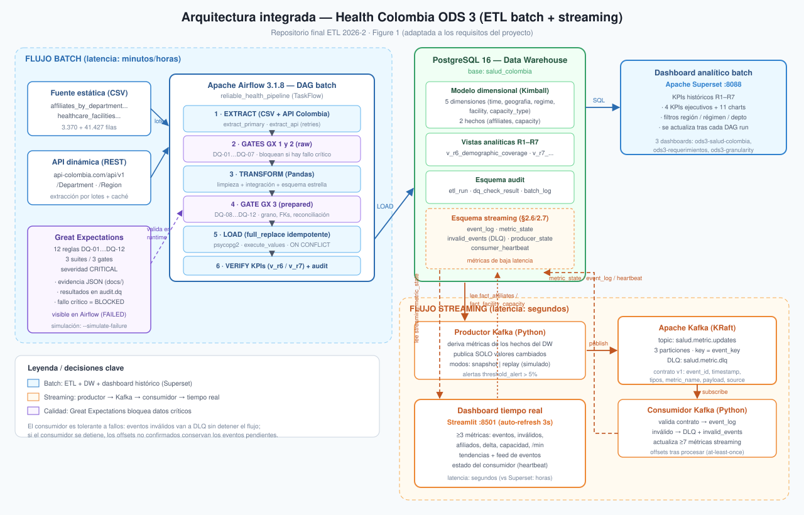
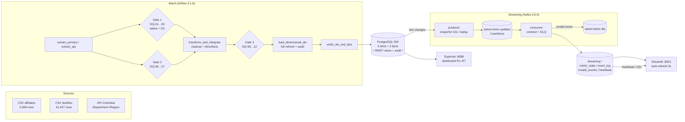
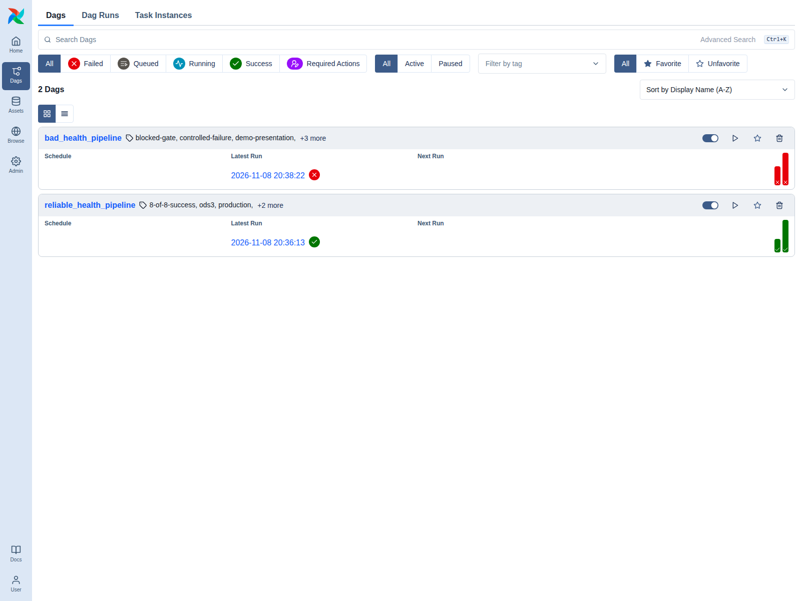
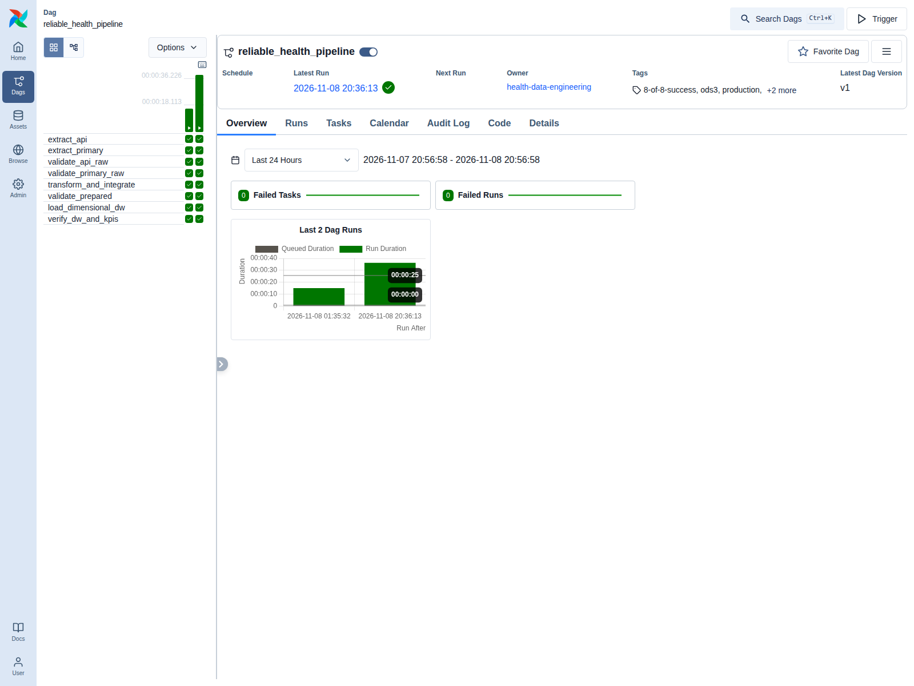
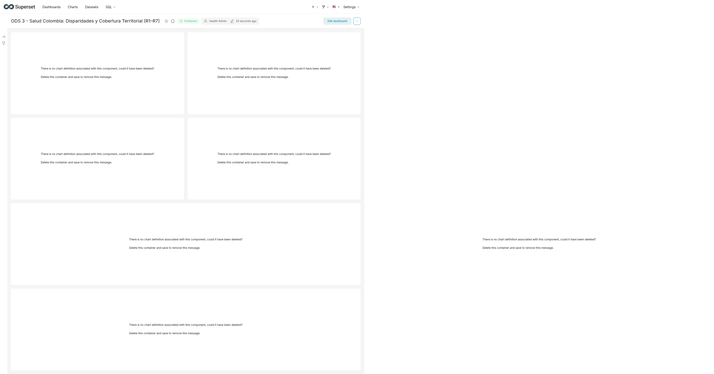
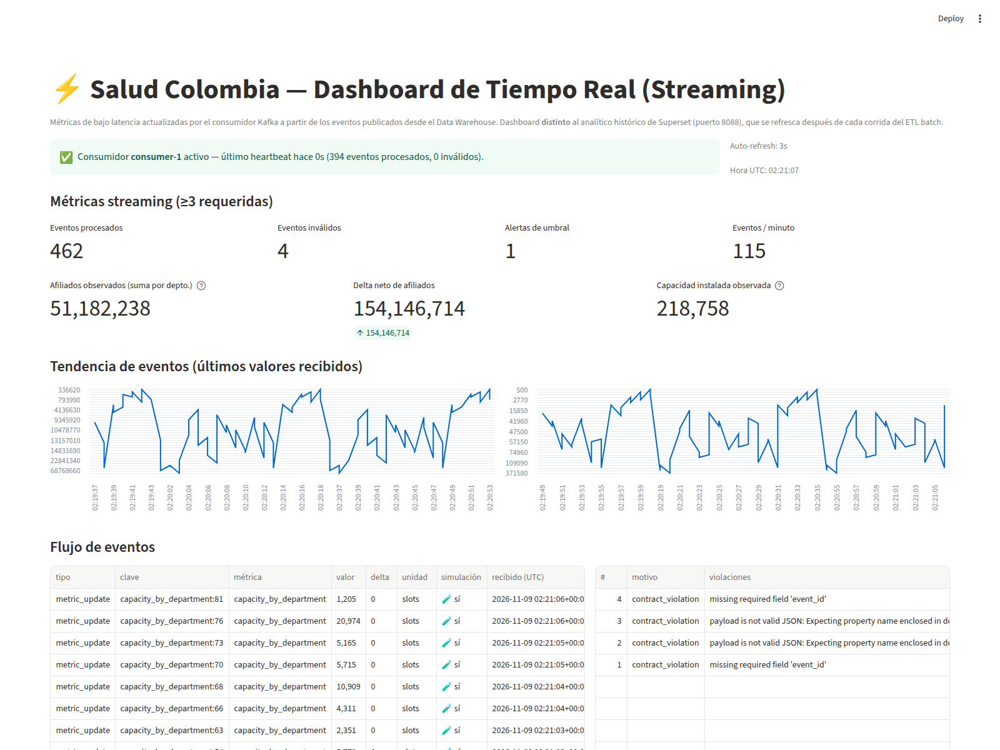
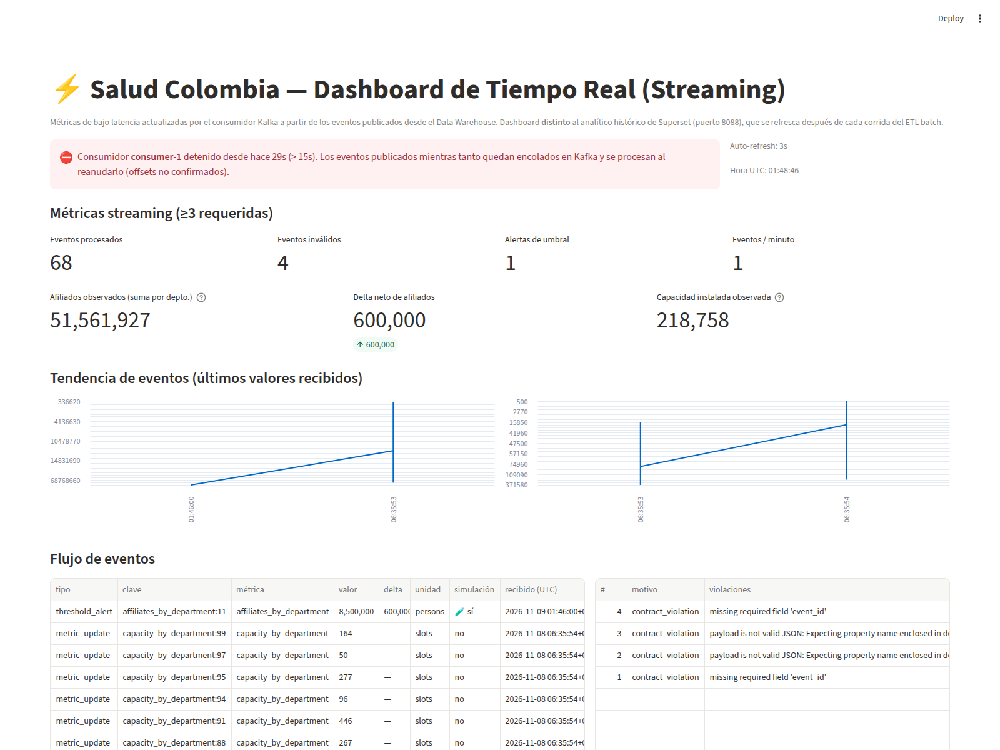
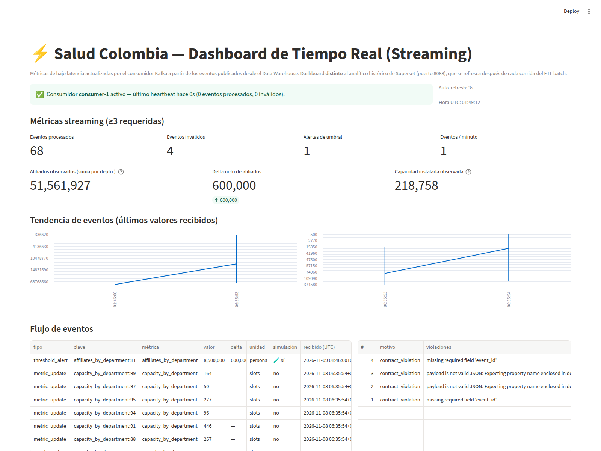

# etl-2026-2-ods3-salud-api-gx-airflow-streaming-kafka-

> 📄 **Spanish version:** [README_ES.md](README_ES.md) · This documentation in English: `README.md`

**Health Colombia — SDG 3 (Good health and well-being):** an integrated batch + streaming ETL
project. Ingests static datasets and a dynamic API, orchestrates the ETL with **Apache
Airflow**, validates data quality with **Great Expectations**, loads a **dimensional Data
Warehouse** in PostgreSQL, delivers historical analytics in **Apache Superset**, and runs a
**Kafka** pipeline (producer/consumer, event contract) with a **real-time dashboard in
Streamlit**.

| Component | Technology | URL / port |
|---|---|---|
| Data Warehouse | PostgreSQL 16.15 | `localhost:5432` (`salud_colombia`) |
| Batch orchestration | Apache Airflow 3.1.8 (custom + GX) | <http://localhost:8080> |
| Data Quality | Great Expectations 1.24.1 (inside the DAG validation gates) | — |
| Historical dashboard | Apache Superset 6.1.0 | <http://localhost:8088> |
| Streaming | Apache Kafka 3.8.0 (single broker) | `localhost:19092` (host) / `kafka:9092` (internal) |
| Real-time dashboard | Streamlit | <http://localhost:8501> |
| REST API over the DW | PostgREST | <http://localhost:3000> |
| Tests | pytest (123 tests) | `pytest -q` |

**Index**

1. [Project Overview and Objectives](#1-project-overview-and-objectives)
2. [Data Sources and EDA](#2-data-sources-and-eda)
3. [System Architecture](#3-system-architecture)
4. [Batch ETL Pipeline](#4-batch-etl-pipeline)
5. [Data Quality](#5-data-quality-great-expectations)
6. [Data Warehouse](#6-data-warehouse)
7. [Batch Analytical Dashboard](#7-batch-analytical-dashboard)
8. [Streaming Pipeline](#8-streaming-pipeline)
9. [Real-Time Dashboard](#9-real-time-dashboard)
10. [Execution and Reproducibility](#10-execution-and-reproducibility)
11. [Functional Evidence](#11-functional-evidence)
12. [Engineering Decisions and Limitations](#12-engineering-decisions-and-limitations)

---

## 1. Project Overview and Objectives

**Problem.** Colombia publishes data on the General Social Security Health System (affiliates
by department/municipality/regime) and on enabled healthcare infrastructure (facilities, beds,
rooms) as static snapshots, while official demographic data (population, surface per
department) lives in an API. SDG 3 stakeholders need (a) a trustworthy, auditable historical
base for analytics, and (b) **live** affiliation and installed-capacity indicators with
seconds-level latency to detect relevant changes.

**Refined objectives**

1. Build a reproducible batch ETL orchestrated with Airflow that extracts both static sources
   and the API, cleans/integrates the data and loads a **dimensional Data Warehouse**.
2. Enforce **12 CRITICAL data-quality rules** implemented with Great Expectations (cross-checked
   with native validation) so that invalid data **never** reaches the DW and any failure is
   visible in Airflow.
3. Deliver a **historical batch analytical dashboard** (Superset) covering KPIs and requirements
   R1–R7.
4. Implement a **Kafka streaming pipeline** (producer + consumer + event contract) that
   publishes **only real metric changes** derived from the DW and keeps at least three streaming
   metrics up to date.
5. Build a **real-time dashboard** (Streamlit), distinct from the historical one, with consumer
   outage detection.
6. Provide **real execution evidence** (runs, logs, screenshots, invalid-event and
   consumer-interruption experiments) inside this repository.

**Batch vs. streaming (differentiated requirements)**

| | Batch (sections 2.4–2.5) | Streaming (sections 2.6–2.7) |
|---|---|---|
| Trigger | Manual DAG run (or `src.etl_main`) | Continuous producer every 10 s + historical replay |
| Latency | Minutes (run duration ≈ 26 s) | Seconds (publish → consumer → dashboard ≈ 1–3 s) |
| Storage | Dimensions/facts + views in PostgreSQL | `streaming.*` (event_log, metric_state, invalid_events, heartbeat) |
| Human consumer | Superset (`:8088`), historical queries | Streamlit (`:8501`), 3 s auto-refresh |
| Low-latency value | — | Threshold alerts (`threshold_alert`) and affiliation/capacity monitoring without waiting for the next batch run |

---

## 2. Data Sources and EDA

### 2.1 Sources

| Source | Type | Content | Path / endpoint |
|---|---|---|---|
| SGSSS affiliates | Static CSV (2026-09-06 snapshot) | 3,369 rows × 8 columns: department, municipality, regime, year, month, num_persons | `data/raw/affiliates_by_department_municipality_regime_20260906.csv` |
| Healthcare facilities (REPS) | Static CSV (2026-09-06 snapshot) | 41,427 rows × ~24 columns: provider, nature, care level, installed capacity (beds/rooms/clinics…) | `data/raw/healthcare_facilities_by_level_capacity_20260906.csv` |
| API Colombia | Dynamic REST API | Departments and regions with official population, surface and DANE codes → enriches `dim_geografia` and feeds R6/R7 | `https://api-colombia.com/api/v1` (`/Department`, `/Region`) |

The API extractor (`src/api_extract.py`) calls the endpoint with a 15 s timeout and **saves a
JSON cache** in `data/raw/`; if the API is down it falls back to the cache
(`source=fallback_cache`) so the batch run stays reproducible. Raw snapshots are versioned in
the repo.

**Why are streaming events generated separately?** The CSV/API only change when a new snapshot
is published (batch, low frequency), but the business needs to observe **metric changes**
(affiliates per department, installed capacity) with seconds-level latency. That is why the
Kafka producer derives events from the **DW fact tables** (not from the raw CSVs) and only
publishes when a value **changes** with respect to its last published state (snapshot mode,
checked every 10 s), or replays history clearly flagged as a simulation (replay mode). Details
in [section 8](#8-streaming-pipeline).

### 2.2 EDA (notebook)

Notebook: [`notebooks/01_data_validation_cleanup.ipynb`](notebooks/01_data_validation_cleanup.ipynb)
(profiling, distribution plots, duplicates, nulls, cleanup and final validation).

**Main findings (real notebook outputs):**

| Finding | Observation | Decision it triggered |
|---|---|---|
| `NumPersonas` is `object` with Spanish thousands separators (`'2.194'`) | not numeric in raw form | cleanup `str.replace('.','')` → `to_numeric` → `int`; drop rows `<= 0` → rule **DQ-03** |
| Affiliates: **0 nulls, 0 duplicates**, 3,369 rows | clean source regarding completeness | schema/grain rules (**DQ-01, DQ-09**) instead of aggressive cleanup |
| Regimes: closed set `S` 1,124 / `C` 1,122 / `E` 1,115 / `I` 8 | few possible values | map to `SUBSIDIZED/CONTRIBUTORY/SPECIAL/INDIVIDUAL` and **DQ-02** (`expect_column_values_to_be_in_set`) |
| Facilities: **3,145 duplicates (7.59%)** and **26,958 nulls** | nulls are ONLY in optional columns: `num nivel atencion` 60.99%, `Teléfono` 3.16%, `Gerente` 0.54%, `Email` 0.16%; identity/capacity = 0 nulls | `drop_duplicates()` + **DQ-04** with a ≥ 99.5% threshold on essential attributes (not a naive 100%) |
| `nit IPS` with separators (`890,980,643`) | garbage in a key column | strip commas before building `dim_facility` |
| Heterogeneous department names: `VALLE` (126 rows), `SAN ANDRES`, `NO APLICA`; special districts reported as departments (`CARTAGENA` ×3, `SANTA MARTA` ×3) | CSV ↔ API join would fail without normalization | `DEPT_NORMALIZE`, `DISTRICT_TO_DEPT`, `REGION_MAP` (`src/config.py`) → single conformed `dim_geografia` → **DQ-08** (≥ 95% match rate) |

Notebook **§9** documents the full mapping *EDA finding → cleanup → DQ rule DQ-01…DQ-12 → GX
expectation*. All notebook outputs are executed and stored in the repo.

---

## 3. System Architecture





**Batch flow:** CSV/API → raw extraction → validation gates (native **and** Great Expectations)
→ transformation and integration → second gate → DW load (idempotent full refresh + audit) →
KPI verification. A failing gate stops the DAG before touching the DW.

**Streaming flow:** the producer watches the DW facts and publishes events to the
`salud.metric.updates` topic; the consumer validates the contract, updates the metrics in
`streaming.*` and writes the heartbeat; Streamlit reads those tables every 3 s. Invalid events
go to the `streaming.invalid_events` table **and** to the `salud.metric.dlq` DLQ topic.

**Services (`docker-compose.yml`)**

| Service | Image / build | Host port |
|---|---|---|
| `postgres` (DW + streaming metadata) | `postgres:16` | 5432 |
| `postgrest` | `postgrest/postgrest` | 3000 |
| `kafka` | `apache/kafka:3.8.0` | 19092 → 9092 |
| `airflow-webserver` / `scheduler` / `dag-processor` / `airflow-init` | `Dockerfile.airflow` → `localhost/health-airflow:3.1.8` | 8080 |
| `superset` / `superset-init` / `superset-bootstrap` | `Dockerfile.superset` → `apache/superset:6.1.0` | 8088 |
| `etl` (manual ETL) | `Dockerfile` → `python:3.11-slim` | — |
| `streaming-producer` / `streaming-consumer` | `Dockerfile` | — |
| `realtime-dashboard` | `Dockerfile` + Streamlit | 8501 |

---

## 4. Batch ETL Pipeline

### 4.1 DAGs

| DAG | Purpose | Schedule |
|---|---|---|
| `reliable_health_pipeline` | **Test A** — full production pipeline (8/8 tasks) | manual (`schedule=None`, `catchup=False`) |
| `bad_health_pipeline` | **Test B** — controlled failure demo: injects `regime_id='INVALID_Z'` to prove the Gate 1 block | manual |

Both share the `create_health_pipeline()` structure in
[`dags/reliable_health_pipeline.py`](dags/reliable_health_pipeline.py) /
[`dags/bad_health_pipeline.py`](dags/bad_health_pipeline.py).

### 4.2 Execution sequence (8 tasks)

```text
extract_primary ─────────────► validate_primary_raw (Gate 1: DQ-01…05) ─┐
      │                                                                  │
extract_api ─────────────────► validate_api_raw   (Gate 2: DQ-06…07) ──┤
                                                                       ▼
                                    transform_and_integrate (cleanup, dims, facts,
                                                             CSV↔API integration)
                                                                       │
                                    validate_prepared (Gate 3: DQ-08…12)
                                                                       │
                                    load_dimensional_dw (full refresh + inserts + audit)
                                                                       │
                                    verify_dw_and_kpis (counts, totals, audit close)
```

1. **extract_primary** — reads the 2 raw CSVs and records counts in `audit.etl_run_step`.
2. **extract_api** — calls `api-colombia.com` (or the cache) and leaves departments/regions as
   JSON.
3. **validate_primary_raw** — **Gate 1**: DQ-01…DQ-05 with native *and* GX validation (suites
   `primary_raw_affiliates_schema`, `primary_raw_affiliates_measures`, `primary_raw_facilities`
   → 11 expectations).
4. **validate_api_raw** — **Gate 2**: DQ-06…DQ-07 (suite `api_raw_departments` → 4
   expectations).
5. **transform_and_integrate** — cleanup (§2.2), builds `dim_time`, `dim_geografia`,
   `dim_regime`, `dim_facility`, `dim_capacity_type`, `fact_affiliates`,
   `fact_facility_capacity` and performs the CSV↔API join (prepares the department resolution
   rate).
6. **validate_prepared** — **Gate 3**: DQ-08…DQ-12 — CSV↔API match rate ≥ 95% (DQ-08), unique
   grain (DQ-09/DQ-10), referential integrity (DQ-11) and sum reconciliation (DQ-12); GX suites
   `prepared_fact_affiliates` + `prepared_fact_capacity` → 10 expectations.
7. **load_dimensional_dw** — `sql/init.sql` (idempotent reset of the dimensional schema,
   **never touching `audit.*`**) + `INSERT … ON CONFLICT DO NOTHING` with a `batch_id` per run.
8. **verify_dw_and_kpis** — recounts dimensions/facts, affiliate/bed totals and closes the run
   in `audit.etl_run` (`SUCCESS` / `BLOCKED_QUALITY` / `FAILED`).

The **manual** batch ETL (same code outside Airflow) is also available:

```bash
podman-compose run --rm etl python -m src.etl_main
```

### 4.3 Execution evidence (Test A / Test B)

- **Test A** `reliable_health_pipeline` → run_id
  `manual__2026-11-09T01:36:13.429328+00:00`: **8/8 tasks in `success`**, audit `SUCCESS` with
  **12/12 DQ rules**, GX **11/11 + 4/4 + 10/10 expectations**, duration ≈ 26 s. Gate logs:
  `"[...] Validation Gate passed successfully (GX 11/11 expectations)"` (see §11).
- **Test B** `bad_health_pipeline` → run_id
  `manual__2026-11-09T01:38:22.905052+00:00`: **`failed`** — `validate_primary_raw` fails
  (DQ-02 detects `INVALID_Z` in both native and GX: 10/11), 3 tasks `success`, 4
  `upstream_failed`, audit **`BLOCKED_QUALITY` 4/5**. The DW is **not** modified.





---

## 5. Data Quality (Great Expectations)

### 5.1 Rule catalog (12, all CRITICAL)

Source: [`src/quality/rules.py`](src/quality/rules.py); executed by
[`src/quality/gx_validator.py`](src/quality/gx_validator.py) in the 3 gates.

| Rule | Layer | Business rule | Threshold | GX expectation |
|---|---|---|---|---|
| DQ-01 | raw_affiliates | 8 mandatory columns present | 100% | `expect_table_columns_to_match_set` |
| DQ-02 | raw_affiliates | `regime_id ∈ {S,C,E,I}` | 100% | `expect_column_values_to_be_in_set` |
| DQ-03 | raw_affiliates | `num_persons` numeric and ≥ 0 | 100% | `expect_column_values_to_be_between` |
| DQ-04 | raw_facilities | essential identity/capacity attributes not null | ≥ 99.5% | `expect_column_values_to_not_be_null` |
| DQ-05 | raw_facilities | installed capacity ≥ 0 | 100% | `expect_column_values_to_be_between` |
| DQ-06 | raw_api_departments | name + id mandatory | 100% | `expect_column_values_to_not_be_null` |
| DQ-07 | raw_api_departments | population and surface > 0 | 100% | `expect_column_values_to_be_between` |
| DQ-08 | integration_gate | ≥ 95% of CSV departments resolve to API records | ≥ 95% | `expect_integration_key_match_rate` |
| DQ-09 | prepared_fact_affiliates | grain `(sk_time, sk_geografia, sk_regime)` unique | 100% | `expect_compound_columns_to_be_unique` |
| DQ-10 | prepared_fact_capacity | grain `(sk_time, sk_facility, sk_capacity_type)` unique | 100% | `expect_compound_columns_to_be_unique` |
| DQ-11 | prepared_facts | zero orphans in fact foreign keys | 100% | `expect_foreign_keys_to_exist_in_dimensions` |
| DQ-12 | prepared_facts | affiliate sum reconciles with raw input | error < 0.01% | `expect_sum_reconciliation` |

### 5.2 Real Great Expectations 1.24.1 integration

[`src/quality/gx_backend.py`](src/quality/gx_backend.py) builds, for each gate:

1. **Suites per DataFrame** (so `column_set` is not polluted by derived columns):
   `primary_raw_affiliates_schema`, `primary_raw_affiliates_measures`, `primary_raw_facilities`,
   `api_raw_departments`, `prepared_fact_affiliates`, `prepared_fact_capacity`.
2. An **ephemeral** `DataContext` (no artifact files written to disk), an `ExpectationSuite` and
   a `ValidationDefinition` per suite, executed with `gx.data_asset.validate(...)`.
3. Serialization of the result inside the quality report:
   `report["gx"] = {available, version, suites[], expectations_passed/total, failed_rules}` and
   `evaluations[].details.gx` → persisted into `audit.dq_check_result.observed_value`.

**Conservative AND combination:** every rule is evaluated with the native implementation
(pandas) **and**, when an equivalent GX expectation exists, also with Great Expectations; the
gate only passes if **both** approve. 11 of the 12 rules have a GX counterpart (DQ-08, a match
rate ≥ 95%, is computed natively). If GX is not installed, `gx_backend` documentedly degrades
to native validation (`available=false`) without breaking the DAG.

### 5.3 Behavior on critical failure

`CriticalQualityError` → the validation task **fails** in Airflow (red), dependent tasks become
`upstream_failed`, the DAG ends `failed`, `audit.etl_run` is left in **`BLOCKED_QUALITY`** and
**the DW is not loaded**. Details (rule, observed values, GX failures) are stored in
`audit.dq_check_result` and in the evidence JSONs.

### 5.4 GX evidence

| File | Gate | Result |
|---|---|---|
| [`docs/evidence/gx/primary_raw_results.json`](docs/evidence/gx/primary_raw_results.json) | Gate 1 | 5/5 rules · GX **11/11** expectations (3 suites) · `available=true v=1.24.1` |
| [`docs/evidence/gx/api_raw_results.json`](docs/evidence/gx/api_raw_results.json) | Gate 2 | 2/2 rules · GX **4/4** expectations |
| [`docs/evidence/gx/prepared_results.json`](docs/evidence/gx/prepared_results.json) | Gate 3 | 5/5 rules · GX **10/10** expectations (includes DQ-12) |

In **Test B** the same JSON shows `DQ-02 → FAIL` with
`gx: {failed: 1, failed_expectations: ['expect_column_values_to_be_in_set(regime_id)']}` — the
GX detector and the native one agree on the failure (10/11 expectations).

---

## 6. Data Warehouse

**Kimball** methodology (declared grain, conformed dimensions, separate facts). Full definition
in [`sql/init.sql`](sql/init.sql); data in
[`docs/evidence/dw/dimensional_dw_state.log`](docs/evidence/dw/dimensional_dw_state.log).

### 6.1 Dimensions (`public`)

| Table | Rows | Content / grain |
|---|---|---|
| `dim_time` | 2 | fact periods: **2022-Q2** (affiliates) and **2022-Q4** (capacity); year, month, quarter, semester |
| `dim_geografia` | 2,240 | **single conformed dimension**: municipality + department + DANE region **and** API enrichment (capital, surface, population) |
| `dim_regime` | 4 | `SUBSIDIZED / CONTRIBUTORY / SPECIAL / INDIVIDUAL` |
| `dim_facility` | 10,921 | providers/facilities (code, name, NIT, nature, care level) |
| `dim_capacity_type` | 63 | capacity types (beds, rooms, clinics, ambulances…) |

### 6.2 Facts (`public`)

| Fact | Grain | Rows | Total |
|---|---|---|---|
| `fact_affiliates` | period × geography × regime (2022-Q2 snapshot) | 3,369 | **51,182,238** affiliates |
| `fact_facility_capacity` | period × facility × capacity type × geography (2022-Q4 snapshot) | 31,496 | **218,758** capacity units |

Every foreign key has a verifiable `REFERENCES` constraint (real referential integrity; DQ-11
also validates it on every run).

### 6.3 Analytical views (feed Superset)

| View | Rows | Used by |
|---|---|---|
| `v_affiliates_summary` | — | R1, R2, R5 |
| `v_facility_summary` | 31,496 | R3 |
| `v_r6_demographic_coverage` | 33 | R6 — affiliation coverage vs official population, category |
| `v_r7_territorial_capacity` | 33 | R7 — beds/1000 pop, capacity/km², alert level |

### 6.4 `audit.*` schema (traceability)

| Table | Rows | Content |
|---|---|---|
| `audit.etl_run` | 4 | one row per run: `run_key`, `dag_id`, `status` (`SUCCESS`/`BLOCKED_QUALITY`/`FAILED`), duration, `dq_rules_passed/total` |
| `audit.etl_run_step` | 14 | steps (extract/validate/transform/load/verify) with `rows_in/out` and status |
| `audit.dq_check_result` | 34 | **per-DQ-rule result** with severity, status, observed value and the embedded `gx` sub-object |
| `audit.etl_batch_log` | 2 | load batches with before/after counts (`batch_id` referenced by the facts) |

### 6.5 Loading strategy

1. **Idempotent full refresh:** `sql/init.sql` runs `DROP … IF EXISTS` + `CREATE` for
   dimensions, facts and views; `audit.*` tables use `CREATE TABLE IF NOT EXISTS` and are
   **never dropped** (the run history survives any reset).
2. **Bulk insert** with `psycopg2.extras.execute_values` and `ON CONFLICT DO NOTHING`
   (re-runs do not duplicate rows).
3. **Per-run audit:** `batch_id` with before/after counts; any exception triggers a `rollback`
   and leaves `FAILED` in `audit.etl_batch_log`.

---

## 7. Batch Analytical Dashboard

**Tool:** Apache Superset 6.1.0 → <http://localhost:8088> (login `admin/admin` for local
development). **Connection:** SQLAlchemy URI to the PostgreSQL DW registered by
[`scripts/superset_bootstrap.py`](scripts/superset_bootstrap.py); **7 datasets**
(`v_affiliates_summary`, `v_facility_summary`, `v_r6_demographic_coverage`,
`v_r7_territorial_capacity`, `fact_affiliates`, `fact_facility_capacity`, `dim_geografia`).
Dashboard: **`ods3-salud-colombia`**
(<http://localhost:8088/superset/dashboard/ods3-salud-colombia/>), charts created by
[`scripts/superset_charts_bootstrap.py`](scripts/superset_charts_bootstrap.py).

| Chart | Dataset | Business question |
|---|---|---|
| **R1** – Affiliates by Regime | `v_affiliates_summary` | how much does each regime weigh? (contributive dominates) |
| **R2** – Top 10 Departments by Affiliates | `v_affiliates_summary` | where is affiliation concentrated? (Bogotá ≈ 6.4 M) |
| **R3** – Facilities by Nature | `v_facility_summary` | private (25,067) vs public (16,174) vs mixed |
| **R4** – Beds per 1000 Inhabitants | `v_r7_territorial_capacity` | relative staffing (leaders: Cesar 2.83, Amazonas 2.74, Atlántico 2.70) |
| **R5** – Affiliates by Region and Regime | `v_affiliates_summary` | regional distribution (Andina/Caribe/Pacific…) |
| **R6** – Demographic Coverage by Department | `v_r6_demographic_coverage` | affiliates vs official population: categories *Universal Meta Adequate*, *High Concentration/Mobility* (coverage >100% = mobility), *Deficit* |
| **R7** – Territorial Capacity by Department | `v_r7_territorial_capacity` | facilities, beds, beds/1000 pop and **hospital alert level** |

**Main insights:** affiliation exceeds 100% of the population in high-mobility departments
(Risaralda 107.1%, Cundinamarca 105.5%), the Andina region holds most affiliates, and hospital
capacity is uneven (Cesar/Amazonas/Atlántico in high alert, others in moderate/critical alert)
— historical insights that require the batch DW (full 2022 snapshot).



---

## 8. Streaming Pipeline

### 8.1 Producer ([`src/streaming/producer.py`](src/streaming/producer.py))

| Mode | Behavior |
|---|---|
| `snapshot` (default, production) | Every **10 s** (`STREAMING_PRODUCER_INTERVAL`) it queries the DW facts, compares them with the last published value (`streaming.producer_state`) and **publishes only what changed** — it never re-publishes an unchanged KPI (analytical justification). If `\|delta\| ≥ 5%` it additionally emits a `threshold_alert` event (`--alert-threshold 0.05`). |
| `replay` (simulation) | Replays DW history at 0.5 s per event. **Explicitly flagged** in every event: `"source": {"mode": "replay", "simulation": true}`. |

```bash
podman exec streaming_producer_salud python -m src.streaming.producer --mode replay --loop   # simulation
podman exec streaming_producer_salud python -m src.streaming.producer --mode snapshot        # production
```

**Generation and frequency:** events derived from `fact_affiliates` /
`fact_facility_capacity` (aggregated per department), on average 134 events per full pass,
checked every 10 s. **Value of low latency:** an affiliation or capacity change reaches the
dashboard in seconds (vs. waiting for the next batch run), enabling near-real-time
`threshold_alert` monitoring for SDG 3.

### 8.2 Topics

| Topic | Partitions | Key | Purpose |
|---|---|---|---|
| `salud.metric.updates` | 3 | `event_key` (e.g. `affiliates_by_department:19`) | ordering per key = ordering per department |
| `salud.metric.dlq` | 1 | original `message_key` | dead-letter for rejected events (created/ensured by the consumer at startup) |

Consumer group: `health-metrics-consumers` (consumer id `consumer-1`).

### 8.3 Event contract ([`src/streaming/contract.py`](src/streaming/contract.py), `schema_version=1`)

| Field | Rule |
|---|---|
| `event_id` | **required**, UUID v4 string, unique per event (idempotency: `ON CONFLICT (event_id) DO NOTHING`) |
| `event_type` | **required**, `metric_update` \| `threshold_alert` |
| `schema_version` | **required**, integer `== 1` |
| `event_key` | **required**, non-empty string — also the **Kafka message key** |
| `timestamp` | **required**, ISO-8601 UTC with timezone |
| `metric_name` | **required**, non-empty string |
| `payload` | **required**, object with `metric_name`, `value`, `unit` |
| `source` | optional, `{"mode": …, "simulation": bool, "batch_id": …}` |

**Validation and behavior on an invalid event:** the consumer checks types, presence,
`schema_version` range, timestamp format and the `payload` schema. On failure it (1) **rejects**
the event (`WARNING INVALID EVENT rejected … errors=[...]`), (2) records it in
`streaming.invalid_events` (reason + errors + raw payload), (3) increments
`invalid_events_total`, (4) **republishes it to the DLQ** `salud.metric.dlq`, and (5) **keeps
processing** (the loop does not crash).

### 8.4 Consumer and metrics ([`src/streaming/consumer.py`](src/streaming/consumer.py))

Updates **7 metrics** in `streaming.metric_state` (minimum required: 3):

| Metric | Meaning |
|---|---|
| `events_processed_total` | valid events processed |
| `invalid_events_total` | events rejected by the contract |
| `threshold_alerts_total` | threshold alerts received |
| `events_per_minute` | current throughput |
| `affiliates_latest_total` | sum of observed affiliates (latest value per department) |
| `affiliates_net_delta` | accumulated net affiliate delta |
| `capacity_latest_total` | observed installed capacity |

Plus: `streaming.event_log` (event history), `streaming.consumer_heartbeat` (`status`,
counters, `last_heartbeat` ≈ every 1 s) and `streaming.producer_state` (avoids re-publishing
without changes).

### 8.5 Evidence

- [`docs/evidence/streaming/01_contract_violation_and_alert.log`](docs/evidence/streaming/01_contract_violation_and_alert.log)
  — rejections + DLQ routing + processed `threshold_alert`.
- [`docs/evidence/streaming/02_dlq_topic_messages.log`](docs/evidence/streaming/02_dlq_topic_messages.log)
  — real messages from the DLQ topic (raw payload + errors).
- [`docs/evidence/streaming/05_replay_and_topic_listen.log`](docs/evidence/streaming/05_replay_and_topic_listen.log)
  — replay (simulation), raw topic listening (`--listen 5`) and partition description.

---

## 9. Real-Time Dashboard

**Tool:** Streamlit → <http://localhost:8501>
([`src/streaming/dashboard.py`](src/streaming/dashboard.py), service `realtime-dashboard`).

**Consumer-to-dashboard integration:** the Kafka consumer writes to PostgreSQL (`streaming.*`);
Streamlit **reads those tables directly with psycopg2 and auto-refreshes every 3 s**
(`st_autorefresh`). There are no websockets: the mechanism is polling over the same transactional
database — simple, tool-compatible and enough for seconds-level latency.

**Metrics shown (≥3 required; 7 are shown):** processed events, invalid events, threshold
alerts, events/minute, observed affiliates, net affiliate delta and observed installed capacity
— plus trend series, recent event flow and the contract-violations table (DLQ).

**Consumer status (heartbeat):** the consumer writes `status='running'` + timestamp
(`clock_timestamp()`) ≈ every 1 s. The dashboard computes heartbeat age with the **server clock**
and shows:

- `✅ ONLINE` if `status='running'` and age ≤ **15 s** (`STREAMING_HEARTBEAT_TIMEOUT`);
- `⛔ OFFLINE` if age exceeds 15 s or `status='stopped'` (outage detected);
- `⚠️ No heartbeat` if the consumer never started.

**Distinction from the historical dashboard**

| | Superset (§7) | Streamlit (§9) |
|---|---|---|
| Data | dimensional DW (2022 historical facts) | `streaming.*` tables (seconds-old events) |
| Update | on query / after each ETL run | polling every **3 s** |
| Question | "how did SDG 3 look historically?" | "what is happening **now** and is the consumer alive?" |
| Scope | R1–R7 analytics | streaming KPIs + pipeline health |



---

## 10. Execution and Reproducibility

### 10.1 Requirements

- **Git**; **Python 3.12** (optional: [Nix](flake.nix) dev shell with `uv`, podman, psql and
  chromium);
- **Podman ≥ 4 + `podman-compose`** (or Docker + `docker compose`; the files are standard);
- ~4 GB free RAM for the 11 containers;
- No paid external dependencies: the only two sources are CSVs included in the repo and the
  public API `api-colombia.com` (with an included backup cache).

### 10.2 Startup (step by step)

```bash
# 1) Clone
git clone https://github.com/driosoft-pro/etl-2026-2-ods3-salud-api-gx-airflow-streaming-kafka-.git
cd etl-2026-2-ods3-salud-api-gx-airflow-streaming-kafka-

# 2) Local configuration (.env is NEVER committed)
cp .env.example .env

# 3) Airflow development login (SimpleAuthManager requires the file;
#    without it Airflow generates a random password)
printf '{"airflow": "airflow"}' > config/simple_auth_manager_passwords.json

# 4) Start everything (PostgreSQL, Kafka, Airflow, Superset, streaming, Streamlit)
podman-compose up -d
podman ps   # wait until all containers are "Up" (postgres/kafka "healthy")

# 5) Superset bootstrap: DW connection + 7 datasets + dashboard
podman-compose --profile bootstrap run --rm superset-bootstrap
#    (note: if podman-compose "run" recreates a container, run again: podman-compose up -d)

# 6) R1–R7 dashboard charts (from the host)
SUPERSET_URL=http://localhost:8088 python3 scripts/superset_charts_bootstrap.py
```

### 10.3 Run and verify the complete system

```bash
# --- Batch ETL in Airflow (Test A: must end 8/8 success) ---
podman exec airflow_scheduler_salud airflow dags trigger reliable_health_pipeline

# --- Test B: controlled failure (must end failed / BLOCKED_QUALITY) ---
podman exec airflow_scheduler_salud airflow dags trigger bad_health_pipeline

# --- Inspect task results ---
podman exec airflow_scheduler_salud airflow dags list-runs reliable_health_pipeline -o plain
podman exec airflow_scheduler_salud airflow tasks states-for-dag-run reliable_health_pipeline \
  manual__2026-11-09T01:36:13.429328+00:00 -o plain

# --- Manual batch ETL (outside Airflow) ---
podman-compose run --rm etl python -m src.etl_main

# --- Tests (123; integration tests skip if the DB is unreachable) ---
pytest -q

# --- Streaming: demos ---
podman exec streaming_producer_salud python -m scripts.streaming_demo --listen 5            # raw events
podman exec streaming_producer_salud python -m scripts.streaming_demo --inject-invalid      # invalid event
podman exec streaming_producer_salud python -m scripts.streaming_demo --inject-json-invalid # non-JSON payload
podman exec streaming_producer_salud python -m scripts.streaming_demo --inject-alert        # threshold_alert
podman exec streaming_producer_salud python -m src.streaming.producer --mode replay --loop  # simulation

# --- Experiment: consumer interruption ---
podman stop streaming_consumer_salud   # after 15 s the dashboard shows OFFLINE
podman start streaming_consumer_salud  # back ONLINE within seconds

# --- Inspect DW / streaming state ---
podman exec -i warehouse_salud psql -U etl_user -d salud_colombia
```

**Verification checklist**

1. <http://localhost:8080> → `reliable_health_pipeline` latest run **green (success)**; gate logs
   showing `GX 11/11`, `4/4`, `10/10 expectations`.
2. `audit.etl_run` → latest run `SUCCESS` `dq_rules=12/12`; Test B → `BLOCKED_QUALITY`.
3. <http://localhost:8088> → dashboard `ods3-salud-colombia` rendering R1–R7.
4. <http://localhost:8501> → `✅ Consumer active` banner and metrics changing every 3 s.
5. `pytest -q` → **123 passed**.
6. Captured evidence available under [`docs/evidence/`](docs/evidence/) (§11).

### 10.4 Credentials

All sensitive material lives in `.env` (**gitignored**); `.env.example` ships placeholders and
**local-development-only** default values (services bound to `localhost`):

| Service | Default user / password (`.env.example`) |
|---|---|
| PostgreSQL | `etl_user` / `change_me_2026` |
| Airflow | `airflow` / `airflow` (file `config/simple_auth_manager_passwords.json`, created in step 3) |
| Superset | `admin` / `admin` |

The repository contains **no** API keys, tokens or real credentials (see §12).

---

## 11. Functional Evidence

All material lives in [`docs/evidence/`](docs/evidence/) and comes from real executions of the
system (not code screenshots).

### 11.1 Evidence index

| Requirement | Evidence |
|---|---|
| Successful Airflow run (8/8 + GX) | [`docs/evidence/gx/`](docs/evidence/gx/) · gate logs in the Airflow run logs · screenshot `airflow_dag_detail.png` |
| Quality validation (native + GX) | `primary_raw_results.json` (11/11), `api_raw_results.json` (4/4), `prepared_results.json` (10/10) |
| Critical failure blocks the DW | Test B `BLOCKED_QUALITY 4/5` in `audit.etl_run` + screenshot `airflow_dags.png` (red run) |
| DW load (dimensions/facts) | [`docs/evidence/dw/dimensional_dw_state.log`](docs/evidence/dw/dimensional_dw_state.log) (counts, FKs, views, audit) |
| Batch dashboard | [`docs/evidence/screenshots/superset_dashboard.png`](docs/evidence/screenshots/superset_dashboard.png) |
| Kafka producer/consumer | [`01_contract_violation_and_alert.log`](docs/evidence/streaming/01_contract_violation_and_alert.log), [`05_replay_and_topic_listen.log`](docs/evidence/streaming/05_replay_and_topic_listen.log) |
| Streaming metrics updated | [`03_database_state.log`](docs/evidence/streaming/03_database_state.log) (`metric_state`: 7 metrics) + screenshot `streamlit_realtime.png` |
| Real-time dashboard | `streamlit_realtime.png` (ONLINE) |
| **Experiment: invalid event** | §11.2 + `01_…log`, `02_dlq_topic_messages.log`, `03_…log` |
| **Experiment: consumer interruption** | §11.3 + `04_consumer_interruption.log` + offline/recovered screenshots |

### 11.2 Experiment 1 — invalid event (contract violation)

```bash
podman exec streaming_producer_salud python -m scripts.streaming_demo --inject-invalid
podman exec streaming_producer_salud python -m scripts.streaming_demo --inject-json-invalid
```

**Observed behavior** (real logs):

```text
WARNING streaming.consumer: INVALID EVENT rejected (1 errors): {"event_type": "metric_update",
  "schema_version": 999, "event_key": "", "timestamp": "not-a-date", ...}
  | errors=["missing required field 'event_id'"]
INFO    streaming.consumer: event routed to DLQ topic=salud.metric.dlq key=demo:invalid
WARNING streaming.consumer: INVALID EVENT rejected (1 errors): {{{not-json!!
  | errors=['payload is not valid JSON: ...']
INFO    streaming.consumer: event routed to DLQ topic=salud.metric.dlq key=demo:garbage
```

Database result: **4** rows in `streaming.invalid_events` (2 `contract_violation`,
2 `payload is not valid JSON`), `invalid_events_total = 4`, `threshold_alerts_total = 1`, the
consumer **stays alive** (`status=running`) and the messages land in the DLQ (2 raw payloads
verifiable in [`02_dlq_topic_messages.log`](docs/evidence/streaming/02_dlq_topic_messages.log)).

### 11.3 Experiment 2 — consumer interruption

```bash
podman stop streaming_consumer_salud    # SIGTERM → status='stopped'
sleep 20                                # > 15 s without heartbeat
podman start streaming_consumer_salud   # recovery
```

**Observed behavior**
([`04_consumer_interruption.log`](docs/evidence/streaming/04_consumer_interruption.log)):

| Moment | Heartbeat | Dashboard |
|---|---|---|
| Normal | `status=running … age=0s` | `✅ Consumer consumer-1 active` |
| Down (20 s) | `status=stopped … age=20s (>15s = OFFLINE)` | `⛔ Consumer stopped for 29s (>15s)` (red banner) |
| Recovered | `status=running … age=1s` | `✅` again in ~1 s |





**Observed limitations:** while the consumer is down, events remain in the topic (Kafka retains
messages), but they are **not processed and do not reach the dashboard** until it returns
(recovery latency = `start` time + group rejoin ≈ 1 s); the heartbeat is best-effort (if the
machine dies without SIGTERM, detection happens by staleness > 15 s).

---

## 12. Engineering Decisions and Limitations

### 12.1 Important decisions

1. **Custom Airflow image (`Dockerfile.airflow`).** The official Airflow image does not ship
   `great_expectations`; `localhost/health-airflow:3.1.8` is built by installing
   `requirements.txt` **as user `airflow`** (the image includes a guard that aborts pip when run
   as root; the destination `/home/airflow/.local` is the user-site visible at runtime).
2. **`protobuf>=5.26.1,<7` in `requirements.txt`.** Streamlit accepts protobuf 7.x but the
   Google/opentelemetry providers bundled with Airflow require `<7`; the pin prevents breaking
   the webserver/scheduler.
3. **Ephemeral Great Expectations, no on-disk artifacts.** Temporary `DataContext` +
   `ExpectationSuite` + `ValidationDefinition` per suite; results are serialized into
   `audit.dq_check_result` and the evidence JSONs (traceability without repo clutter).
4. **Suites separated per DataFrame** (raw without derived columns) so
   `expect_table_columns_to_match_set` (DQ-01) is not polluted by transformation columns.
5. **Conservative AND combination (native ∧ GX).** Both engines must agree on the verdict; if
   GX is missing it degrades to native with documented `available=false` (the DAG never breaks
   because of the missing package, quality is still guaranteed).
6. **`kafka-python>=2.2.2,<3.0`.** 3.x renames/removes `kafka.errors.NoBrokersAvailable` used
   by the retry handling.
7. **DLQ ensured at consumer startup** (`_ensure_dlq_topic`): Kafka's late auto-create made the
   first publish lost (bug found during demonstration and fixed — see the
   `Topic salud.metric.dlq not found` logs from the first iteration). Today the consumer creates
   the topic if missing and sets an explicit `key_serializer` on the DLQ producer.
8. **Heartbeat with `clock_timestamp()`** (not `now()`, which freezes inside a transaction): the
   first dashboard version showed a heartbeat that never aged.
9. **Replay flagged as a simulation** inside the event itself (`source.simulation=true`), as
   required by the assignment, plus a `snapshot` mode that **publishes only real changes** (no
   spam of identical KPIs).
10. **DAGs with `schedule=None` + `catchup=False`** for deterministic evidence (manual runs with
    a verifiable `run_id`); orchestration does not depend on system clocks.
11. **Superset as the BI tool** (open source, native SQL over the DW) and **Streamlit** for real
    time (same Python stack as the pipeline, simple polling over PostgreSQL).
12. **Credentials only via environment variables.** `src/config.py` and the bootstrap scripts
    read `DB_PASSWORD`/`POSTGRES_PASSWORD` from the environment; password literals were removed
    from the code (the fallback is the `change_me_2026` placeholder from `.env.example`).

### 12.2 Assumptions

- The included CSVs are the official snapshot (2026-09-06) and the Colombia API responds or a
  cache exists (fallback included).
- Facts are snapshots (2022-Q2 affiliates, 2022-Q4 capacity): `dim_time` has 2 periods because
  the sources only contain those cuts.
- Credentials and ports are for **local development**; any other environment changes them through
  `.env` (never by editing code).

### 12.3 Known limitations

- **Single-broker Kafka** (`replication_factor=1`), no TLS/auth: acceptable for the demo, not
  for production. Neither the DLQ nor the main topic has extended retention configured.
- **At-least-once semantics** in the consumer (no Kafka transactions): `event_log` is
  idempotent by `event_id` (`ON CONFLICT DO NOTHING`), but a redelivery may re-count
  `events_processed_total`.
- **3 s polling** on the real-time dashboard (no websockets/SSE): real dashboard latency ≈ 0–3 s
  on top of processing latency.
- **The heartbeat is best-effort:** a hard crash (kill -9, network) is detected by staleness
  (>15 s), not by an explicit `stopped` state.
- **`ON CONFLICT DO NOTHING` on load** means a re-run does not update existing rows: the model
  is reloaded with a *full refresh* (`sql/init.sql`) to guarantee consistency; the audit history
  is preserved.
- **Third-party API:** if `api-colombia.com` is down and there is no cache, the DAG fails at
  `extract_api` (visible and retryable; the cached JSONs in `data/raw/` minimize the impact).
- **Temporal coverage limited** by the sources (2 periods) — historical KPIs are correct for
  those snapshots, not for long time series.

---

## Appendix: Repository Structure

```text
├── README.md                      # technical documentation (English)
├── README_ES.md                   # same documentation (Spanish)
├── requirements.txt               # Python dependencies (batch, streaming, GX, tests)
├── docker-compose.yml             # orchestration of the 11 services
├── Dockerfile                     # etl / streaming / real-time dashboard (python:3.11-slim)
├── Dockerfile.airflow             # Airflow 3.1.8 + Great Expectations (custom build)
├── Dockerfile.superset            # Superset 6.1.0 with bootstrap scripts
├── flake.nix / flake.lock         # optional Nix environment (uv, podman, psql, chromium)
├── .env.example                   # configuration template (the real .env is gitignored)
├── .gitignore
├── config/                        # superset_config.py + Airflow login file (gitignored)
├── dags/                          # reliable_health_pipeline.py (Test A) and bad_health_pipeline.py (Test B)
├── data/
│   ├── raw/                       # source CSVs + API JSON snapshots
│   └── processed/                 # cleaned outputs from the notebook
├── diagrams/architecture.svg      # architecture diagram (§3)
├── doc/                           # final project assignment PDF
├── docs/evidence/                 # REAL execution evidence (§11)
│   ├── gx/*.json                  # Great Expectations reports per gate
│   ├── dw/dimensional_dw_state.log
│   ├── streaming/*.log            # invalid contracts, DLQ, replay, interruption
│   └── screenshots/*.png          # Airflow, Superset, Streamlit (online/offline)
├── gx/great_expectations.yml      # GX configuration used by gx_backend
├── notebooks/01_data_validation_cleanup.ipynb   # EDA + cleanup + §9 EDA→DQ
├── scripts/                       # Superset bootstrap, R1–R7 charts, streaming demos
├── sql/                           # init.sql (dimensional model), initdb/ (schemas), queries
├── src/
│   ├── extract.py / api_extract.py / transform.py / load.py / etl_main.py / audit.py
│   ├── quality/                   # rules.py (12 DQ), gx_validator.py (3 gates), gx_backend.py
│   └── streaming/                 # producer, consumer, contract, store, dashboard
├── tests/                         # 123 tests (unit/integration/data/quality/streaming)
└── visualizations/                # additional visual outputs
```

---

*ETL 2026-2 project — SDG 3 Health. All technical documentation and execution evidence lives
in this README and in `docs/evidence/`.*
