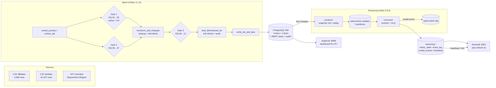
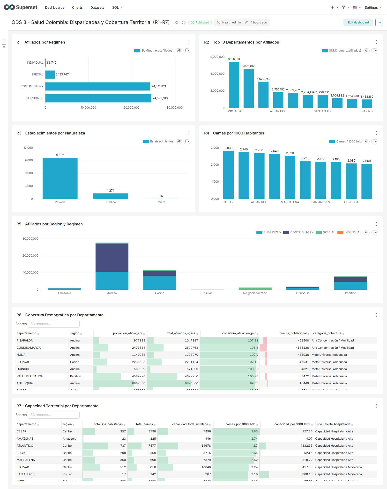
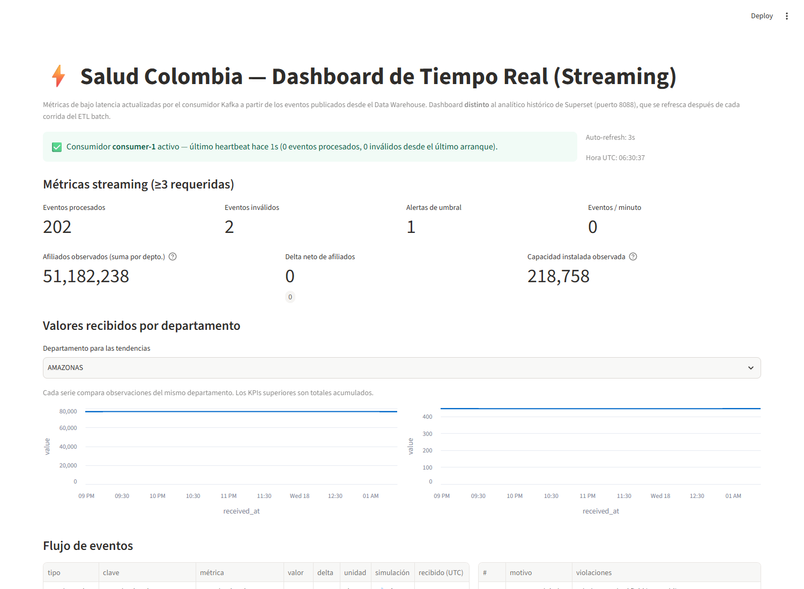

# etl-2026-2-ods3-salud-api-gx-airflow-streaming-kafka-


> 📄 **Spanish version:** [README_ES.md](README_ES.md) · This documentation in English: `README.md`

**Health Colombia — SDG 3 (Good health and well-being):** an integrated batch + streaming ETL
project. Ingests static datasets and a dynamic API, orchestrates the ETL with **Apache
Airflow**, validates data quality with **Great Expectations**, loads a **dimensional Data
Warehouse** in PostgreSQL, delivers historical analytics in **Apache Superset**, and runs a
**Kafka** pipeline (producer/consumer, event contract) with a **real-time dashboard in
Streamlit**.

| Component | Technology | URL / port |
|---|---|---|
| Data Warehouse | PostgreSQL 16.15 | `localhost:5432` (`salud_colombia`) |
| Batch orchestration | Apache Airflow 3.1.8 (custom + GX) | <http://localhost:8080> |
| Data Quality | Great Expectations 1.25.0 (inside the DAG validation gates) | — |
| Historical dashboard | Apache Superset 6.1.0 | <http://localhost:8088> |
| Streaming | Apache Kafka 3.8.0 (single broker) | `localhost:19092` (host) / `kafka:9092` (internal) |
| Real-time dashboard | Streamlit | <http://localhost:8501> |
| REST API over the DW | PostgREST | <http://localhost:3220> |
| Tests | pytest (regression suite) | `pytest -q` |

**Index**

1. [Project Overview and Objectives](#1-project-overview-and-objectives)
2. [Data Sources and EDA](#2-data-sources-and-eda)
3. [System Architecture](#3-system-architecture)
4. [Batch ETL Pipeline](#4-batch-etl-pipeline)
5. [Data Quality](#5-data-quality-great-expectations)
6. [Data Warehouse](#6-data-warehouse)
7. [Batch Analytical Dashboard](#7-batch-analytical-dashboard)
8. [Streaming Pipeline](#8-streaming-pipeline)
9. [Real-Time Dashboard](#9-real-time-dashboard)
10. [Execution and Reproducibility](#10-execution-and-reproducibility)
11. [Functional Evidence](#11-functional-evidence)
12. [Engineering Decisions and Limitations](#12-engineering-decisions-and-limitations)

---

## 1. Project Overview and Objectives

**Problem.** Colombia publishes data on the General Social Security Health System (affiliates
by department/municipality/regime) and on enabled healthcare infrastructure (facilities, beds,
rooms) as static snapshots, while official demographic data (population, surface per
department) lives in an API. SDG 3 stakeholders need (a) a trustworthy, auditable historical
base for analytics, and (b) **live** affiliation and installed-capacity indicators with
seconds-level latency to detect relevant changes.

**Refined objectives**

1. Build a reproducible batch ETL orchestrated with Airflow that extracts both static sources
   and the API, cleans/integrates the data and loads a **dimensional Data Warehouse**.
2. Enforce **12 CRITICAL data-quality rules** implemented with Great Expectations (cross-checked
   with native validation) so that invalid data **never** reaches the DW and any failure is
   visible in Airflow.
3. Deliver a **historical batch analytical dashboard** (Superset) covering KPIs and requirements
   R1–R7.
4. Implement a **Kafka streaming pipeline** (producer + consumer + event contract) that
   publishes **only real metric changes** derived from the DW and keeps at least three streaming
   metrics up to date.
5. Build a **real-time dashboard** (Streamlit), distinct from the historical one, with consumer
   outage detection.
6. Provide **real execution evidence** (runs, logs, screenshots, invalid-event and
   consumer-interruption experiments) inside this repository.

**Batch vs. streaming (differentiated requirements)**

| | Batch (sections 2.4–2.5) | Streaming (sections 2.6–2.7) |
|---|---|---|
| Trigger | Daily scheduled DAG + manual trigger (or `src.etl_main`) | Continuous producer every 10 s + historical replay |
| Latency | Minutes (run duration ≈ 26 s) | Seconds (publish → consumer → dashboard ≈ 1–3 s) |
| Storage | Dimensions/facts + views in PostgreSQL | `streaming.*` (event_log, metric_state, invalid_events, heartbeat) |
| Human consumer | Superset (`:8088`), historical queries | Streamlit (`:8501`), 3 s auto-refresh |
| Low-latency value | — | Threshold alerts (`threshold_alert`) and affiliation/capacity monitoring without waiting for the next batch run |

---

## 2. Data Sources and EDA

### 2.1 Sources

| Source | Type | Content | Path / endpoint |
|---|---|---|---|
| SGSSS affiliates | Static CSV (2026-09-06 snapshot) | 3,369 rows × 8 columns: department, municipality, regime, year, month, num_persons | `data/raw/affiliates_by_department_municipality_regime_20260906.csv` |
| Healthcare facilities (REPS) | Static CSV (2026-09-06 snapshot) | 41,427 rows × 20 columns: provider, nature, care level, installed capacity (beds/rooms/clinics…) | `data/raw/healthcare_facilities_by_level_capacity_20260906.csv` |
| API Colombia | Dynamic REST API | Departments and regions with official population, surface and DANE codes → enriches `dim_geografia` and feeds R6/R7 | `https://api-colombia.com/api/v1` (`/Department`, `/Region`) |

The API extractor (`src/api_extract.py`) calls the endpoint with a 15 s timeout and **saves a
JSON cache** in `data/raw/`; if the API is down it falls back to the cache
(`source=local_cache`) so the batch run stays reproducible. Raw snapshots are versioned in
the repo.

**Why are streaming events generated separately?** The CSV/API only change when a new snapshot
is published (batch, low frequency), but the business needs to observe **metric changes**
(affiliates per department, installed capacity) with seconds-level latency. That is why the
Kafka producer derives events from the **DW fact tables** (not from the raw CSVs) and only
publishes when a value **changes** with respect to its last published state (snapshot mode,
checked every 10 s), or replays history clearly flagged as a simulation (replay mode). Details
in [section 8](#8-streaming-pipeline).

### 2.2 EDA (notebook)

Notebook: [`notebooks/01_data_validation_cleanup.ipynb`](notebooks/01_data_validation_cleanup.ipynb)
(profiling, distribution plots, duplicates, nulls, cleanup and final validation).

**Main findings (real notebook outputs):**

| Finding | Observation | Decision it triggered |
|---|---|---|
| `NumPersonas` is `object` with Spanish thousands separators (`'2.194'`) | not numeric in raw form | cleanup `str.replace('.','')` → `to_numeric` → `int`; drop rows `<= 0` → rule **DQ-03** |
| Affiliates: **0 nulls, 0 duplicates**, 3,369 rows | clean source regarding completeness | schema/grain rules (**DQ-01, DQ-09**) instead of aggressive cleanup |
| Regimes: closed set `S` 1,124 / `C` 1,122 / `E` 1,115 / `I` 8 | few possible values | map to `SUBSIDIZED/CONTRIBUTORY/SPECIAL/INDIVIDUAL` and **DQ-02** (`expect_column_values_to_be_in_set`) |
| Facilities: **3,145 duplicates (7.59%)** and **26,958 nulls** | nulls are ONLY in optional columns: `num nivel atencion` 60.99%, `Teléfono` 3.16%, `Gerente` 0.54%, `Email` 0.16%; identity/capacity = 0 nulls | `drop_duplicates()` + **DQ-04** with a ≥ 99.5% threshold on essential attributes (not a naive 100%) |
| `nit IPS` with separators (`890,980,643`) | garbage in a key column | strip commas before building `dim_facility` |
| Heterogeneous department names: `VALLE` (126 rows), `SAN ANDRES`, `NO APLICA`; special districts reported as departments (`CARTAGENA` ×3, `SANTA MARTA` ×3) | CSV ↔ API join would fail without normalization | `DEPT_NORMALIZE`, `DISTRICT_TO_DEPT`, `REGION_MAP` (`src/config.py`) → single conformed `dim_geografia` → **DQ-08** (≥ 95% match rate) |

Notebook **§10** documents the full mapping *EDA finding → cleanup → DQ rule DQ-01…DQ-12 → GX
expectation*. All notebook outputs are executed and stored in the repo.

API EDA is executed in notebook **§9**, including Department/Region completeness, ID uniqueness,
positive population/surface, geographic joins and regional consistency. The executed notebook has 45 code cells and three embedded figures; API input has 33 departments and six regions, with no invalid demographic values in the cached snapshot. Three figures and a
machine-readable profile are included under [`docs/evidence/profiling/`](docs/evidence/profiling/).
The region mapping follows the cached API classification, including Norte de Santander → Andina,
Vichada → Orinoquia and Guainia → Amazonia. See notebook **§10** for the EDA-to-DQ mapping.

---

## 3. System Architecture




**Batch flow:** CSV/API → raw extraction → validation gates (native **and** Great Expectations)
→ transformation and integration → second gate → DW load (idempotent full refresh + audit) →
KPI verification. A failing gate stops the DAG before touching the DW.

**Streaming flow:** the producer watches the DW facts and publishes events to the
`salud.metric.updates` topic; the consumer validates the contract, updates the metrics in
`streaming.*` and writes the heartbeat; Streamlit reads those tables every 3 s. Invalid events
go to the `streaming.invalid_events` table **and** to the `salud.metric.dlq` DLQ topic.

**Services (`docker-compose.yml`)**

| Service | Image / build | Host port |
|---|---|---|
| `postgres` (DW + streaming metadata) | `postgres:16` | 5432 |
| `postgrest` | `postgrest/postgrest` | 3220 |
| `kafka` | `apache/kafka:3.8.0` | 19092 → 9092 |
| `airflow-webserver` / `scheduler` / `dag-processor` / `airflow-init` | `Dockerfile.airflow` → `localhost/health-airflow:3.1.8` | 8080 |
| `superset` / `superset-init` / `superset-bootstrap` | `Dockerfile.superset` → `apache/superset:6.1.0` | 8088 |
| `etl` (manual ETL) | `Dockerfile` → `python:3.11-slim` | — |
| `streaming-producer` / `streaming-consumer` | `Dockerfile` | — |
| `realtime-dashboard` | `Dockerfile` + Streamlit | 8501 |

---

## 4. Batch ETL Pipeline

### 4.1 DAGs

| DAG | Purpose | Schedule |
|---|---|---|
| `reliable_health_pipeline` | **Test A** — full production pipeline (8/8 tasks) | daily 06:00 UTC + manual (`ETL_SCHEDULE`, `catchup=False`) |
| `bad_health_pipeline` | **Test B** — controlled failure demo: injects `regime_id='INVALID_Z'` to prove the Gate 1 block | manual |

Both share the `create_health_pipeline()` structure in
[`dags/reliable_health_pipeline.py`](dags/reliable_health_pipeline.py) /
[`dags/bad_health_pipeline.py`](dags/bad_health_pipeline.py).

### 4.2 Execution sequence (8 tasks)

```text
extract_primary ─────────────► validate_primary_raw (Gate 1: DQ-01…05) ─┐
      │                                                                  │
extract_api ─────────────────► validate_api_raw   (Gate 2: DQ-06…07) ──┤
                                                                       ▼
                                    transform_and_integrate (cleanup, dims, facts,
                                                             CSV↔API integration)
                                                                       │
                                    validate_prepared (Gate 3: DQ-08…12)
                                                                       │
                                    load_dimensional_dw (full refresh + inserts + audit)
                                                                       │
                                    verify_dw_and_kpis (counts, totals, audit close)
```

1. **extract_primary** — reads the 2 raw CSVs and records counts in `audit.etl_run_step`.
2. **extract_api** — calls `api-colombia.com` (or the cache) and leaves departments/regions as
   JSON.
3. **validate_primary_raw** — **Gate 1**: DQ-01…DQ-05 with native *and* GX validation (suites
   `primary_raw_affiliates_schema`, `primary_raw_affiliates_measures`, `primary_raw_facilities`
   → 11 expectations).
4. **validate_api_raw** — **Gate 2**: DQ-06…DQ-07 (suite `api_raw_departments` → 4
   expectations).
5. **transform_and_integrate** — cleanup (§2.2), builds `dim_time`, `dim_geografia`,
   `dim_regime`, `dim_facility`, `dim_capacity_type`, `fact_affiliates`,
   `fact_facility_capacity` and performs the CSV↔API join (prepares the department resolution
   rate).
6. **validate_prepared** — **Gate 3**: DQ-08…DQ-12 — CSV↔API match rate ≥ 95% (DQ-08), unique
   grain (DQ-09/DQ-10), referential integrity (DQ-11) and sum reconciliation (DQ-12); GX suites
   `prepared_fact_affiliates` + `prepared_fact_capacity` → 10 expectations.
7. **load_dimensional_dw** — `sql/init.sql` (idempotent reset of the dimensional schema,
   **never touching `audit.*`**) + `INSERT … ON CONFLICT DO NOTHING` with a `batch_id` per run.
8. **verify_dw_and_kpis** — recounts dimensions/facts, affiliate/bed totals and closes the run
   in `audit.etl_run` (`SUCCESS` / `BLOCKED_QUALITY` / `FAILED`).


Each Airflow run keeps its extracted and prepared snapshots under `data/batches/` (local runtime
artifacts, gitignored). Validation and loading use the same prepared files; loading checks their
fingerprints instead of rebuilding data from mutable raw sources. Keep the snapshot directory
until the run has finished so a task retry can use the same batch.

The **manual** batch ETL (same code outside Airflow) is also available:

```bash
podman-compose run --rm --no-deps etl python -m src.etl_main
```

### 4.3 Execution evidence (Test A / Test B)

The historical captures below show a successful run and a controlled critical failure. Current
JSON validation outputs are under `docs/evidence/gx/`; use each report's `executed_at` and the
run IDs in `audit.etl_run` to identify the latest execution. The validation contract now expects
**12/12 rules** and GX **11/11 + 6/6 + 10/10** expectations. The two extra API expectations reject
missing population/surface before checking their positive ranges.

- **Test A:** `reliable_health_pipeline` must finish with eight `success` tasks and audit `SUCCESS`.
- **Test B:** `bad_health_pipeline` injects `INVALID_Z`; Gate 1 fails, dependent tasks become
  `upstream_failed`, audit records `BLOCKED_QUALITY`, and final DW rows remain unchanged.


---

## 5. Data Quality (Great Expectations)

### 5.1 Rule catalog (12, all CRITICAL)

Source: [`src/quality/rules.py`](src/quality/rules.py); executed by
[`src/quality/gx_validator.py`](src/quality/gx_validator.py) in the 3 gates.

| Rule | Layer | Business rule | Threshold | GX expectation |
|---|---|---|---|---|
| DQ-01 | raw_affiliates | 8 mandatory columns present | 100% | `expect_table_columns_to_match_set` |
| DQ-02 | raw_affiliates | `regime_id ∈ {S,C,E,I}` | 100% | `expect_column_values_to_be_in_set` |
| DQ-03 | raw_affiliates | `num_persons` numeric and ≥ 0 | 100% | `expect_column_values_to_be_between` |
| DQ-04 | raw_facilities | essential identity/capacity attributes not null | ≥ 99.5% | `expect_column_values_to_not_be_null` |
| DQ-05 | raw_facilities | installed capacity ≥ 0 | 100% | `expect_column_values_to_be_between` |
| DQ-06 | raw_api_departments | name + id mandatory | 100% | `expect_column_values_to_not_be_null` |
| DQ-07 | raw_api_departments | population and surface are non-null, numeric and > 0 | 100% | `expect_column_values_to_be_between` |
| DQ-08 | integration_gate | ≥ 95% of CSV departments resolve to API records | ≥ 95% | `expect_integration_key_match_rate` |
| DQ-09 | prepared_fact_affiliates | grain `(sk_time, sk_geografia, sk_regime)` unique | 100% | `expect_compound_columns_to_be_unique` |
| DQ-10 | prepared_fact_capacity | grain `(sk_time, sk_facility, sk_capacity_type)` unique | 100% | `expect_compound_columns_to_be_unique` |
| DQ-11 | prepared_facts | zero orphans in fact foreign keys | 100% | `expect_foreign_keys_to_exist_in_dimensions` |
| DQ-12 | prepared_facts | affiliate sum reconciles with raw input | error < 0.01% | `expect_sum_reconciliation` |

Numeric person/capacity measures must be finite; raw capacity validation never fills invalid values with zero.

Raw capacity includes `1,000`: `src/numeric.py` parses it as 1000 and is shared by validation, cleanup and the notebook. DW capacity totals 219,758 units. Malformed grouping (for example `1,5`) is rejected.


### 5.2 Real Great Expectations 1.25.0 integration

[`src/quality/gx_backend.py`](src/quality/gx_backend.py) builds, for each gate:

1. **Suites per DataFrame** (so `column_set` is not polluted by derived columns):
   `primary_raw_affiliates_schema`, `primary_raw_affiliates_measures`, `primary_raw_facilities`,
   `api_raw_departments`, `prepared_fact_affiliates`, `prepared_fact_capacity`.
2. An **ephemeral** `DataContext` (no artifact files written to disk), an `ExpectationSuite` and
   a `ValidationDefinition` per suite, executed with `gx.data_asset.validate(...)`.
3. Serialization of the result inside the quality report:
   `report["gx"] = {available, version, suites[], expectations_passed/total, failed_rules}` and
   `evaluations[].details.gx` → persisted into `audit.dq_check_result.observed_value`.

**Conservative AND combination:** every rule is evaluated with the native implementation
(pandas) **and**, when an equivalent GX expectation exists, also with Great Expectations; the
gate only passes if **both** approve. 11 of the 12 rules have a GX counterpart (DQ-08, a match
rate ≥ 95%, is computed natively). GX is mandatory: an unavailable library, an execution error or an incomplete suite is a critical failure. The gate records the reason and blocks loading instead of silently accepting native-only validation.

### 5.3 Behavior on critical failure

`CriticalQualityError` → the validation task **fails** in Airflow (red), dependent tasks become
`upstream_failed`, the DAG ends `failed`, `audit.etl_run` is left in **`BLOCKED_QUALITY`** and
**the DW is not loaded**. Details (rule, observed values, GX failures) are stored in
`audit.dq_check_result` and in the evidence JSONs.

### 5.4 GX evidence

| File | Gate | Result |
|---|---|---|
| [`docs/evidence/gx/primary_raw_results.json`](docs/evidence/gx/primary_raw_results.json) | Gate 1 | 5/5 rules · GX **11/11** expectations (3 suites) · `available=true v=1.25.0` |
| [`docs/evidence/gx/api_raw_results.json`](docs/evidence/gx/api_raw_results.json) | Gate 2 | 2/2 rules · GX **6/6** expectations |
| [`docs/evidence/gx/prepared_results.json`](docs/evidence/gx/prepared_results.json) | Gate 3 | 5/5 rules · GX **10/10** expectations (includes DQ-12) |

In **Test B** the same JSON shows `DQ-02 → FAIL` with
`gx: {failed: 1, failed_expectations: ['expect_column_values_to_be_in_set(regime_id)']}` — the
GX detector and the native one agree on the failure (10/11 expectations).

---

## 6. Data Warehouse

**Kimball** methodology (declared grain, conformed dimensions, separate facts). Full definition
in [`sql/init.sql`](sql/init.sql); data in
[`docs/evidence/dw/dimensional_dw_state.log`](docs/evidence/dw/dimensional_dw_state.log).

### 6.1 Dimensions (`public`)

| Table | Rows | Content / grain |
|---|---|---|
| `dim_time` | 2 | fact periods: **2022-Q2** (affiliates) and **2022-Q4** (capacity); year, month, quarter, semester |
| `dim_geografia` | 2,240 | **single conformed dimension**: municipality + department + DANE region **and** API enrichment (capital, surface, population) |
| `dim_regime` | 4 | `SUBSIDIZED / CONTRIBUTORY / SPECIAL / INDIVIDUAL` |
| `dim_facility` | 10,921 | providers/facilities (code, name, NIT, nature, care level) |
| `dim_capacity_type` | 63 | capacity types (beds, rooms, clinics, ambulances…) |

### 6.2 Facts (`public`)

| Fact | Grain | Rows | Total |
|---|---|---|---|
| `fact_affiliates` | period × geography × regime (2022-Q2 snapshot) | 3,369 | **51,182,238** affiliates |
| `fact_facility_capacity` | period × facility × capacity type × geography (2022-Q4 snapshot) | 31,496 | **219,758** capacity units |

Every foreign key has a verifiable `REFERENCES` constraint (real referential integrity; DQ-11
also validates it on every run).

### 6.3 Analytical views (feed Superset)

| View | Rows | Used by |
|---|---|---|
| `v_affiliates_summary` | — | R1, R2, R5 |
| `v_facility_summary` | 31,496 | R3 |
| `v_r6_demographic_coverage` | 33 | R6 — affiliation coverage vs official population, category |
| `v_r7_territorial_capacity` | 33 | R7 — beds/1000 pop, capacity/km², alert level |

### 6.4 `audit.*` schema (traceability)

| Table | Rows | Content |
|---|---|---|
| `audit.etl_run` | 4 | one row per run: `run_key`, `dag_id`, `status` (`SUCCESS`/`BLOCKED_QUALITY`/`FAILED`), duration, `dq_rules_passed/total` |
| `audit.etl_run_step` | 14 | steps (extract/validate/transform/load/verify) with `rows_in/out` and status |
| `audit.dq_check_result` | 34 | **per-DQ-rule result** with severity, status, observed value and the embedded `gx` sub-object |
| `audit.etl_batch_log` | 2 | load batches with before/after counts (`batch_id` referenced by the facts) |

### 6.5 Loading strategy

1. **Idempotent full refresh:** `sql/init.sql` runs `DROP … IF EXISTS` + `CREATE` for
   dimensions, facts and views; `audit.*` tables use `CREATE TABLE IF NOT EXISTS` and are
   **never dropped** (the run history survives any reset).
2. **Bulk insert** with `psycopg2.extras.execute_values` and `ON CONFLICT DO NOTHING`
   (re-runs do not duplicate rows).
3. **Per-run audit:** `batch_id` with before/after counts; any exception triggers a `rollback`
   and leaves `FAILED` in `audit.etl_batch_log`.

---

## 7. Batch Analytical Dashboard

**Tool:** Apache Superset 6.1.0 → <http://localhost:8088> (login `admin/admin` for local
development). **Connection:** SQLAlchemy URI to the PostgreSQL DW registered by
[`scripts/superset_bootstrap.py`](scripts/superset_bootstrap.py); **7 base datasets**
(`v_affiliates_summary`, `v_facility_summary`, `v_r6_demographic_coverage`,
`v_r7_territorial_capacity`, `fact_affiliates`, `fact_facility_capacity`, `dim_geografia`), plus `dim_facility` registered by the chart script (**8 total**).
Dashboard: **`ods3-salud-colombia`**
(<http://localhost:8088/superset/dashboard/ods3-salud-colombia/>), charts created by
[`scripts/superset_charts_bootstrap.py`](scripts/superset_charts_bootstrap.py).

| Chart | Dataset | Business question |
|---|---|---|
| **R1** – Affiliates by Regime | `v_affiliates_summary` | how much does each regime weigh? (subsidized 24,599,910; contributory 24,341,821) |
| **R2** – Top 10 Departments by Affiliates | `v_affiliates_summary` | where is affiliation concentrated? (Bogotá total 8,120,311) |
| **R3** – Facilities by Nature | `dim_facility` | unique facilities: private 9,632 / public 1,274 / mixed 15 |
| **R4** – Beds per 1000 Inhabitants | `v_r7_territorial_capacity` | relative staffing (leaders: Cesar 2.83, Amazonas 2.74, Atlántico 2.70) |
| **R5** – Affiliates by Region and Regime | `v_affiliates_summary` | regional distribution (Andina/Caribe/Pacific…) |
| **R6** – Demographic Coverage by Department | `v_r6_demographic_coverage` | affiliates vs official population: categories *Universal Meta Adequate*, *High Concentration/Mobility* (coverage >100% requires investigating the population/affiliate reference dates and mobility), *Deficit* |
| **R7** – Territorial Capacity by Department | `v_r7_territorial_capacity` | facilities, beds, beds/1000 pop and **hospital alert level** |

**Main insights:** affiliation exceeds 100% of the API population in some departments
(Risaralda 107.1%, Cundinamarca 105.5%), the Andina region holds most affiliates, and hospital
capacity is uneven (Cesar/Amazonas/Atlántico have high installed capacity; other departments show moderate capacity or a deficit)
— descriptive snapshot comparisons. Coverage above 100% alone does not establish mobility or causality; population/API and affiliate reference dates can differ.



---

## 8. Streaming Pipeline

### 8.1 Producer ([`src/streaming/producer.py`](src/streaming/producer.py))

| Mode | Behavior |
|---|---|
| `snapshot` (default, production) | Every **10 s** (`STREAMING_PRODUCER_INTERVAL`) it queries the DW facts, compares them with the last published value (`streaming.producer_state`) and **publishes only what changed** — it never re-publishes an unchanged KPI (analytical justification). If `\|delta\| > 5%` it additionally emits a `threshold_alert` event (`--alert-threshold 0.05`). |
| `replay` (simulation) | Replays DW history at 0.5 s per event. **Explicitly flagged** in every event: `"source": {"mode": "replay", "simulation": true}`. |

```bash
podman exec streaming_producer_salud python -m src.streaming.producer --mode replay --loop   # simulation
podman exec streaming_producer_salud python -m src.streaming.producer --mode snapshot        # production
```

**Generation and frequency:** events derived from `fact_affiliates` /
`fact_facility_capacity` (aggregated per department), 67 metric updates per full pass (134 for a two-cycle replay),
checked every 10 s. **Value of low latency:** an affiliation or capacity change reaches the
dashboard in seconds (vs. waiting for the next batch run), enabling near-real-time
`threshold_alert` monitoring for SDG 3.

### 8.2 Topics

| Topic | Partitions | Key | Purpose |
|---|---|---|---|
| `salud.metric.updates` | 3 | `event_key` (e.g. `affiliates_by_department:19`) | ordering per key = ordering per department |
| `salud.metric.dlq` | 1 | original `message_key` | dead-letter for rejected events (created/ensured by the consumer at startup) |

Consumer group: `health-metrics-consumers` (consumer id `consumer-1`).

### 8.3 Event contract ([`src/streaming/contract.py`](src/streaming/contract.py), `schema_version=1`)

| Field | Rule |
|---|---|
| `event_id` | **required**, UUID v4 string, unique per event (idempotency: `ON CONFLICT (event_id) DO NOTHING`) |
| `event_type` | **required**, `metric_update` \| `threshold_alert` |
| `schema_version` | **required**, integer `== 1` |
| `event_key` | **required**, non-empty string — also the **Kafka message key** |
| `timestamp` | **required**, ISO-8601 UTC with timezone |
| `metric_name` | **required**, non-empty string |
| `payload` | **required**, object with `metric_name`, `value`, `unit` |
| `source` | optional, `{"mode": …, "simulation": bool, "batch_id": …}` |

**Validation and behavior on an invalid event:** the consumer checks types, presence,
`schema_version` range, timestamp format and the `payload` schema. On failure it (1) **rejects**
the event (`WARNING INVALID EVENT rejected … errors=[...]`), (2) records it in
`streaming.invalid_events` (reason + errors + raw payload), (3) increments
`invalid_events_total`, (4) **republishes it to the DLQ** `salud.metric.dlq`, and (5) **keeps
processing** (the loop does not crash).

### 8.4 Consumer and metrics ([`src/streaming/consumer.py`](src/streaming/consumer.py))

Updates **7 metrics** in `streaming.metric_state` (minimum required: 3):

| Metric | Meaning |
|---|---|
| `events_processed_total` | valid events processed |
| `invalid_events_total` | events rejected by the contract |
| `threshold_alerts_total` | threshold alerts received |
| `events_per_minute` | current throughput |
| `affiliates_latest_total` | sum of observed affiliates (latest value per department) |
| `affiliates_net_delta` | accumulated net affiliate delta |
| `capacity_latest_total` | observed installed capacity |

Plus: `streaming.event_log` (event history), `streaming.consumer_heartbeat` (`status`,
counters, `last_heartbeat` ≈ every 1 s) and `streaming.producer_state` (avoids re-publishing
without changes).

### 8.5 Evidence

- [`docs/evidence/streaming/01_contract_violation_and_alert.log`](docs/evidence/streaming/01_contract_violation_and_alert.log)
  — rejections + DLQ routing + processed `threshold_alert`.
- [`docs/evidence/streaming/02_dlq_topic_messages.log`](docs/evidence/streaming/02_dlq_topic_messages.log)
  — real messages from the DLQ topic (raw payload + errors).
- [`docs/evidence/streaming/05_replay_and_topic_listen.log`](docs/evidence/streaming/05_replay_and_topic_listen.log)
  — replay (simulation), raw topic listening (`--listen 5`) and partition description.

---

## 9. Real-Time Dashboard

**Tool:** Streamlit → <http://localhost:8501>
([`src/streaming/dashboard.py`](src/streaming/dashboard.py), service `realtime-dashboard`).

**Consumer-to-dashboard integration:** the Kafka consumer writes to PostgreSQL (`streaming.*`);
Streamlit **reads those tables directly with psycopg2 and auto-refreshes every 3 s**
(`st.fragment(run_every=...)`). There are no websockets: the mechanism is polling over the same transactional
database — simple, tool-compatible and enough for seconds-level latency.

**Metrics shown (≥3 required; 7 are shown):** processed events, invalid events, threshold
alerts, events/minute, observed affiliates, net affiliate delta and observed installed capacity
— plus trend series, recent event flow and the contract-violations table (DLQ).

**Consumer status (heartbeat):** the consumer writes `status='running'` + timestamp
(`clock_timestamp()`) ≈ every 1 s. The dashboard computes heartbeat age with the **server clock**
and shows:

- `✅ ONLINE` if `status='running'` and age ≤ **15 s** (`STREAMING_HEARTBEAT_TIMEOUT`);
- `⛔ OFFLINE` if age exceeds 15 s or `status='stopped'` (outage detected);
- `⚠️ No heartbeat` if the consumer never started.

**Distinction from the historical dashboard**

| | Superset (§7) | Streamlit (§9) |
|---|---|---|
| Data | dimensional DW (2022 historical facts) | `streaming.*` tables (seconds-old events) |
| Update | on query / after each ETL run | polling every **3 s** |
| Question | "how did SDG 3 look historically?" | "what is happening **now** and is the consumer alive?" |
| Scope | R1–R7 analytics | streaming KPIs + pipeline health |


---

## 10. Execution and Reproducibility

### 10.1 Requirements

- **Git**; **Python 3.12** (optional for host-side development: [Nix](flake.nix) dev shell with `uv`, podman, psql and chromium — the normal Docker path runs the scripts inside containers);
- **Podman ≥ 4 + `podman-compose`** (Linux; any current Compose provider is supported through the base Compose file) or **Docker Desktop** with WSL2 backend + `docker compose` using Linux containers (Windows);
- ~4 GB free RAM for the 11 containers, plus additional memory for the browser;
- No paid external dependencies and no paid API or token: the only two sources are CSVs included in the repo and the public API `api-colombia.com` (with an included backup cache in `data/raw/`).

### 10.2 Startup (Docker Desktop / PowerShell)

Two equivalent launchers run the whole project: **`bash start.sh`** (Linux/macOS) and
**`start.bat`** (Windows, a thin wrapper over `scripts/project_manager.ps1`; no Python is
needed on the host). Both work from any directory, create `.env` and the Airflow
credentials on first run, and expose the same menu and the same actions.

#### Quick start

```bash
# Linux / macOS — full clean rebuild: wipe → build → start → load Airflow → dashboards → tests
bash start.sh auto
```

```powershell
# Windows PowerShell — the same flow (menu option 7)
start.bat auto
```

`auto` asks you to type `ELIMINAR` first. On a machine you do not want to wipe, use
`setup` (start + first Airflow load + dashboards, nothing deleted) or just `start`
(services only).

#### Menu and command-line actions

Run the launcher without arguments for the interactive menu, or pass an action directly:

```bash
bash start.sh            # interactive menu
bash start.sh --help     # list the actions without starting Docker
start.bat                # interactive menu (Windows)
start.bat validate       # run a single action directly
```

| # | Menu option (as printed) | Action | What it does |
|---|---|---|---|
| 1 | Iniciar servicios | `start` | Build if needed and start the services, waiting until they are healthy |
| 2 | Detener servicios | `stop` | Stop the containers, keep the data |
| 3 | Validar instalacion | `validate` | Compose config, container status, `pip check` and the pytest suite |
| 4 | Resetear contenedores (conserva datos) | `reset` | Recreate the containers, keep volumes and data |
| 5 | Vaciar volumenes y datos | `wipe` | Remove this project's containers, volumes, `.pgdata` and `data/batches` |
| 6 | Recrear paso a paso | `steps` | Clean rebuild that pauses before each of its 5 stages |
| 7 | Reconstruccion automatica completa | `auto` | `wipe` + `start` + Airflow load + Superset bootstrap + `validate` |
| 8 | Reiniciar servicios | `restart` | Restart the containers and print the links |
| 9 | Instalar/cargar dashboards sin borrar | `setup` | Start, load Airflow and register the BI dashboards without wiping |
| 10 | Mostrar todos los enlaces del proyecto | `links` | Print every project URL (see [10.3](#103-links-to-view-the-data)); no Docker needed |
| 11 | Mostrar estado, topicos, lag y recursos de Kafka | `kafka` | Point-in-time Kafka health, topics, consumer groups, lag, disk and resources |
| 12 | Monitorear Kafka en tiempo real | `kafka-live` | Live refresh every 5 s, read-only; `Ctrl+C` exits |
| 0 | Salir | — | Leave the menu |

Options **5, 6 and 7** (`wipe`, `steps`, `auto`) require typing **`ELIMINAR`** and only
touch this project's containers, volumes and verified data directories (`.pgdata`,
`data/batches`); they never run `docker system prune` nor remove resources of other
projects, and code, `.env`, source CSVs and `docs/evidence` are always preserved.
`reset` and `restart` keep the data. Pass `--help` to see the action list without starting
Docker. The [Spanish instructions](README_ES.md#102-puesta-en-marcha-docker-desktop--powershell)
describe the same menu with additional data-retention details.

Use `start.bat kafka` or `bash start.sh kafka` to inspect Kafka health, topics, partitions,
consumer groups, lag, log disk usage and one-shot CPU/memory/network/block I/O. This is a
point-in-time view; historical resource charts require periodic capture or JMX/Prometheus.
Use `start.bat kafka-live` or `bash start.sh kafka-live` for a five-second live refresh;
press `Ctrl+C` to return. This mode is read-only and does not publish events or commit offsets.

Run these commands from the repository root. Keep the same PowerShell window for `$dc`.
The versioned override disables Podman's `keep-id` option without changing names or ports.

```powershell
# Keep an existing local .env; create it only on a fresh checkout.
if (!(Test-Path .env)) { Copy-Item .env.example .env }
if (!(Test-Path config/simple_auth_manager_passwords.json)) {
    '{"airflow":"airflow"}' | Set-Content -Encoding ascii config/simple_auth_manager_passwords.json
}
$dc = @('-f', 'docker-compose.yml')
docker compose @dc config --quiet
docker compose @dc up -d --build
docker compose @dc ps -a    # podman-compose has no `-a`: run `docker compose @dc ps` instead (it already lists stopped containers)
```

The startup graph waits for PostgreSQL/Kafka health and for successful database initialization.
Airflow's scheduler and DAG processor also wait for its API server. `airflow-init` and
`superset-init` finishing with `Exited (0)` is expected; a nonzero exit blocks dependent services.
Container DNS (`postgres`, `airflow-webserver`, `superset`, `kafka`) is used directly. Mapping
these names to `host-gateway` would route internal traffic through the host and can cause HTTP 500 errors.

1. Open <http://localhost:8080> (`airflow` / `airflow`) and wait for `reliable_health_pipeline`.
2. Trigger the first load; wait until **all eight tasks** finish in `success` before creating charts:

```powershell
docker exec airflow_scheduler_salud airflow dags trigger reliable_health_pipeline
```

3. Register the DW and create the dashboard's seven charts:

```powershell
docker compose @dc --profile bootstrap run --rm --no-deps superset-bootstrap
docker compose @dc exec superset /app/.venv/bin/python /app/scripts/superset_charts_bootstrap.py
```

> [!NOTE]
> `--no-deps` matters under **podman-compose**: without it, its `run` triggers an internal
> `up` of the dependencies with `--remove-orphans` and a compose hash computed per
> `--profile`, so it tears down every service of the project and only recreates the
> dependencies. Docker Compose is unaffected, and the flag exists in both engines.

Open [the historical dashboard](http://localhost:8088/superset/dashboard/ods3-salud-colombia/)
(`admin` / `admin`) and [the streaming dashboard](http://localhost:8501).
PostgREST uses <http://localhost:3220> by default (`POSTGREST_PORT` in `.env`); its container still
listens on 3000. If Windows reserves a host port, choose another free `POSTGREST_PORT` and recreate
only `postgrest`; never change the container port or database address to work around that reservation.

For Podman on Linux, create `.env` and the password JSON, then use `podman-compose` with the base file:

Choose the setup matching your operating system and container engine:

#### Option A: Linux / Podman (rootless bash)

```bash
cp .env.example .env
printf '{"airflow":"airflow"}' > config/simple_auth_manager_passwords.json
podman-compose up -d --build
# After the first successful DAG load:
podman-compose --profile bootstrap run --rm --no-deps superset-bootstrap
podman exec superset_salud /app/.venv/bin/python /app/scripts/superset_charts_bootstrap.py
```

#### Option B: Windows / Docker Desktop (PowerShell)

Step-by-step reproducible guide tested and verified on Windows 11 with PowerShell and Docker Desktop:

##### Step 1: Environment setup and Airflow credentials

```powershell
# 1. Create and activate local virtual environment in Windows PowerShell
py -3.12 -m venv venv
venv\Scripts\Activate.ps1

# 2. Copy environment template (.env is NEVER committed to Git)
Copy-Item .env.example .env

# 3. Generate credentials for Airflow 3 (SimpleAuthManager)
# NOTE: PowerShell does not have 'printf' and 'print' must not be used.
# Use Out-File with -Encoding ascii to prevent UTF-16 BOM encoding that breaks the JSON parser:
'{"airflow": "airflow"}' | Out-File -FilePath config/simple_auth_manager_passwords.json -Encoding ascii
```

##### Step 2: Free port 5432 on Windows

> [!WARNING]
> **Port 5432 Conflict (Native PostgreSQL service):** If you have a native PostgreSQL service running on Windows (e.g., `postgresql-x64-18`), **you must stop it** before starting Docker. Pipeline services (`streaming-producer`, `streaming-consumer`, etc.) resolve the `postgres` host to `host-gateway`, so if port `5432` on the host is occupied by a local Windows PostgreSQL instance, they will collide and authentication will fail.
>
> Run in PowerShell as Administrator if the service is active:
> ```powershell
> Stop-Service postgresql-x64-18 -ErrorAction SilentlyContinue
> ```

##### Step 3: Start infrastructure and initialize Airflow 3

```powershell
# 1. Build images and start all 11 services in the background
docker compose up -d --build

# 2. Verify containers are healthy (wait until postgres and kafka report 'healthy')
docker ps

# 3. Initialize Airflow 3 metadata and migrations (ensures execution schemas exist)
docker exec -it airflow_scheduler_salud airflow db migrate

# 4. Restart Airflow services to synchronize Scheduler, Webserver, and Dag Processor
docker restart airflow_webserver_salud airflow_scheduler_salud airflow_dag_processor_salud

# 5. Unpause and trigger the reliable DAG (Test A: Full successful run across all 8 tasks)
docker exec -it airflow_scheduler_salud airflow dags unpause reliable_health_pipeline
docker exec -it airflow_scheduler_salud airflow dags trigger reliable_health_pipeline
```

##### Step 4: Initialize Apache Superset and link charts to the Dashboard

```powershell
# 1. Register DW connection and R1–R7 analytical datasets in Superset (bootstrap profile)
docker compose --profile bootstrap run --rm --no-deps superset-bootstrap

# 2. Generate all 7 R1–R7 charts and configure the Dashboard layout grid
docker exec -it superset_salud python /app/scripts/superset_charts_bootstrap.py

# 3. Formally link chart slices to Dashboard 1 in the Superset metadata database:
docker exec -it superset_salud python -c "from superset.app import create_app; app = create_app(); app.app_context().push(); from superset import db; from superset.models.dashboard import Dashboard; from superset.models.slice import Slice; d = db.session.query(Dashboard).get(1); d.slices = db.session.query(Slice).all(); db.session.commit(); print('Slices vinculados:', len(d.slices))"
```

##### Step 5: Activate Streaming simulation (Kafka) for the presentation

```powershell
# Start continuous emission of DW-derived events in replay mode (0.5s interval loop)
docker exec -d streaming_producer_salud python -m src.streaming.producer --mode replay --interval 0.5 --loop
```

> [!IMPORTANT]
> **EXECUTION RULE FOR KAFKA SCRIPTS (PYTHON 3.12 vs 3.11):** Do not run streaming scripts (`src.streaming.producer`, `src.streaming.consumer`, `scripts.streaming_demo`) directly in your PowerShell terminal using the local Python 3.12 `venv`. The `kafka-python` package is incompatible with Python 3.12 due to the removal of the standard library `imp` module. All Docker containers run **Python 3.11**, so **all Kafka scripts and experiments must be executed strictly via `docker exec`** inside the streaming containers (`streaming_producer_salud` or `streaming_consumer_salud`).

##### Step 6: Web User Interfaces (Web UIs)

| Service | URL | Default local credentials |
|---|---|---|
| **Apache Airflow 3** | <http://localhost:8080> | `airflow` / `airflow` |
| **Apache Superset (BI)** | <http://localhost:8088> | `admin` / `admin` |
| **Streamlit (Real-Time)** | <http://localhost:8501> | Direct public access (no login) |
| **PostgREST API** | <http://localhost:3000> | Anonymous access (`etl_user`) |

Quick PowerShell command to open them in the browser:
```powershell
Start-Process "http://localhost:8080"
Start-Process "http://localhost:8088"
Start-Process "http://localhost:8501"
```

---

### 10.3 Links to view the data

With the services running (`start`, `setup` or `auto`), these are every place where the data
can be inspected. **Ports are read from `.env`** (`AIRFLOW_WEBSERVER_PORT`, `SUPERSET_PORT`,
`REALTIME_DASHBOARD_PORT`, `POSTGREST_PORT`, `POSTGRES_PORT`, `KAFKA_EXTERNAL_PORT`); the
values below are the defaults shipped in `.env.example`. Print the exact list for your
machine at any time with `bash start.sh links` or `start.bat links` (works without Docker).

#### Orchestration — Apache Airflow · `airflow` / `airflow`

| What to view | URL |
|---|---|
| Airflow UI (DAG list, runs, logs) | <http://localhost:8080> |
| Main DAG `reliable_health_pipeline` (8 tasks) | <http://localhost:8080/dags/reliable_health_pipeline> |
| Controlled-failure DAG `bad_health_pipeline` | <http://localhost:8080/dags/bad_health_pipeline> |
| Airflow health endpoint | <http://localhost:8080/api/v2/monitor/health> |

#### Historical analytics — Apache Superset · `admin` / `admin`

| What to view | URL |
|---|---|
| Superset UI | <http://localhost:8088> |
| **Dashboard BI “ODS 3 – Salud Colombia” (charts R1–R7)** | <http://localhost:8088/superset/dashboard/ods3-salud-colombia/> |
| Dashboard list | <http://localhost:8088/dashboard/list/> |
| Charts list | <http://localhost:8088/chart/list/> |
| Datasets (views and facts) | <http://localhost:8088/tablemodelview/list/> |
| SQL Lab (query the DW interactively) | <http://localhost:8088/sqllab/> |

The BI dashboard is created by the bootstrap step (menu option **9** / `setup`); log in with
your configured Superset credentials.

#### Real time — Streamlit · no login

| What to view | URL |
|---|---|
| Real-time dashboard (Kafka metrics, refresh ≈ 3 s, consumer ONLINE/OFFLINE banner) | <http://localhost:8501> |

#### REST API — PostgREST · anonymous (`etl_user`)

Default base URL <http://localhost:3220/> (`POSTGREST_PORT` in `.env`); the root returns the
**OpenAPI schema** of the whole DW.

| What to view | URL |
|---|---|
| Root + OpenAPI schema | <http://localhost:3220/> |
| `dim_time` | <http://localhost:3220/dim_time?limit=10> |
| `dim_geografia` | <http://localhost:3220/dim_geografia?limit=10> |
| `dim_regime` | <http://localhost:3220/dim_regime?limit=10> |
| `dim_facility` | <http://localhost:3220/dim_facility?limit=10> |
| `dim_capacity_type` | <http://localhost:3220/dim_capacity_type?limit=10> |
| `fact_affiliates` | <http://localhost:3220/fact_affiliates?limit=10> |
| `fact_facility_capacity` | <http://localhost:3220/fact_facility_capacity?limit=10> |

#### Data Warehouse — PostgreSQL · database client, not a browser

| What to view | Address |
|---|---|
| PostgreSQL 16, database `salud_colombia`, user `etl_user` | `localhost:5432` (DBeaver, pgAdmin, `psql`) |
| Run history and DQ results | schema `audit` → `audit.etl_run`, `audit.dq_check_result` |
| Live streaming metrics | schema `streaming` → `streaming.metric_state`, `streaming.event_log` |

#### Streaming — Kafka · Kafka client, not a browser

| What to view | Address |
|---|---|
| External broker listener | `localhost:19092` (`KAFKA_EXTERNAL_PORT`; in-cluster `kafka:9092`) |
| Topics | `salud.metric.updates`, `salud.metric.dlq`, `__consumer_offsets` |

Use menu option **11** (`kafka`) for topics, consumer groups and lag, and **12**
(`kafka-live`) to watch them refresh every five seconds.

### 10.4 Execute and verify

`ETL_SCHEDULE` defaults to `0 6 * * *`: **daily at 06:00 UTC / 01:00 America/Bogota**.
`catchup=False` avoids historical backfills and `max_active_runs=1` prevents concurrent full refreshes.
Set `ETL_SCHEDULE=none` in `.env` for manual-only demonstrations, then recreate Airflow services.
The controlled-failure DAG remains manual.

```powershell
# Inspect actual runs; copy the desired run_id from this output or from the UI.
docker exec airflow_scheduler_salud airflow dags list-runs reliable_health_pipeline -o plain

# Controlled critical failure: expect failed / BLOCKED_QUALITY and an unchanged DW.
docker exec airflow_scheduler_salud airflow dags trigger bad_health_pipeline

# Tests in a disposable tool container; quality reports must not overwrite final evidence.
docker compose @dc --profile tools run --rm --build --no-deps -e GX_EVIDENCE_DIR=/tmp/etl-test-gx etl python -m pytest -q -p no:cacheprovider

# Simulated arrival of historical DW metrics (one bounded replay).
docker exec streaming_producer_salud python -m src.streaming.producer --mode replay --interval 0.5 --cycles 1
# Contract rejection demo and an explicit business alert:
docker exec streaming_producer_salud python -m scripts.streaming_demo --inject-invalid
docker exec streaming_producer_salud python -m scripts.streaming_demo --inject-alert

# Consumer interruption: observe OFFLINE after 15 seconds, then recovery.
docker stop streaming_consumer_salud
docker start streaming_consumer_salud

# Logs and a safe stop that retains local data:
docker compose @dc logs --tail 80
docker compose @dc stop
```

Verification: eight Airflow tasks green; audit `SUCCESS` with 12/12 rules; GX **11/11 + 6/6 + 10/10**;
seven Superset charts with data; Streamlit metrics update after events and throughput returns to zero
when idle. Snapshot mode publishes nothing when DW values have not changed; this is intentional.
Use replay to demonstrate arrivals, clearly marked as simulation. Historical experiment logs must
be distinguished from the latest successful evidence.

For local EDA/development, create a virtual environment and install the declared dependencies:

```powershell
python -m venv .venv
.\.venv\Scripts\python -m pip install -r requirements.txt
.\.venv\Scripts\python -m jupyter lab
```

Open `notebooks/01_data_validation_cleanup.ipynb` and run all cells. It reads API cache snapshots by
default. Clean CSV export is opt-in with `EXPORT_CLEAN_DATA=1`; normal EDA does not replace DW exports.

### 10.5 Verification Commands and Live Experiments

```powershell
# --- 1. Inspect successful Airflow execution (Test A: 8/8 success) ---
docker exec -it airflow_scheduler_salud airflow dags list-runs reliable_health_pipeline -o plain

# --- 2. Controlled Quality Failure Demonstration (Test B: Blocked at Gate 1 DQ-02) ---
docker exec -it airflow_scheduler_salud airflow dags trigger bad_health_pipeline
# (In Airflow UI: validate_primary_raw fails in red; downstream tasks transition to upstream_failed)

# --- 3. Streaming Experiment 1: Invalid Event Injection (Contract Violation) ---
docker exec -it streaming_producer_salud python -m scripts.streaming_demo --inject-invalid
# (Consumer rejects event, routes to DLQ, and keeps running; invalid_events_total increments in Streamlit)

# --- 4. Streaming Experiment 2: Non-JSON Malformed Payload Injection ---
docker exec -it streaming_producer_salud python -m scripts.streaming_demo --inject-json-invalid

# --- 5. Streaming Experiment 3: Threshold Alert Injection (|delta| >= 5%) ---
docker exec -it streaming_producer_salud python -m scripts.streaming_demo --inject-alert

# --- 6. Inspect Raw Events Flowing Through Kafka Topic ---
docker exec -it streaming_producer_salud python -m scripts.streaming_demo --listen 5

# --- 7. Consumer Interruption and Recovery Demonstration ---
docker stop streaming_consumer_salud    # After 15s without heartbeat, Streamlit displays red '⛔ OFFLINE' banner
docker start streaming_consumer_salud   # Within 1-2s transitions back to '✅ ONLINE' and processes backlogged events

# --- 8. Run Repository Unit and Integration Test Suite (123 tests) ---
docker exec -it etl_process pytest -q

# --- 9. Query Data Warehouse State and Audit Logs in PostgreSQL ---
docker exec -it warehouse_salud psql -U etl_user -d salud_colombia -c "SELECT run_id, dag_id, status, dq_rules_passed, dq_rules_total, duration_seconds FROM audit.etl_run ORDER BY started_at DESC LIMIT 3;"
docker exec -it warehouse_salud psql -U etl_user -d salud_colombia -c "SELECT metric_name, metric_value, unit, event_count, invalid_count, updated_at FROM streaming.metric_state;"
```

### 10.6 Presentation Verification Checklist

1. **Airflow (`:8080`):** `reliable_health_pipeline` showing green run (8/8 success), gate logs displaying `GX 11/11`, `4/4`, and `10/10 expectations`. Test B (`bad_health_pipeline`) showing deterministic failure in red.
2. **Audit (`audit.etl_run`):** Records showing `SUCCESS` and `dq_rules_passed = 12/12` for Test A, and `BLOCKED_QUALITY` for Test B.
3. **Superset (`:8088`):** Dashboard `ods3-salud-colombia` published and rendering all 7 charts (R1–R7) without database errors.
4. **Streamlit (`:8501`):** Green `✅ Consumer consumer-1 active` banner, metrics continuously refreshing every 3 seconds in replay mode.
5. **Test suite (123 tests):** `pytest -q` executing with 100% pass rate.
6. **Captured evidence:** All execution logs and screenshots verified under [`docs/evidence/`](docs/evidence/).

### 10.7 Credential and Secret Management

All sensitive values are managed strictly through `.env` (**gitignored**); `.env.example` provides default values for **local development only**. The example URLs use `localhost`; Compose publishes host ports, so do not expose these demonstration credentials outside the development machine:

| Parameter | Environment Variable | Default Local Value |
|---|---|---|
| PostgreSQL DW | `POSTGRES_USER` / `POSTGRES_PASSWORD` | `etl_user` / `change_me_2026` |
| Airflow Web UI | `AIRFLOW_CORE__SIMPLE_AUTH_MANAGER_PASSWORDS_FILE` | `airflow` / `airflow` (in `config/simple_auth_manager_passwords.json`) |
| Superset Admin | `SUPERSET_ADMIN_USER` / `SUPERSET_ADMIN_PASSWORD` | `admin` / `admin` |
| PostgREST Role | `POSTGREST_DB_ANON_ROLE` | `etl_user` |

The repository contains no production credentials, private API keys, or real access tokens.

---

## 11. Functional Evidence

All material lives in [`docs/evidence/`](docs/evidence/) and comes from real executions of the
system (not code screenshots).

The final integrated checks are recorded in [final_validation.md](docs/evidence/final_validation.md).
Use its run IDs, timestamps, SQL results and test output to distinguish final evidence from historical experiments.

### 11.1 Evidence index

| Requirement | Evidence |
|---|---|
| Successful Airflow run (8/8 + GX) | [`docs/evidence/gx/`](docs/evidence/gx/) · gate logs in the Airflow run logs · screenshot `airflow_dag_detail.png` |
| Quality validation (native + GX) | `primary_raw_results.json` (11/11), `api_raw_results.json` (6/6), `prepared_results.json` (10/10) |
| Critical failure blocks the DW | Test B `BLOCKED_QUALITY 4/5` in `audit.etl_run` + screenshot `airflow_dags.png` (red run) |
| DW load (dimensions/facts) | [`docs/evidence/dw/dimensional_dw_state.log`](docs/evidence/dw/dimensional_dw_state.log) (counts, FKs, views, audit) |
| Batch dashboard | [`docs/evidence/screenshots/superset_dashboard.png`](docs/evidence/screenshots/superset_dashboard.png) |
| Kafka producer/consumer | [`01_contract_violation_and_alert.log`](docs/evidence/streaming/01_contract_violation_and_alert.log), [`05_replay_and_topic_listen.log`](docs/evidence/streaming/05_replay_and_topic_listen.log) |
| Streaming metrics updated | [`03_database_state.log`](docs/evidence/streaming/03_database_state.log) (`metric_state`: 7 metrics) + screenshot `streamlit_realtime.png` |
| Real-time dashboard | `streamlit_realtime.png` (ONLINE) |
| **Experiment: invalid event** | §11.2 + `01_…log`, `02_dlq_topic_messages.log`, `03_…log` |
| **Experiment: consumer interruption** | §11.3 + `04_consumer_interruption.log` + offline/recovered screenshots |

### 11.2 Experiment 1 — invalid event (contract violation)

```bash
podman exec streaming_producer_salud python -m scripts.streaming_demo --inject-invalid
podman exec streaming_producer_salud python -m scripts.streaming_demo --inject-json-invalid
```

**Observed behavior** (real logs):

```text
WARNING streaming.consumer: INVALID EVENT rejected (1 errors): {"event_type": "metric_update",
  "schema_version": 999, "event_key": "", "timestamp": "not-a-date", ...}
  | errors=["missing required field 'event_id'"]
INFO    streaming.consumer: event routed to DLQ topic=salud.metric.dlq key=demo:invalid
WARNING streaming.consumer: INVALID EVENT rejected (1 errors): {{{not-json!!
  | errors=['payload is not valid JSON: ...']
INFO    streaming.consumer: event routed to DLQ topic=salud.metric.dlq key=demo:garbage
```

Database result: **2** rows in `streaming.invalid_events` (one missing event identifier and
one malformed JSON payload), `invalid_events_total = 2`, `threshold_alerts_total = 1`, the
consumer **stays alive** (`status=running`) and the messages land in the DLQ (2 raw payloads
verifiable in [`02_dlq_topic_messages.log`](docs/evidence/streaming/02_dlq_topic_messages.log)).

### 11.3 Experiment 2 — consumer interruption

```bash
podman stop streaming_consumer_salud    # SIGTERM → status='stopped'
sleep 20                                # > 15 s without heartbeat
podman start streaming_consumer_salud   # recovery
```

**Observed behavior**
([`04_consumer_interruption.log`](docs/evidence/streaming/04_consumer_interruption.log)):

| Moment | Heartbeat | Dashboard |
|---|---|---|
| Normal | `status=running … age=1s` | `✅ Consumer consumer-1 active` |
| Down (>15 s) | `status=stopped … age=19s` in the log | OFFLINE red banner |
| Recovered | `status=running … age=2s` | ONLINE after restarting |




**Observed limitations:** while the consumer is down, events remain in the topic (Kafka retains
messages), but they are **not processed and do not reach the dashboard** until it returns
(recovery latency = `start` time + group rejoin, normally a few seconds); the heartbeat is best-effort (if the
machine dies without SIGTERM, detection happens by staleness > 15 s).

---

## 12. Engineering Decisions and Limitations

### 12.1 Important engineering decisions

1. **Ephemeral Great Expectations architecture & persistence strategy.**
   Instead of generating static on-disk HTML Data Docs (which clutter version control and add overhead), Great Expectations 1.x is executed in ephemeral in-memory mode (`gx.get_context(mode="ephemeral")`). Suites and validation definitions run dynamically per DataFrame. Validation results are serialized into versioned JSON evidence files (`docs/evidence/gx/*.json`) and simultaneously persisted into PostgreSQL (`audit.dq_check_result` table). This provides SQL-queryable auditability, guarantees reproducibility in containerized environments, and eliminates disk sprawl.

2. **Cross-source integration validation in Pandas (Rule DQ-08).**
   While 11 of the 12 quality rules are evaluated with official Great Expectations 1.x expectations (`ExpectTableColumnsToMatchSet`, `ExpectColumnValuesToBeInSet`, etc.), Rule DQ-08 (verifying that ≥ 95% of CSV departments resolve to API Colombia demographic records) is evaluated natively in Pandas. Standard Great Expectations does not provide an out-of-the-box cross-source reconciliation expectation between two distinct in-memory datasets before loading. Both engines (native Pandas and Great Expectations) are combined through a conservative logical AND policy: a rule only passes if both engines approve it; any critical failure halts the DAG before touching the Data Warehouse.

3. **Data Warehouse loading strategy: Idempotent Full Refresh.**
   The dimensional Data Warehouse applies an idempotent *Full Refresh* pattern via `sql/init.sql` (`DROP TABLE IF EXISTS ... CASCADE` followed by `CREATE TABLE`). Crucially, the operational audit schema (`audit.*`) uses `CREATE TABLE IF NOT EXISTS` and is **never dropped**, ensuring complete run history and metric traceability across pipeline re-runs. Because the source healthcare datasets represent static point-in-time snapshots rather than continuous streaming flows, full table replacement ensures strict consistency, avoids orphaned surrogate keys, and eliminates duplicate rows without complex SCD-2 pipelines.

4. **Temporal asymmetry and grain modeling in `dim_time`.**
   The official source datasets published by government entities have different temporal snapshots: SGSSS affiliates microdata is captured as of April 2022 (Q2 2022 snapshot), while REPS installed healthcare capacity (beds, rooms) is captured as of November 2022 (Q4 2022 snapshot). `dim_time` conformed dimension explicitly models both quarters (`2022-Q2` and `2022-Q4`) without fabricating synthetic dates. Infrastructure capacity is modeled as a semi-additive stock (valid at a point in time, non-additive across time), whereas affiliates are modeled as an additive periodic snapshot.

5. **Kafka producer modes: `--mode snapshot` (production) vs. `--mode replay` (simulation).**
   To satisfy the strict specification ("Avoid repeatedly publishing unchanged KPI values without analytical justification"), the producer runs by default in `--mode snapshot` with a 10 s interval. It compares aggregated DW metrics against `streaming.producer_state` and **only publishes when values change**, emitting an extra `threshold_alert` if `|delta| ≥ 5%`. Conversely, `--mode replay` enables controlled event streaming demonstration when the underlying warehouse is static, replaying historical records at low latency (0.5 s) and explicitly stamping each event with `"source": {"mode": "replay", "simulation": true}` for total transparency.

6. **Containerized execution in Python 3.11 for Kafka streaming.**
   Streaming services and dependencies (`kafka-python>=2.2.2,<3.0`) run in dedicated Docker containers with Python 3.11. This prevents runtime failures on host environments running Python 3.12 (where the removal of the standard library module `imp` causes `kafka-python` imports to fail). All streaming demos, producers, and consumers are executed cleanly via `docker exec`.

7. **Custom Airflow image (`Dockerfile.airflow`).**
   The official Airflow image does not ship `great_expectations`. A custom build (`localhost/health-airflow:3.1.8`) installs `requirements.txt` under user `airflow` into `/home/airflow/.local`.

8. **Protobuf version constraint (`protobuf>=5.26.1,<7`).**
   Streamlit supports protobuf 7.x, but Google/OpenTelemetry providers in Airflow 3 require `<7`. Pinning `<7` prevents webserver and scheduler runtime crashes.

9. **Dead-Letter Queue (DLQ) topic initialization on startup.**
   To prevent lost messages when rejected events arrive before Kafka's auto-creation mechanism finishes, `src/streaming/consumer.py` proactively ensures the `salud.metric.dlq` topic exists and sets explicit JSON string serialization.

10. **Reliable consumer heartbeat with `clock_timestamp()`.**
    The consumer writes heartbeat timestamps using PostgreSQL's `clock_timestamp()` instead of `now()` (which freezes at transaction start), ensuring the real-time Streamlit dashboard accurately detects consumer outages when heartbeat age exceeds 15 s.

11. **Deterministic manual DAG scheduling (`schedule=None`, `catchup=False`).**
    DAGs are scheduled manually for deterministic execution and clear run ID traceability in compliance with academic evaluation standards.

12. **Zero credentials exposed in codebase.**
    All database credentials, ports, and secret keys are passed through `.env` (gitignored). Code fallbacks point strictly to local development placeholders (`change_me_2026`).

Additional engineering decisions:

1. **Separate Python environments.** `Dockerfile.airflow` installs `requirements.txt`
   under the official image's `/home/airflow/constraints.txt`, retains `apache-airflow==3.1.8`
   and runs `pip check`. Streamlit remains in the general Dockerfile/requirements.txt image.
   Its protobuf >=5 does not replace Airflow's constrained protobuf 4 / OpenTelemetry stack.
2. **Startup order and internal DNS.** Compose waits for database/broker health, successful
   initializers and the Airflow API. Service names are resolved by the container network.
   Docker Desktop uses the main Compose file; Podman can set `CONTAINER_USERNS_MODE=keep-id`.
3. **Mandatory Great Expectations.** Native checks and their GX equivalents must both pass;
   unavailable or incomplete GX execution blocks the gate and is recorded in the quality report.
4. **Suites per DataFrame.** Raw schema expectations do not include numeric helper columns;
   DQ-07 explicitly validates both nullability and positive demographic values.
5. **Immutable batch input.** Per-run snapshots and fingerprints ensure load consumes the
   prepared batch that passed quality checks. Concurrent full refreshes are prevented.
6. **Correct KPI grain.** R3 counts distinct `sk_facility` in `dim_facility`; it does not count
   capacity rows. Regions follow the chosen API's classification.
7. **Explicit Kafka contract.** Required fields, key, timestamp and UUID are validated; bools
   do not count as integers and NaN/Infinity are rejected. Invalid events go to PostgreSQL/DLQ.
8. **Streaming state and retries.** Duplicate event IDs do not inflate counters; alerts do not
   double-count business deltas; a failed batch is retried without confirming its offsets.
9. **Window metrics keep aging.** Events/minute is refreshed during idle polling; the dashboard
   reads the current window. Historical values can be replayed with `simulation=true`.
10. **Daily orchestration.** `ETL_SCHEDULE` defaults to 06:00 UTC daily, `catchup=False` and
    `max_active_runs=1`; manual runs and the manual failure experiment remain available.
11. **Two dashboards.** Superset answers historical questions from the dimensional DW;
    Streamlit uses `st.fragment(run_every=...)` over streaming tables for operational updates.
12. **Consolidated dependencies.** All versions are declared in `requirements.txt`; Airflow excludes the GENERAL_ONLY block. Secrets stay in gitignored `.env`.

Official Airflow image-extension guidance: [adding requirements](https://airflow.apache.org/docs/docker-stack/build.html#adding-packages-from-requirements-txt).

### 12.2 Assumptions

- The included CSVs are the official snapshot (2026-09-06) and the Colombia API responds or a cache exists (fallback included).
- Facts are snapshots (2022-Q2 affiliates, 2022-Q4 capacity): `dim_time` has 2 periods because the sources only contain those cuts.
- Credentials and ports are for **local development**; any other environment changes them through `.env` (never by editing code).

### 12.3 Known limitations

- **Single-broker Kafka** (`replication_factor=1`), no TLS/auth: acceptable for the demo, not for production. Neither the DLQ nor the main topic has extended retention configured.
- **At-least-once semantics** in the consumer (no Kafka transactions): `event_log` is idempotent by `event_id` (`ON CONFLICT DO NOTHING`) and duplicate IDs do not increase counters, yet a redelivery may re-count `events_processed_total`. Publishing to Kafka and committing PostgreSQL are still separate operations; distinct event IDs for the same business change require source-level deduplication.
- **3 s polling** on the real-time dashboard (no websockets/SSE): real dashboard latency ≈ 0–3 s on top of processing latency.
- **The heartbeat is best-effort:** a hard crash (kill -9, network) is detected by staleness (>15 s), not by an explicit `stopped` state.
- **`ON CONFLICT DO NOTHING` on load** means a re-run does not update existing rows: the model is reloaded with a *full refresh* (`sql/init.sql`) to guarantee consistency; the audit history is preserved.
- **Third-party API:** if `api-colombia.com` is down and there is no cache, the DAG fails at `extract_api` (visible and retryable; the cached JSONs in `data/raw/` minimize the impact).
- **Temporal coverage limited** by the sources (2 periods) — historical KPIs are correct for those snapshots, not for long time series.

---

## Appendix: Repository Structure

```text
├── README.md                      # technical documentation (English)
├── README_ES.md                   # same documentation (Spanish)
├── requirements.txt               # Python dependencies (batch, streaming, GX, tests)
├── docker-compose.yml             # orchestration of the 11 services
├── Dockerfile                     # etl / streaming / real-time dashboard (python:3.11-slim)
├── Dockerfile.airflow             # Airflow 3.1.8 + Great Expectations (custom build)
├── Dockerfile.superset            # Superset 6.1.0 with bootstrap scripts
├── flake.nix / flake.lock         # optional Nix environment (uv, podman, psql, chromium)
├── .env.example                   # configuration template (the real .env is gitignored)
├── .gitignore
├── config/                        # superset_config.py + Airflow login file (gitignored)
├── dags/                          # reliable_health_pipeline.py (Test A) and bad_health_pipeline.py (Test B)
├── data/
│   ├── raw/                       # source CSVs + API JSON snapshots
│   └── processed/                 # cleaned outputs from the notebook
├── diagrams/architecture.svg      # architecture diagram (§3)
├── doc/                           # final project assignment PDF
├── docs/evidence/                 # REAL execution evidence (§11)
│   ├── gx/*.json                  # Great Expectations reports per gate
│   ├── dw/dimensional_dw_state.log
│   ├── streaming/*.log            # invalid contracts, DLQ, replay, interruption
│   └── screenshots/*.png          # Airflow, Superset, Streamlit (online/offline)
├── gx/great_expectations.yml      # GX configuration used by gx_backend
├── notebooks/01_data_validation_cleanup.ipynb   # EDA + cleanup + §10 EDA→DQ
├── scripts/                       # Superset bootstrap, R1–R7 charts, streaming demos
├── sql/                           # init.sql (dimensional model), initdb/ (schemas), queries
├── src/
│   ├── extract.py / api_extract.py / transform.py / load.py / etl_main.py / audit.py
│   ├── quality/                   # rules.py (12 DQ), gx_validator.py (3 gates), gx_backend.py
│   └── streaming/                 # producer, consumer, contract, store, dashboard
├── tests/                         # tests (unit/integration/data/quality/streaming)
└── visualizations/                # additional visual outputs
```

---

*ETL 2026-2 project — SDG 3 Health. All technical documentation and execution evidence lives
in this README and in `docs/evidence/`.*
