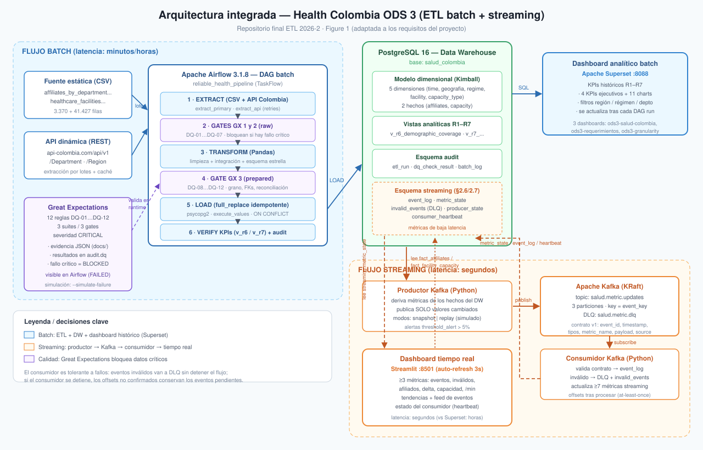
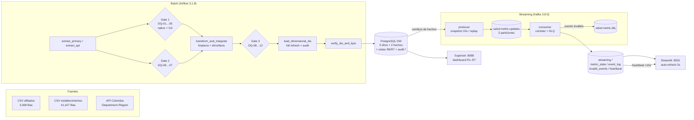
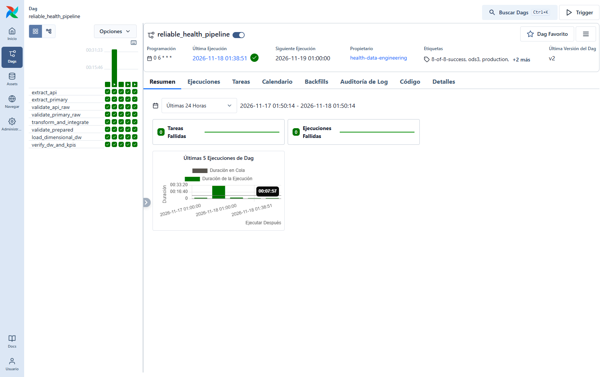
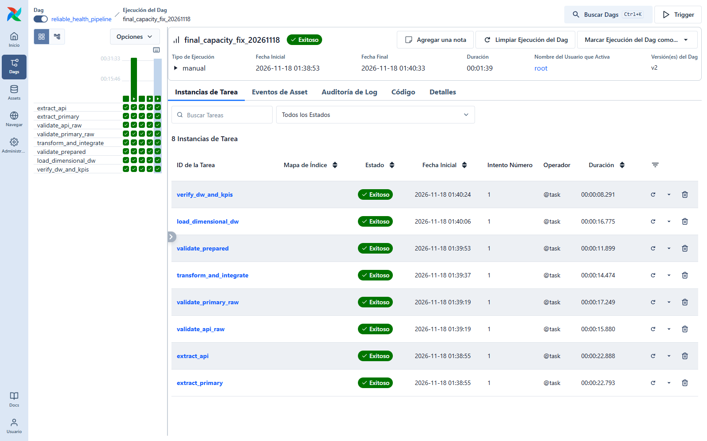
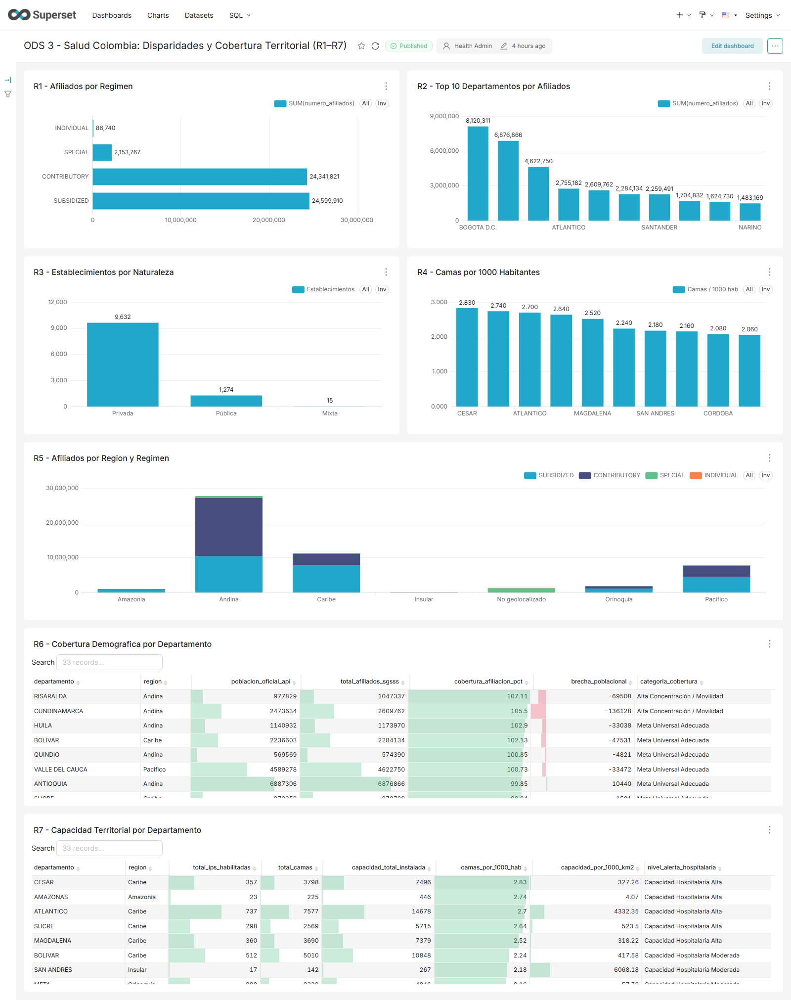
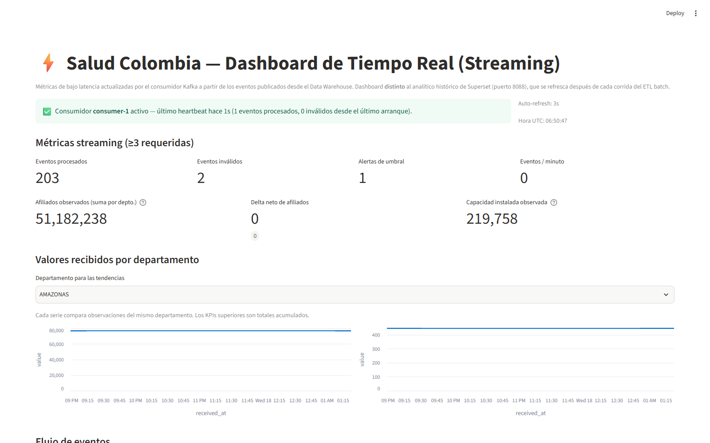
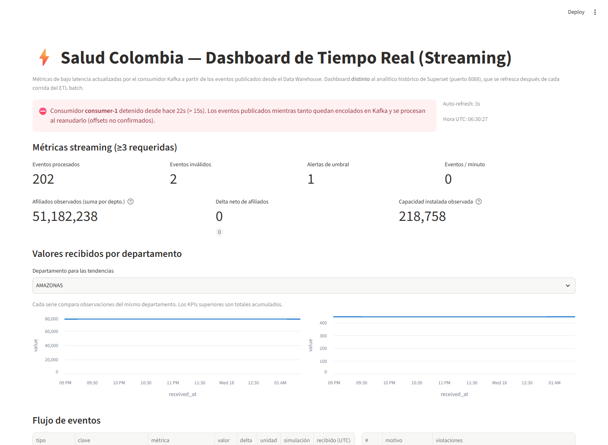
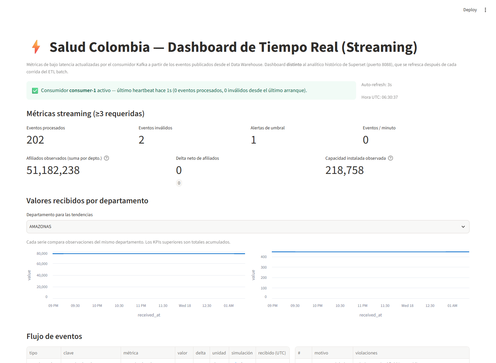

# etl-2026-2-ods3-salud-api-gx-airflow-streaming-kafka-


> 📄 **Versión en inglés:** [README.md](README.md) · Esta documentación en español: `README_ES.md`

**Health Colombia — ODS 3 (Salud y bienestar):** proyecto ETL batch + streaming integrado.
Ingesta de datasets estáticos y de una API dinámica, ETL orquestado con **Apache Airflow**,
validación de calidad con **Great Expectations**, **Data Warehouse dimensional** en PostgreSQL,
analítica histórica en **Apache Superset**, y un pipeline de **Kafka** con productor/consumidor,
contrato de eventos y dashboard de **tiempo real en Streamlit**.

| Componente | Tecnología | URL / puerto |
|---|---|---|
| Data Warehouse | PostgreSQL 16.15 | `localhost:5432` (`salud_colombia`) |
| Orquestación batch | Apache Airflow 3.1.8 (custom + GX) | <http://localhost:8080> |
| Data Quality | Great Expectations 1.25.0 (dentro de los gates del DAG) | — |
| Dashboard histórico | Apache Superset 6.1.0 | <http://localhost:8088> |
| Streaming | Apache Kafka 3.8.0 (1 broker) | `localhost:19092` (host) / `kafka:9092` (interno) |
| Dashboard tiempo real | Streamlit | <http://localhost:8501> |
| API REST sobre el DW | PostgREST | <http://localhost:3220> |
| Tests | pytest (regression suite) | `pytest -q` |

**Índice**

1. [Project Overview and Objectives](#1-project-overview-and-objectives--descripción-general-y-objetivos)
2. [Data Sources and EDA](#2-data-sources-and-eda--fuentes-de-datos-y-eda)
3. [System Architecture](#3-system-architecture--arquitectura-del-sistema)
4. [Batch ETL Pipeline](#4-batch-etl-pipeline--pipeline-etl-batch)
5. [Data Quality](#5-data-quality--calidad-de-datos-great-expectations)
6. [Data Warehouse](#6-data-warehouse--almacén-de-datos-dimensional)
7. [Batch Analytical Dashboard](#7-batch-analytical-dashboard--dashboard-analítico-batch-superset)
8. [Streaming Pipeline](#8-streaming-pipeline--pipeline-de-streaming-kafka)
9. [Real-Time Dashboard](#9-real-time-dashboard--dashboard-de-tiempo-real-streamlit)
10. [Execution and Reproducibility](#10-execution-and-reproducibility--ejecución-y-reproducibilidad)
11. [Functional Evidence](#11-functional-evidence--evidencia-funcional)
12. [Engineering Decisions and Limitations](#12-engineering-decisions-and-limitations--decisiones-de-ingeniería-y-limitaciones)

---

## 1. Project Overview and Objectives — Descripción general y objetivos

**Problema.** Colombia publica información del Sistema General de Seguridad Social en Salud
(afiliados por departamento/municipio/régimen) y de la infraestructura habilitada
(establecimientos, camas, salas) en cortes estáticos, mientras que la información demográfica
oficial (población, superficie por departamento) vive en una API. Los tomadores de decisión del
ODS 3 necesitan (a) una base histórica confiable y auditada para analítica, y (b) indicadores
**en vivo** de afiliación y capacidad instalada con latencia de segundos para detectar cambios
relevantes.

**Objetivos refinados**

1. Construir un ETL batch reproducible orquestado con Airflow que extraiga las dos fuentes
   estáticas y la API, limpie/integre los datos y cargue un **Data Warehouse dimensional**.
2. Aplicar **12 reglas de calidad CRÍTICAS** implementadas con Great Expectations (y verificadas
   con validación nativa) de modo que un dato inválido **nunca** llegue al DW y la falla sea
   visible en Airflow.
3. Proveer un **dashboard analítico histórico** (Superset) con KPIs y requisitos R1–R7.
4. Implementar un pipeline de **streaming en Kafka** (productor + consumidor + contrato de
   eventos) que publique **solo cambios reales** de métricas derivadas del DW y mantenga al
   menos 3 métricas de streaming actualizadas.
5. Construir un **dashboard de tiempo real** (Streamlit) distinto del histórico, con detección
   de caída del consumidor.
6. Dejar **evidencia real de ejecución** (corridas, logs, screenshots, experimentos de evento
   inválido e interrupción del consumidor) dentro de este repositorio.

**Batch vs. streaming (requisitos diferenciados)**

| | Batch (secciones 2.4–2.5) | Streaming (secciones 2.6–2.7) |
|---|---|---|
| Disparador | DAG diario programado + disparo manual (o `src.etl_main`) | Productor continuo cada 10 s + replay de histórico |
| Latencia | Minutos (duración de la corrida ≈ 26 s) | Segundos (publicación → consumidor → dashboard ≈ 1–3 s) |
| Almacenamiento | Dimensiones/hechos + vistas en PostgreSQL | `streaming.*` (event_log, metric_state, invalid_events, heartbeat) |
| Consumidor humano | Superset (`:8088`), consultas históricas | Streamlit (`:8501`), auto-refresh cada 3 s |
| Valor de baja latencia | — | Alertas de umbral (`threshold_alert`) y monitoreo de afiliación/capacidad sin esperar la próxima corrida batch |

---

## 2. Data Sources and EDA — Fuentes de datos y EDA

### 2.1 Fuentes

| Fuente | Tipo | Contenido | Ruta / endpoint |
|---|---|---|---|
| Afiliados al SGSSS | CSV estático (corte 2026-09-06) | 3,369 filas × 8 columnas: departamento, municipio, régimen, año, mes, num_personas | `data/raw/affiliates_by_department_municipality_regime_20260906.csv` |
| Establecimientos (REPS) | CSV estático (corte 2026-09-06) | 41,427 filas × 20 columnas: prestador, naturaleza, nivel de atención, capacidad instalada (camas/salas/consultorios…) | `data/raw/healthcare_facilities_by_level_capacity_20260906.csv` |
| API Colombia | API REST dinámica | Departamentos y regiones con población oficial, superficie y códigos DANE → enriquece `dim_geografia` y alimenta R6/R7 | `https://api-colombia.com/api/v1` (`/Department`, `/Region`) |

El productor de la API (`src/api_extract.py`) hace la llamada con timeout de 15 s y **guarda un
caché JSON** en `data/raw/`; si la API no responde, cae al caché (`source=local_cache`) y la
corrida batch sigue siendo reproducible. Los snapshots crudos quedan versionados en el repo.

**¿Por qué los eventos de streaming se generan aparte?** El CSV/API solo cambian cuando se
publica un nuevo corte (batch, baja frecuencia), pero el negocio necesita observar **cambios de
métricas** (afiliados por departamento, capacidad instalada) con latencia de segundos. Por eso el
productor Kafka deriva eventos de las **tablas de hechos del DW** (no de los CSV crudos) y solo
publica cuando un valor **cambia** respecto a su último estado publicado (modo `snapshot`,
chequeo cada 10 s), o replaya el histórico claramente identificado como simulación (modo
`replay`). El detalle está en la [sección 8](#8-streaming-pipeline--pipeline-de-streaming-kafka).

### 2.2 EDA (notebook)

Notebook: [`notebooks/01_data_validation_cleanup.ipynb`](notebooks/01_data_validation_cleanup.ipynb)
(perfilado, visualización de distribuciones, duplicados, nulos, limpieza y validación final).

**Hallazgos principales (outputs reales del notebook):**

| Hallazgo | Observación | Decisión que motivó |
|---|---|---|
| `NumPersonas` es `object` con separador de miles español (`'2.194'`) | no es numérico en crudo | limpieza `str.replace('.','')` → `to_numeric` → `int`; descarte de filas `<= 0` → regla **DQ-03** |
| Afiliados: **0 nulos, 0 duplicados**, 3,369 filas | fuente limpia en completitud | reglas de esquema/grano (**DQ-01, DQ-09**) en lugar de limpieza agresiva |
| Regímenes: conjunto cerrado `S` 1,124 / `C` 1,122 / `E` 1,115 / `I` 8 | pocos valores posibles | mapeo a `SUBSIDIZED/CONTRIBUTORY/SPECIAL/INDIVIDUAL` y **DQ-02** (`expect_column_values_to_be_in_set`) |
| Establecimientos: **3,145 duplicados (7.59%)** y **26,958 nulos** | los nulos están SOLO en columnas opcionales: `num nivel atencion` 60.99%, `Teléfono` 3.16%, `Gerente` 0.54%, `Email` 0.16%; identidad/capacidad = 0 nulos | `drop_duplicates()` + **DQ-04** con umbral ≥ 99.5% sobre atributos esenciales (no 100% global) |
| `nit IPS` con separadores (`890,980,643`) | basura en clave | limpieza de comas antes de construir `dim_facility` |
| Nombres de departamento heterogéneos: `VALLE` (126 filas), `SAN ANDRES`, `NO APLICA`; distritos especiales como departamento (`CARTAGENA` ×3, `SANTA MARTA` ×3) | cruce CSV ↔ API fallaría sin normalizar | `DEPT_NORMALIZE`, `DISTRICT_TO_DEPT`, `REGION_MAP` (`src/config.py`) → `dim_geografia` única (conforme) → **DQ-08** (≥ 95% de cruce) |

La sección **§10 del notebook** documenta el mapeo completo *hallazgo EDA → limpieza → regla
DQ-01…DQ-12 → expectativa GX*. Todos los outputs del notebook están ejecutados en el repo.

El EDA de API está ejecutado en la **§9 del notebook**: completitud de Department/Region,
unicidad de IDs, población/superficie positivas, cruces geográficos y consistencia regional.
El notebook ejecutado tiene 45 celdas de código y tres figuras embebidas. La API cacheada contiene
33 departamentos y seis regiones, sin valores demográficos inválidos.
Las tres figuras y el perfilado JSON están en [`docs/evidence/profiling/`](docs/evidence/profiling/).
La clasificación regional sigue el caché de la API: Norte de Santander → Andina, Vichada →
Orinoquia y Guainía → Amazonia. La **§10** documenta el mapeo EDA → DQ.

---

## 3. System Architecture — Arquitectura del sistema





**Flujo batch:** CSV/API → extracción cruda → *gates* de validación (nativo **y** Great
Expectations) → transformación e integración → segundo gate → carga al DW (full refresh
idempotente + auditoría) → verificación de KPIs. Un gate fallido detiene el DAG antes de tocar el
DW.

**Flujo streaming:** el productor observa los hechos del DW y publica eventos al tópico
`salud.metric.updates`; el consumidor valida el contrato, actualiza las métricas en
`streaming.*` y escribe el heartbeat; Streamlit lee esas tablas cada 3 s. Los eventos inválidos
van a la tabla `streaming.invalid_events` **y** al tópico DLQ `salud.metric.dlq`.

**Servicios (`docker-compose.yml`)**

| Servicio | Imagen / build | Puerto host |
|---|---|---|
| `postgres` (DW + metadatos streaming) | `postgres:16` | 5432 |
| `postgrest` | `postgrest/postgrest` | 3220 |
| `kafka` | `apache/kafka:3.8.0` | 19092 → 9092 |
| `airflow-webserver` / `scheduler` / `dag-processor` / `airflow-init` | `Dockerfile.airflow` → `localhost/health-airflow:3.1.8` | 8080 |
| `superset` / `superset-init` / `superset-bootstrap` | `Dockerfile.superset` → `apache/superset:6.1.0` | 8088 |
| `etl` (ETL manual) | `Dockerfile` → `python:3.11-slim` | — |
| `streaming-producer` / `streaming-consumer` | `Dockerfile` | — |
| `realtime-dashboard` | `Dockerfile` + Streamlit | 8501 |

---

## 4. Batch ETL Pipeline — Pipeline ETL batch

### 4.1 DAGs

| DAG | Propósito | Schedule |
|---|---|---|
| `reliable_health_pipeline` | **Test A** — pipeline productivo completo (8/8 tareas) | diario 06:00 UTC + manual (`ETL_SCHEDULE`, `catchup=False`) |
| `bad_health_pipeline` | **Test B** — demostración controlada de falla: inyecta `regime_id='INVALID_Z'` para probar el bloqueo en Gate 1 | manual |

Ambos comparten la estructura de `create_health_pipeline()` en
[`dags/reliable_health_pipeline.py`](dags/reliable_health_pipeline.py) /
[`dags/bad_health_pipeline.py`](dags/bad_health_pipeline.py).

### 4.2 Secuencia de ejecución (8 tareas)

```text
extract_primary ─────────────► validate_primary_raw (Gate 1: DQ-01…05) ─┐
      │                                                                  │
extract_api ─────────────────► validate_api_raw   (Gate 2: DQ-06…07) ──┤
                                                                       ▼
                                    transform_and_integrate (limpieza, dims, hechos,
                                                             integración CSV↔API)
                                                                       │
                                    validate_prepared (Gate 3: DQ-08…12)
                                                                       │
                                    load_dimensional_dw (full refresh + inserts + audit)
                                                                       │
                                    verify_dw_and_kpis (conteos, totales, cierre audit)
```

1. **extract_primary** — lee los 2 CSV crudos, registra conteos en `audit.etl_run_step`.
2. **extract_api** — llama a `api-colombia.com` (o caché) y deja departamentos/regiones en JSON.
3. **validate_primary_raw** — **Gate 1**: DQ-01…DQ-05 con validación nativa *y* GX
   (suites `primary_raw_affiliates_schema`, `primary_raw_affiliates_measures`,
   `primary_raw_facilities` → 11 expectativas).
4. **validate_api_raw** — **Gate 2**: DQ-06…DQ-07 (suite `api_raw_departments` → 6 expectativas).
5. **transform_and_integrate** — limpieza (§2.2), construcción de `dim_time`, `dim_geografia`,
   `dim_regime`, `dim_facility`, `dim_capacity_type`, `fact_affiliates`,
   `fact_facility_capacity` y cruce CSV↔API (prepara la tasa de resolución de departamentos).
6. **validate_prepared** — **Gate 3**: DQ-08…DQ-12 — tasa de cruce CSV↔API ≥ 95% (DQ-08),
   grano único (DQ-09/DQ-10), integridad referencial (DQ-11) y conciliación de sumas
   (DQ-12); suites GX `prepared_fact_affiliates` + `prepared_fact_capacity` → 10 expectativas.
7. **load_dimensional_dw** — `sql/init.sql` (reset idempotente del esquema dimensional,
   **sin tocar `audit.*`**) + `INSERT … ON CONFLICT DO NOTHING` con `batch_id` por corrida.
8. **verify_dw_and_kpis** — recount de dimensiones/hechos, totales de afiliados/camas y
   cierre del run en `audit.etl_run` (`SUCCESS` / `BLOCKED_QUALITY` / `FAILED`).


Cada corrida de Airflow conserva snapshots extraídos y preparados en `data/batches/` (artefactos
locales de ejecución, gitignorados). La validación y la carga usan los mismos archivos preparados;
la carga comprueba sus huellas en vez de reconstruir desde fuentes raw mutables. Conserva esa
carpeta hasta terminar la corrida para que los reintentos usen el mismo lote.

También existe el ETL batch **manual** (mismo código fuera de Airflow):

```bash
podman-compose run --rm --no-deps etl python -m src.etl_main
```

### 4.3 Evidencia de ejecución (Test A / Test B)

Las capturas históricas siguientes muestran éxito y falla crítica controlada. Los reportes
actuales están en `docs/evidence/gx/`: usa `executed_at` y los run IDs de `audit.etl_run` para
identificar la última ejecución. El contrato actual exige **12/12 reglas** y GX
**11/11 + 6/6 + 10/10** expectativas. Las dos expectativas adicionales de API impiden aceptar
población/superficie nulas antes de comprobar que sean positivas.

- **Test A:** `reliable_health_pipeline` debe finalizar con ocho tareas `success` y auditoría `SUCCESS`.
- **Test B:** `bad_health_pipeline` inyecta `INVALID_Z`; Gate 1 falla, las dependientes quedan
  `upstream_failed`, la auditoría registra `BLOCKED_QUALITY` y las filas finales del DW no cambian.





---

## 5. Data Quality — Calidad de datos (Great Expectations)

### 5.1 Catálogo de reglas (12, todas CRÍTICAS)

Fuente: [`src/quality/rules.py`](src/quality/rules.py); ejecutadas por
[`src/quality/gx_validator.py`](src/quality/gx_validator.py) en los 3 gates.

| Regla | Capa | Regla de negocio | Umbral | Expectativa GX |
|---|---|---|---|---|
| DQ-01 | raw_affiliates | 8 columnas obligatorias presentes | 100% | `expect_table_columns_to_match_set` |
| DQ-02 | raw_affiliates | `regime_id ∈ {S,C,E,I}` | 100% | `expect_column_values_to_be_in_set` |
| DQ-03 | raw_affiliates | `num_persons` numérico y ≥ 0 | 100% | `expect_column_values_to_be_between` |
| DQ-04 | raw_facilities | atributos esenciales de identidad/capacidad no nulos | ≥ 99.5% | `expect_column_values_to_not_be_null` |
| DQ-05 | raw_facilities | capacidad instalada ≥ 0 | 100% | `expect_column_values_to_be_between` |
| DQ-06 | raw_api_departments | nombre + id obligatorios | 100% | `expect_column_values_to_not_be_null` |
| DQ-07 | raw_api_departments | población y superficie no nulas, numéricas y > 0 | 100% | `expect_column_values_to_be_between` |
| DQ-08 | integration_gate | ≥ 95% de departamentos CSV resueltos en la API | ≥ 95% | `expect_integration_key_match_rate` |
| DQ-09 | prepared_fact_affiliates | grano `(sk_time, sk_geografia, sk_regime)` único | 100% | `expect_compound_columns_to_be_unique` |
| DQ-10 | prepared_fact_capacity | grano `(sk_time, sk_facility, sk_capacity_type)` único | 100% | `expect_compound_columns_to_be_unique` |
| DQ-11 | prepared_facts | cero huérfanos en las FK de los hechos | 100% | `expect_foreign_keys_to_exist_in_dimensions` |
| DQ-12 | prepared_facts | suma de afiliados concilia con el crudo | error < 0.01% | `expect_sum_reconciliation` |

Las medidas de afiliados/capacidad deben ser finitas; la validación cruda no convierte capacidades inválidas en cero.

La capacidad incluye un valor crudo `1,000`: se normaliza a 1000 con `src/numeric.py`, compartido por validación, limpieza y notebook. El total del DW es 219.758 unidades. Las comas mal agrupadas (por ejemplo `1,5`) se rechazan.


### 5.2 Integración real de Great Expectations 1.25.0

[`src/quality/gx_backend.py`](src/quality/gx_backend.py) construye, para cada gate:

1. **Suites por DataFrame** (para no contaminar `column_set` con columnas derivadas):
   `primary_raw_affiliates_schema`, `primary_raw_affiliates_measures`, `primary_raw_facilities`,
   `api_raw_departments`, `prepared_fact_affiliates`, `prepared_fact_capacity`.
2. Un `DataContext` **efímero** (sin escritura de artefactos en disco), un `ExpectationSuite` y
   una `ValidationDefinition` por suite, ejecutados con `gx.data_asset.validate(...)`.
3. Serialización del resultado dentro del reporte de calidad:
   `report["gx"] = {available, version, suites[], expectations_passed/total, failed_rules}` y
   `evaluations[].details.gx` → persistido en `audit.dq_check_result.observed_value`.

**Combinación conservadora (AND):** cada regla se evalúa con su implementación nativa (pandas)
**y**, cuando existe la expectativa GX equivalente, también con Great Expectations; el gate solo
pasa si **ambas** aprueban. 11 de las 12 reglas tienen expectativa GX (DQ-08, una tasa de
cruce ≥ 95%, se calcula nativamente). GX es obligatorio: si falta la biblioteca, una suite no se ejecuta o queda incompleta, el gate registra una falla crítica y bloquea la carga; no acepta silenciosamente una validación solo nativa.

### 5.3 Comportamiento ante falla crítica

`CriticalQualityError` → la tarea de validación **falla** en Airflow (roja), las tareas
dependientes quedan `upstream_failed`, el DAG termina `failed`, `audit.etl_run` queda en
**`BLOCKED_QUALITY`** y **el DW no se carga**. Los detalles (regla, valores observados, fallos GX)
quedan en `audit.dq_check_result` y en los JSONs de evidencia.

### 5.4 Evidencia GX

| Archivo | Gate | Resultado |
|---|---|---|
| [`docs/evidence/gx/primary_raw_results.json`](docs/evidence/gx/primary_raw_results.json) | Gate 1 | 5/5 reglas · GX **11/11** expectativas (3 suites) · `available=true v=1.25.0` |
| [`docs/evidence/gx/api_raw_results.json`](docs/evidence/gx/api_raw_results.json) | Gate 2 | 2/2 reglas · GX **6/6** expectativas |
| [`docs/evidence/gx/prepared_results.json`](docs/evidence/gx/prepared_results.json) | Gate 3 | 5/5 reglas · GX **10/10** expectativas (incluye DQ-12) |

En el **Test B** el mismo JSON muestra `DQ-02 → FAIL` con
`gx: {failed: 1, failed_expectations: ['expect_column_values_to_be_in_set(regime_id)']}` —
es decir, el detector GX y el nativo coinciden en la falla (10/11 expectativas).

---

## 6. Data Warehouse — Almacén de datos dimensional

Metodología **Kimball** (grano declarado, dimensiones conformadas, hechos por separado).
Definición completa en [`sql/init.sql`](sql/init.sql); datos en
[`docs/evidence/dw/dimensional_dw_state.log`](docs/evidence/dw/dimensional_dw_state.log).

### 6.1 Dimensiones (`public`)

| Tabla | Filas | Contenido / grano |
|---|---|---|
| `dim_time` | 2 | periodos de los hechos: **2022-Q2** (afiliados) y **2022-Q4** (capacidad); año, mes, trimestre, semestre |
| `dim_geografia` | 2,240 | **dimensión conforme única**: municipio + departamento + región DANE **y** enriquecimiento de la API (capital, superficie, población) |
| `dim_regime` | 4 | `SUBSIDIZED / CONTRIBUTORY / SPECIAL / INDIVIDUAL` |
| `dim_facility` | 10,921 | prestadores/establecimientos (código, nombre, NIT, naturaleza, nivel) |
| `dim_capacity_type` | 63 | tipos de capacidad (camas, salas, consultorios, ambulancias…) |

### 6.2 Hechos (`public`)

| Hecho | Grano | Filas | Total |
|---|---|---|---|
| `fact_affiliates` | periodo × geografía × régimen (snapshot 2022-Q2) | 3,369 | **51,182,238** afiliados |
| `fact_facility_capacity` | periodo × establecimiento × tipo de capacidad × geografía (snapshot 2022-Q4) | 31,496 | **219,758** unidades de capacidad |

Todas las FK tienen restricción `REFERENCES` verificable (integridad referencial real; DQ-11
además la valida en cada corrida).

### 6.3 Vistas analíticas (alimentan Superset)

| Vista | Filas | Uso |
|---|---|---|
| `v_affiliates_summary` | — | R1, R2, R5 |
| `v_facility_summary` | 31,496 | R3 |
| `v_r6_demographic_coverage` | 33 | R6 — cobertura de afiliación vs. población oficial, categoría |
| `v_r7_territorial_capacity` | 33 | R7 — camas/1000 hab, capacidad/km², nivel de alerta |

### 6.4 Esquema `audit.*` (trazabilidad)

| Tabla | Filas | Contenido |
|---|---|---|
| `audit.etl_run` | 4 | una fila por corrida: `run_key`, `dag_id`, `status` (`SUCCESS`/`BLOCKED_QUALITY`/`FAILED`), duración, `dq_rules_passed/total` |
| `audit.etl_run_step` | 14 | pasos (extract/validate/transform/load/verify) con `rows_in/out` y estado |
| `audit.dq_check_result` | 34 | **resultado por regla DQ** con severidad, estado, valor observado y el subobjeto `gx` |
| `audit.etl_batch_log` | 2 | lotes de carga con conteos antes/después (`batch_id` referenciado por los hechos) |

### 6.5 Estrategia de carga

1. **Full refresh idempotente:** `sql/init.sql` hace `DROP … IF EXISTS` + `CREATE` de
   dimensiones, hechos y vistas; las tablas `audit.*` usan `CREATE TABLE IF NOT EXISTS` y **nunca
   se eliminan** (el historial de corridas sobrevive a cualquier reset).
2. **Bulk insert** con `psycopg2.extras.execute_values` y `ON CONFLICT DO NOTHING`
   (re-ejecución sin duplicados).
3. **Auditoría por corrida:** `batch_id` con conteos antes/después; cualquier excepción hace
   `rollback` y deja `FAILED` en `audit.etl_batch_log`.

---

## 7. Batch Analytical Dashboard — Dashboard analítico batch (Superset)

**Herramienta:** Apache Superset 6.1.0 → <http://localhost:8088> (login `admin/admin` en
desarrollo local). **Conexión:** URI SQLAlchemy al DW PostgreSQL registrada por
[`scripts/superset_bootstrap.py`](scripts/superset_bootstrap.py); **7 datasets base**
(`v_affiliates_summary`, `v_facility_summary`, `v_r6_demographic_coverage`,
`v_r7_territorial_capacity`, `fact_affiliates`, `fact_facility_capacity`, `dim_geografia`), más `dim_facility` registrado por el script de gráficos (**8 en total**).
Dashboard: **`ods3-salud-colombia`**
(<http://localhost:8088/superset/dashboard/ods3-salud-colombia/>), gráficas creadas por
[`scripts/superset_charts_bootstrap.py`](scripts/superset_charts_bootstrap.py).

| Chart | Dataset | Pregunta de negocio |
|---|---|---|
| **R1** – Afiliados por Régimen | `v_affiliates_summary` | ¿cuánto pesa cada régimen? (subsidiado 24,599,910; contributivo 24,341,821) |
| **R2** – Top 10 Departamentos por Afiliados | `v_affiliates_summary` | ¿dónde se concentra la afiliación? (Bogotá total 8,120,311) |
| **R3** – Establecimientos por Naturaleza | `dim_facility` | IPS únicas: privada 9,632 / pública 1,274 / mixta 15 |
| **R4** – Camas por 1000 Habitantes | `v_r7_territorial_capacity` | dotación relativa (líderes: Cesar 2.83, Amazonas 2.74, Atlántico 2.70) |
| **R5** – Afiliados por Región y Régimen | `v_affiliates_summary` | distribución regional (Andina/Caribe/Pacífico…) |
| **R6** – Cobertura Demográfica por Departamento | `v_r6_demographic_coverage` | afiliados vs población oficial: categorías *Meta Universal Adecuada*, *Alta Concentración/Movilidad* (cov. >100% requiere investigar fechas de referencia y movilidad), *Déficit* |
| **R7** – Capacidad Territorial por Departamento | `v_r7_territorial_capacity` | IPS, camas, camas/1000 hab y **nivel de alerta hospitalaria** |

**Insights principales:** el subsidiado supera ligeramente al contributivo; Bogotá totaliza
8,120,311 afiliados. La cobertura calculada supera 100% en algunos departamentos (Risaralda
107.1%, Cundinamarca 105.5%). Esto no demuestra movilidad por sí solo: deben contrastarse las
fechas de referencia y la definición de población. La capacidad hospitalaria es desigual;
Cesar/Amazonas/Atlántico tienen alta capacidad instalada y otros departamentos presentan déficit.
Son comparaciones descriptivas de snapshots, no conclusiones causales ni series de largo plazo.



---

## 8. Streaming Pipeline — Pipeline de streaming (Kafka)

### 8.1 Productor ([`src/streaming/producer.py`](src/streaming/producer.py))

| Modo | Comportamiento |
|---|---|
| `snapshot` (default, producción) | Cada **10 s** (`STREAMING_PRODUCER_INTERVAL`) consulta los hechos del DW, compara con su último valor publicado (`streaming.producer_state`) y **solo publica lo que cambió** — nunca re-publica un KPI sin cambio (justificación analítica). Si `\|delta\| > 5%` emite además un evento `threshold_alert` (`--alert-threshold 0.05`). |
| `replay` (simulación) | Replaya el histórico del DW a 0.5 s por evento. **Identificado explícitamente** en cada evento: `"source": {"mode": "replay", "simulation": true}`. |

```bash
podman exec streaming_producer_salud python -m src.streaming.producer --mode replay --loop   # simulación
podman exec streaming_producer_salud python -m src.streaming.producer --mode snapshot        # producción
```

**Generación y frecuencia:** eventos derivados de `fact_affiliates` / `fact_facility_capacity`
(agregados por departamento), 67 actualizaciones por pasada completa (134 en un replay de dos ciclos), chequeo cada 10 s.
**Valor de baja latencia:** un cambio de afiliación o de capacidad llega al dashboard en
segundos (vs. esperar la próxima corrida batch), habilitando `threshold_alert` casi en tiempo
real para monitoreo del ODS 3.

### 8.2 Tópicos

| Tópico | Particiones | Clave (key) | Uso |
|---|---|---|---|
| `salud.metric.updates` | 3 | `event_key` (ej. `affiliates_by_department:19`) | orden por clave = orden por departamento |
| `salud.metric.dlq` | 1 | `message_key` original | dead-letter de eventos rechazados (creado/asegurado por el consumidor al arrancar) |

Grupo de consumidores: `health-metrics-consumers` (consumer id `consumer-1`).

### 8.3 Contrato de eventos ([`src/streaming/contract.py`](src/streaming/contract.py), `schema_version=1`)

| Campo | Regla |
|---|---|
| `event_id` | **requerido**, UUID v4 string, único por evento (idempotencia: `ON CONFLICT (event_id) DO NOTHING`) |
| `event_type` | **requerido**, `metric_update` \| `threshold_alert` |
| `schema_version` | **requerido**, entero `== 1` |
| `event_key` | **requerido**, string no vacío — es también la **key de Kafka** |
| `timestamp` | **requerido**, ISO-8601 UTC con timezone |
| `metric_name` | **requerido**, string no vacío |
| `payload` | **requerido**, objeto con `metric_name`, `value`, `unit` |
| `source` | opcional, `{"mode": …, "simulation": bool, "batch_id": …}` |

**Validación y comportamiento ante evento inválido:** el consumidor valida tipo, presencia,
rango de `schema_version`, formato de timestamp y esquema de `payload`. Si falla: (1) **rechaza**
el evento (`WARNING INVALID EVENT rejected … errors=[...]`), (2) lo registra en
`streaming.invalid_events` (motivo + errores + payload crudo), (3) incrementa
`invalid_events_total`, (4) lo **re-publica a la DLQ** `salud.metric.dlq`, y (5) **sigue
procesando** (el loop no se cae).

### 8.4 Consumidor y métricas ([`src/streaming/consumer.py`](src/streaming/consumer.py))

Actualiza **7 métricas** en `streaming.metric_state` (mínimo requerido: 3):

| Métrica | Significado |
|---|---|
| `events_processed_total` | eventos válidos procesados |
| `invalid_events_total` | eventos rechazados por contrato |
| `threshold_alerts_total` | alertas de umbral recibidas |
| `events_per_minute` | throughput actual |
| `affiliates_latest_total` | suma de afiliados observados (último valor por depto) |
| `affiliates_net_delta` | delta neto acumulado de afiliados |
| `capacity_latest_total` | capacidad instalada observada |

Además: `streaming.event_log` (histórico de eventos), `streaming.consumer_heartbeat`
(`status`, contadores, `last_heartbeat` ≈ cada 1 s) y `streaming.producer_state` (evita
re-publicar sin cambios).

### 8.5 Evidencia

- [`docs/evidence/streaming/01_contract_violation_and_alert.log`](docs/evidence/streaming/01_contract_violation_and_alert.log)
  — rechazos + enrutado a DLQ + `threshold_alert` procesado.
- [`docs/evidence/streaming/02_dlq_topic_messages.log`](docs/evidence/streaming/02_dlq_topic_messages.log)
  — mensajes reales del tópico DLQ (payload crudo + errores).
- [`docs/evidence/streaming/05_replay_and_topic_listen.log`](docs/evidence/streaming/05_replay_and_topic_listen.log)
  — replay (simulación), escucha raw del tópico (`--listen 5`) y descripción de particiones.

---

## 9. Real-Time Dashboard — Dashboard de tiempo real (Streamlit)

**Herramienta:** Streamlit → <http://localhost:8501> ([`src/streaming/dashboard.py`](src/streaming/dashboard.py),
servicio `realtime-dashboard`).

**Integración consumidor → dashboard:** el consumidor Kafka escribe en PostgreSQL
(`streaming.*`); Streamlit **lee esas tablas directamente con psycopg2 y se auto-refresca cada
3 s** (`st.fragment(run_every=...)`). No hay websockets: el mecanismo es polling sobre la misma base
transaccional — simple, compatible con la herramienta y suficiente para latencia de segundos.

**Métricas mostradas (≥3 requeridas; se muestran 7):** eventos procesados, eventos inválidos,
alertas de umbral, eventos/minuto, afiliados observados, delta neto de afiliados y capacidad
instalada observada — más series de tendencia, flujo de eventos recientes y la tabla de
violaciones de contrato (DLQ).

**Estado del consumidor (heartbeat):** el consumidor escribe `status='running'` + timestamp
(`clock_timestamp()`) ≈ cada 1 s. El dashboard calcula la edad del heartbeat con el **reloj del
servidor** y muestra:

- `✅ ONLINE` si `status='running'` y edad ≤ **15 s** (`STREAMING_HEARTBEAT_TIMEOUT`);
- `⛔ OFFLINE` si la edad supera 15 s o `status='stopped'` (caída detectada);
- `⚠️ Sin heartbeat` si el consumidor nunca arrancó.

**Distinción con el dashboard histórico**

| | Superset (§7) | Streamlit (§9) |
|---|---|---|
| Datos | DW dimensional (hechos históricos 2022) | tablas `streaming.*` (eventos de segundos) |
| Actualización | al consultar / tras cada corrida ETL | polling cada **3 s** |
| Pregunta | “¿cómo fue el histórico del ODS 3?” | “¿qué está pasando **ahora** y está vivo el consumidor?” |
| Alcance | analítica R1–R7 | KPIs de streaming + salud del pipeline |



---

## 10. Execution and Reproducibility — Ejecución y reproducibilidad

### 10.1 Requisitos

- Git y Docker Desktop con Docker Compose v2, en modo contenedores Linux. Para Podman, usar
  un proveedor Compose actual y el archivo base.
- Aproximadamente 4 GB de RAM libres para esta demostración y memoria adicional para el navegador.
- Python 3.12 es opcional en el host: el camino Docker ejecuta los scripts dentro de los contenedores.
- Los dos CSV y el caché de la API están incluidos; no se necesita API de pago ni token.

### 10.2 Puesta en marcha (Docker Desktop / PowerShell)

Hay dos lanzadores equivalentes para ejecutar todo el proyecto: **`bash start.sh`**
(Linux/macOS) y **`start.bat`** (Windows, un envoltorio sobre `scripts/project_manager.ps1`;
no necesita Python en el host). Ambos funcionan desde cualquier directorio, crean `.env` y
las credenciales de Airflow en el primer uso, y exponen el mismo menú y las mismas acciones.

**Inicio rápido:**

```bash
# Linux/macOS — reconstrucción completa: vaciar → construir → iniciar → cargar Airflow → dashboards → tests
bash start.sh auto
```

```powershell
# Windows PowerShell — el mismo flujo (opción 7 del menú)
start.bat auto
```

`auto` pide escribir **ELIMINAR** primero. En una máquina con datos que quieras conservar,
usa `setup` (iniciar + primera carga de Airflow + dashboards, sin borrar) o solo `start`
(solo servicios).

**Menú:** Windows: `start.bat`; Linux/macOS: `bash start.sh`. Funcionan desde cualquier
directorio. Windows usa `scripts/project_manager.ps1` y no necesita Python en el host.
Sin argumentos abren el menú interactivo; con un argumento ejecutan una sola acción
(`bash start.sh --help` / `start.bat --help` lista las acciones sin iniciar Docker).

| Opción | Comando | Acción |
|---|---|---|
| 1 | `start` | Construir e iniciar servicios conservando datos |
| 2 | `stop` | Detener servicios conservando datos |
| 3 | `validate` | Revisar Compose, estado, dependencias Airflow y suite pytest |
| 4 | `reset` | Recrear contenedores conservando datos |
| 5 | `wipe` | Eliminar contenedores y vaciar todos los volúmenes de este proyecto, `.pgdata` y `data/batches` |
| 6 | `steps` | Reconstruir desde cero, con pausa antes de cada etapa |
| 7 | `auto` | Vaciar datos, construir, cargar Airflow, esperar éxito, crear BI y validar |
| 8 | `restart` | Reiniciar servicios conservando datos |
| 9 | `setup` | Iniciar, cargar Airflow y registrar BI sin borrar |
| 10 | `links` | Mostrar los enlaces y direcciones del proyecto sin necesitar Docker activo |
| 11 | `kafka` | Mostrar salud, tópicos, particiones, grupos, lag, disco, CPU y memoria de Kafka |
| 12 | `kafka-live` | Actualizar el monitoreo de Kafka cada cinco segundos hasta presionar `Ctrl+C` |
| 0 | — | Salir |

Ejemplos: `start.bat setup`, `start.bat validate`, `bash start.sh restart`.
Para consultar direcciones: `start.bat links` o `bash start.sh links`. También aparecen
al iniciar/reiniciar servicios y al preparar los dashboards. Se leen los puertos de `.env`
(las variables del entorno tienen prioridad). Se muestran Airflow y sus DAGs, Superset y
su BI, gráficos/datasets/SQL Lab, Streamlit, PostgREST y las siete tablas del DW.
PostgreSQL y Kafka muestran direcciones para sus clientes, no páginas web.
La tabla completa, con credenciales y qué ver en cada enlace, está en
[10.3 Enlaces para ver los datos](#103-enlaces-para-ver-los-datos).

Para revisar Kafka ejecuta `start.bat kafka` o `bash start.sh kafka`. La salida muestra el
estado y healthcheck del contenedor, reinicios, tópicos, particiones y réplicas, grupos de
consumidores, lag de `health-metrics-consumers`, tamaño de `/var/lib/kafka/data` y CPU,
memoria, red y disco del contenedor. `docker stats` es una medición puntual; para una
serie histórica se debe capturar la salida periódicamente o usar métricas JMX/Prometheus.
Para monitoreo continuo ejecuta `start.bat kafka-live` o `bash start.sh kafka-live`.
La pantalla se actualiza cada cinco segundos y se detiene con `Ctrl+C`; este modo es de solo
lectura y no publica eventos ni confirma offsets.
Usa `--help` para consultar comandos sin iniciar Docker. Las opciones 5, 6 y 7 requieren
escribir **ELIMINAR**. No usan `docker system prune` ni eliminan recursos de otros proyectos.
El borrado automático exige `PGDATA_HOST_DIR=./.pgdata` y rechaza enlaces y rutas externas.
Se conservan código, `.env`, fuentes originales y evidencias. En Linux se usa `alpine:3.20`
para vaciar los directorios verificados aunque sus archivos pertenezcan al contenedor.

Si faltan, se crean `.env` desde el ejemplo y el acceso local `airflow/airflow`; las
credenciales existentes se conservan. La carga espera hasta 15 minutos tras reintentar
el registro del DAG hasta cinco minutos. Una falla cancela los pasos siguientes.
`start` solo levanta servicios; `setup` incluye la primera carga y los dashboards.
`validate` requiere el entorno iniciado y guarda la evidencia de pruebas en un temporal.

Ejecuta desde la raíz del repositorio y conserva la misma ventana de PowerShell para `$dc`.
El archivo principal funciona en Docker; Podman puede definir `CONTAINER_USERNS_MODE=keep-id`.

```powershell
# Conserva .env si ya existe; solo lo crea en una clonación nueva.
if (!(Test-Path .env)) { Copy-Item .env.example .env }
if (!(Test-Path config/simple_auth_manager_passwords.json)) {
    '{"airflow":"airflow"}' | Set-Content -Encoding ascii config/simple_auth_manager_passwords.json
}
$dc = @('-f', 'docker-compose.yml')
docker compose @dc config --quiet
docker compose @dc up -d --build
docker compose @dc ps -a    # podman-compose no admite `-a`: usa `docker compose @dc ps` (ya lista los detenidos)
```

El arranque espera la salud de PostgreSQL/Kafka y la finalización correcta de los inicializadores.
El scheduler y el procesador de DAGs esperan también al servidor API de Airflow. Que `airflow-init`
y `superset-init` terminen con `Exited (0)` es normal; un código distinto bloquea a sus dependientes.
Los servicios usan DNS interno (`postgres`, `airflow-webserver`, `superset`, `kafka`). Mapear esos
nombres a `host-gateway` desvía el tráfico hacia el host y puede provocar errores HTTP 500.

1. Abre <http://localhost:8080> (`airflow` / `airflow`) y espera a que aparezca `reliable_health_pipeline`.
2. Dispara la primera carga y espera que **las ocho tareas** terminen en `success`:

```powershell
docker exec airflow_scheduler_salud airflow dags trigger reliable_health_pipeline
```

3. Registra la conexión al DW y crea los siete gráficos del dashboard:

```powershell
docker compose @dc --profile bootstrap run --rm --no-deps superset-bootstrap
docker compose @dc exec superset /app/.venv/bin/python /app/scripts/superset_charts_bootstrap.py
```

> [!NOTE]
> `--no-deps` es importante con **podman-compose**: sin él, su `run` lanza un `up` interno
> de las dependencias con `--remove-orphans` y un hash del compose calculado por `--profile`,
> con lo que derriba todos los servicios del proyecto y solo recrea las dependencias.
> Docker Compose no se ve afectado y el flag existe en ambos motores.

Abre [el dashboard histórico](http://localhost:8088/superset/dashboard/ods3-salud-colombia/)
(`admin` / `admin`) y [el dashboard de streaming](http://localhost:8501).
PostgREST usa <http://localhost:3220> por defecto (`POSTGREST_PORT` en `.env`); dentro del contenedor
continúa en 3000. Si Windows reserva un puerto del host, elige otro `POSTGREST_PORT` libre y recrea
solo `postgrest`; no cambies el puerto interno ni la dirección de la base de datos.

Para Podman en Linux, crea `.env` y el JSON de contraseña, y usa el archivo base:

```bash
cp .env.example .env
printf '{"airflow":"airflow"}' > config/simple_auth_manager_passwords.json
podman-compose up -d --build
# Después de la primera carga exitosa del DAG:
podman-compose --profile bootstrap run --rm --no-deps superset-bootstrap
podman exec superset_salud /app/.venv/bin/python /app/scripts/superset_charts_bootstrap.py
```

### 10.3 Enlaces para ver los datos

Con los servicios en marcha (`start`, `setup` o `auto`), estos son todos los lugares donde
se puede inspeccionar los datos. **Los puertos se leen de `.env`**
(`AIRFLOW_WEBSERVER_PORT`, `SUPERSET_PORT`, `REALTIME_DASHBOARD_PORT`, `POSTGREST_PORT`,
`POSTGRES_PORT`, `KAFKA_EXTERNAL_PORT`); los valores de abajo son los valores por defecto de
`.env.example`. Imprime la lista exacta de tu máquina en cualquier momento con
`bash start.sh links` o `start.bat links` (funciona sin Docker).

#### Orquestación — Apache Airflow · `airflow` / `airflow`

| Qué ver | URL |
|---|---|
| UI de Airflow (lista de DAGs, corridas, logs) | <http://localhost:8080> |
| DAG principal `reliable_health_pipeline` (8 tareas) | <http://localhost:8080/dags/reliable_health_pipeline> |
| DAG de fallo controlado `bad_health_pipeline` | <http://localhost:8080/dags/bad_health_pipeline> |
| Endpoint de salud de Airflow | <http://localhost:8080/api/v2/monitor/health> |

#### Analítica histórica — Apache Superset · `admin` / `admin`

| Qué ver | URL |
|---|---|
| UI de Superset | <http://localhost:8088> |
| **Dashboard BI “ODS 3 – Salud Colombia” (gráficos R1–R7)** | <http://localhost:8088/superset/dashboard/ods3-salud-colombia/> |
| Lista de dashboards | <http://localhost:8088/dashboard/list/> |
| Lista de gráficos | <http://localhost:8088/chart/list/> |
| Datasets (vistas y hechos) | <http://localhost:8088/tablemodelview/list/> |
| SQL Lab (consultas interactivas al DW) | <http://localhost:8088/sqllab/> |

El dashboard BI lo crea el paso de bootstrap (opción **9** del menú / `setup`); entra con
las credenciales configuradas de Superset.

#### Tiempo real — Streamlit · sin login

| Qué ver | URL |
|---|---|
| Dashboard en tiempo real (métricas de Kafka, refresco ≈ 3 s, banner ONLINE/OFFLINE del consumidor) | <http://localhost:8501> |

#### API REST — PostgREST · anónimo (`etl_user`)

URL base por defecto <http://localhost:3220/> (`POSTGREST_PORT` en `.env`); la raíz devuelve
el **esquema OpenAPI** de todo el DW.

| Qué ver | URL |
|---|---|
| Raíz + esquema OpenAPI | <http://localhost:3220/> |
| `dim_time` | <http://localhost:3220/dim_time?limit=10> |
| `dim_geografia` | <http://localhost:3220/dim_geografia?limit=10> |
| `dim_regime` | <http://localhost:3220/dim_regime?limit=10> |
| `dim_facility` | <http://localhost:3220/dim_facility?limit=10> |
| `dim_capacity_type` | <http://localhost:3220/dim_capacity_type?limit=10> |
| `fact_affiliates` | <http://localhost:3220/fact_affiliates?limit=10> |
| `fact_facility_capacity` | <http://localhost:3220/fact_facility_capacity?limit=10> |

#### Almacén de datos — PostgreSQL · cliente de base de datos, no navegador

| Qué ver | Dirección |
|---|---|
| PostgreSQL 16, base `salud_colombia`, usuario `etl_user` | `localhost:5432` (DBeaver, pgAdmin, `psql`) |
| Historial de corridas y resultados de calidad | esquema `audit` → `audit.etl_run`, `audit.dq_check_result` |
| Métricas de streaming en vivo | esquema `streaming` → `streaming.metric_state`, `streaming.event_log` |

#### Streaming — Kafka · cliente de Kafka, no navegador

| Qué ver | Dirección |
|---|---|
| Listener externo del broker | `localhost:19092` (`KAFKA_EXTERNAL_PORT`; en el clúster `kafka:9092`) |
| Tópicos | `salud.metric.updates`, `salud.metric.dlq`, `__consumer_offsets` |

Usa la opción **11** (`kafka`) del menú para ver tópicos, grupos de consumidores y lag, y la
**12** (`kafka-live`) para observarlos actualizarse cada cinco segundos.

### 10.4 Ejecutar y verificar

`ETL_SCHEDULE` vale `0 6 * * *` por defecto: **cada día a las 06:00 UTC / 01:00 America/Bogota**.
`catchup=False` evita corridas históricas y `max_active_runs=1` impide full refresh simultáneos.
Para una demostración solo manual, configura `ETL_SCHEDULE=none` en `.env` y recrea los servicios de Airflow.
El DAG de falla controlada continúa siendo manual.

```powershell
# Ver corridas reales; copia el run_id deseado de esta salida o de la interfaz.
docker exec airflow_scheduler_salud airflow dags list-runs reliable_health_pipeline -o plain

# Falla crítica controlada: debe quedar failed / BLOCKED_QUALITY sin alterar el DW.
docker exec airflow_scheduler_salud airflow dags trigger bad_health_pipeline

# Tests en un contenedor temporal; los reportes de pruebas no reemplazan la evidencia final.
docker compose @dc --profile tools run --rm --build --no-deps -e GX_EVIDENCE_DIR=/tmp/etl-test-gx etl python -m pytest -q -p no:cacheprovider

# Simulación acotada de llegada de métricas históricas del DW.
docker exec streaming_producer_salud python -m src.streaming.producer --mode replay --interval 0.5 --cycles 1
# Rechazo por contrato y alerta de negocio explícita:
docker exec streaming_producer_salud python -m scripts.streaming_demo --inject-invalid
docker exec streaming_producer_salud python -m scripts.streaming_demo --inject-alert

# Interrupción del consumidor: observar OFFLINE tras 15 segundos y después recuperación.
docker stop streaming_consumer_salud
docker start streaming_consumer_salud

# Logs y detención conservando datos locales:
docker compose @dc logs --tail 80
docker compose @dc stop
```

Verifica ocho tareas verdes, auditoría `SUCCESS` con 12/12 reglas, GX **11/11 + 6/6 + 10/10**,
siete gráficos Superset con datos y métricas Streamlit que cambien tras eventos. La tasa debe volver
a cero al quedar inactivo. En modo snapshot no se publican valores idénticos: es el comportamiento
esperado. Usa replay para demostrar llegadas; los eventos se identifican como simulación. Distingue
los experimentos históricos de las evidencias exitosas finales.

Para EDA/desarrollo local, crea un entorno virtual e instala las dependencias declaradas:

```powershell
python -m venv .venv
.\.venv\Scripts\python -m pip install -r requirements.txt
.\.venv\Scripts\python -m jupyter lab
```

Abre `notebooks/01_data_validation_cleanup.ipynb` y ejecuta todas las celdas. Usa snapshots cacheados
de la API por defecto. Exportar CSV limpios requiere `EXPORT_CLEAN_DATA=1`; el EDA normal no reemplaza
los exports del DW.

### 10.5 Credenciales

Todo el material sensible vive en `.env` (**gitignorado**); `.env.example` trae placeholders y
valores por defecto **solo de desarrollo local**. Las URLs usan `localhost`, pero Compose publica puertos del host: no expongas esas credenciales de demostración fuera del equipo de desarrollo:

| Servicio | Usuario / contraseña por defecto (`.env.example`) |
|---|---|
| PostgreSQL | `etl_user` / `change_me_2026` |
| Airflow | `airflow` / `airflow` (archivo `config/simple_auth_manager_passwords.json`, creado en el paso 3) |
| Superset | `admin` / `admin` |

El repositorio **no contiene** API keys, tokens ni credenciales reales (ver §12).

---

## 11. Functional Evidence — Evidencia funcional

Todo el material está en [`docs/evidence/`](docs/evidence/) y corresponde a ejecuciones reales
del sistema (no capturas de código).

Las comprobaciones integradas finales están en [final_validation.md](docs/evidence/final_validation.md).
Sus run IDs, fechas, consultas SQL y salida de pruebas distinguen la evidencia final de experimentos históricos.

### 11.1 Índice de evidencia

| Requisito | Evidencia |
|---|---|
| Corrida exitosa de Airflow (8/8 + GX) | [`docs/evidence/gx/`](docs/evidence/gx/) · logs de gates en los run logs de Airflow · screenshot `airflow_dag_detail.png` |
| Validación de calidad (nativa + GX) | `primary_raw_results.json` (11/11), `api_raw_results.json` (6/6), `prepared_results.json` (10/10) |
| Falla crítica bloquea el DW | Test B `BLOCKED_QUALITY 4/5` en `audit.etl_run` + screenshot `airflow_dags.png` (corrida roja) |
| Carga del DW (dimensiones/hechos) | [`docs/evidence/dw/dimensional_dw_state.log`](docs/evidence/dw/dimensional_dw_state.log) (conteos, FK, vistas, auditoría) |
| Dashboard batch | [`docs/evidence/screenshots/superset_dashboard.png`](docs/evidence/screenshots/superset_dashboard.png) |
| Productor/consumidor Kafka | [`01_contract_violation_and_alert.log`](docs/evidence/streaming/01_contract_violation_and_alert.log), [`05_replay_and_topic_listen.log`](docs/evidence/streaming/05_replay_and_topic_listen.log) |
| Métricas de streaming actualizadas | [`03_database_state.log`](docs/evidence/streaming/03_database_state.log) (`metric_state`: 7 métricas) + screenshot `streamlit_realtime.png` |
| Dashboard tiempo real | `streamlit_realtime.png` (ONLINE) |
| **Experimento: evento inválido** | §11.2 + `01_…log`, `02_dlq_topic_messages.log`, `03_…log` |
| **Experimento: interrupción del consumidor** | §11.3 + `04_consumer_interruption.log` + screenshots offline/recuperado |

### 11.2 Experimento 1 — evento inválido (violación de contrato)

```bash
podman exec streaming_producer_salud python -m scripts.streaming_demo --inject-invalid
podman exec streaming_producer_salud python -m scripts.streaming_demo --inject-json-invalid
```

**Comportamiento observado** (logs reales):

```text
WARNING streaming.consumer: INVALID EVENT rejected (1 errors): {"event_type": "metric_update",
  "schema_version": 999, "event_key": "", "timestamp": "not-a-date", ...}
  | errors=["missing required field 'event_id'"]
INFO    streaming.consumer: event routed to DLQ topic=salud.metric.dlq key=demo:invalid
WARNING streaming.consumer: INVALID EVENT rejected (1 errors): {{{not-json!!
  | errors=['payload is not valid JSON: ...']
INFO    streaming.consumer: event routed to DLQ topic=salud.metric.dlq key=demo:garbage
```

Resultado en base de datos: **2** filas en `streaming.invalid_events` (un identificador de evento ausente
y un payload JSON mal formado), `invalid_events_total = 2`, `threshold_alerts_total = 1`, el
consumidor **sigue vivo** (`status=running`) y los mensajes quedan en la DLQ (2 payloads crudos
verificables en [`02_dlq_topic_messages.log`](docs/evidence/streaming/02_dlq_topic_messages.log)).

### 11.3 Experimento 2 — interrupción del consumidor

```bash
podman stop streaming_consumer_salud    # SIGTERM → status='stopped'
sleep 20                                # > 15 s sin heartbeat
podman start streaming_consumer_salud   # recuperación
```

**Comportamiento observado** ([`04_consumer_interruption.log`](docs/evidence/streaming/04_consumer_interruption.log)):

| Momento | Heartbeat | Dashboard |
|---|---|---|
| Normal | `status=running … hace=1s` | `✅ Consumidor consumer-1 activo` |
| Caído (>15 s) | `status=stopped … hace=19s` en el log | Banner rojo OFFLINE |
| Recuperado | `status=running … hace=2s` | ONLINE tras reiniciar |





**Limitaciones observadas:** durante la caída los eventos siguen en el tópico (Kafka retiene
mensajes), pero **no se procesan ni llegan al dashboard** hasta que el consumidor vuelve
(latencia de recuperación = tiempo de `start` + rejoin del grupo, normalmente unos segundos); el heartbeat es
best-effort (si la máquina muere sin SIGTERM, la detección ocurre por antigüedad > 15 s).

---

## 12. Engineering Decisions and Limitations — Decisiones de ingeniería y limitaciones

### 12.1 Decisiones importantes

1. **Entornos Python separados.** `Dockerfile.airflow` instala `requirements.txt`
   con `/home/airflow/constraints.txt`, conserva `apache-airflow==3.1.8` y ejecuta `pip check`.
   Streamlit queda en la imagen general Dockerfile/requirements.txt: su protobuf >=5 no
   reemplaza el protobuf 4 / OpenTelemetry que usa la imagen de Airflow.
2. **Orden de arranque y DNS interno.** Compose espera la salud de base/broker, los
   inicializadores y la API de Airflow. Los nombres de servicio se resuelven dentro de la red.
   Docker Desktop usa el archivo Compose principal; Podman puede definir `CONTAINER_USERNS_MODE=keep-id`.
3. **Great Expectations obligatorio.** Deben aprobar el control nativo y su equivalente GX;
   una ejecución GX ausente/incompleta bloquea el gate y queda registrada en el reporte.
4. **Suites por DataFrame.** El esquema raw no incluye columnas numéricas auxiliares;
   DQ-07 comprueba explícitamente nulidad y valores demográficos positivos.
5. **Lote inmutable.** Snapshots por corrida y huellas verifican que se carga lo que pasó
   validación. Se impiden full refresh simultáneos.
6. **Grano correcto del KPI.** R3 cuenta `sk_facility` distintos en `dim_facility`, no filas
   de capacidad. La clasificación regional coincide con la API elegida.
7. **Contrato Kafka explícito.** Se validan campos, clave, timestamp y UUID; bool no equivale
   a un entero válido y se rechazan NaN/Infinity. Los inválidos van a PostgreSQL/DLQ.
8. **Estado y reintentos de streaming.** Reentregas del mismo ID no inflan contadores; las
   alertas no duplican deltas; un lote fallido se reintenta sin confirmar sus offsets.
9. **Ventanas que envejecen.** Eventos/minuto se actualiza durante polling inactivo y el
   dashboard consulta la ventana actual. Replay identifica sus llegadas con `simulation=true`.
10. **Orquestación diaria.** `ETL_SCHEDULE` vale 06:00 UTC diario por defecto, con
    `catchup=False` y `max_active_runs=1`. Siguen disponibles disparos manuales y la prueba de falla.
11. **Dos dashboards.** Superset responde preguntas históricas desde el DW dimensional;
    Streamlit usa `st.fragment(run_every=...)` sobre tablas streaming para operación.
12. **Dependencias consolidadas.** Todas las versiones están en `requirements.txt`; Airflow excluye el bloque GENERAL_ONLY. Los secretos permanecen en `.env` ignorado.

Guía oficial para extender la imagen Airflow: [instalación de requirements](https://airflow.apache.org/docs/docker-stack/build.html#adding-packages-from-requirements-txt).

### 12.2 Supuestos

- Los CSVs incluidos son el corte oficial (2026-09-06) y la API de Colombia responde o hay
  caché (fallback incluido).
- Los hechos son snapshots (2022-Q2 afiliados, 2022-Q4 capacidad): `dim_time` tiene 2 periodos
  porque las fuentes solo contienen esos cortes.
- Credenciales y puertos son de **desarrollo local**; para cualquier otro entorno se cambian
  por `.env` (no por editar código).

### 12.3 Limitaciones conocidas

- **Kafka single-broker** (`replication_factor=1`), sin TLS/auth: aceptable para la demo, no
  para producción. El DLQ y el tópico principal no tienen retención extendida configurada.
- **Semántica at-least-once** en el consumidor (sin transacciones Kafka): el `event_log` es
  idempotente por `event_id` (`ON CONFLICT DO NOTHING`) y un ID duplicado no incrementa contadores.
  Publicar en Kafka y confirmar PostgreSQL siguen siendo operaciones distintas; dos IDs diferentes
  para el mismo cambio de negocio requieren deduplicación desde el origen.
- **Polling de 3 s** en el dashboard tiempo real (sin websockets/SSE): la latencia real
  dashboard≈ 0–3 s además de la latencia de proceso.
- **El heartbeat es best-effort:** una caída abrupta (kill -9, red) se detecta por antigüedad
  (>15 s), no por un estado `stopped` explícito.
- **`ON CONFLICT DO NOTHING` en la carga** significa que una re-ejecución no actualiza filas
  existentes: el modelo se recarga con *full refresh* (`sql/init.sql`) para garantizar
  consistencia; el historial de auditoría sí es preservado.
- **API de terceros:** si `api-colombia.com` está caído y no hay caché, el DAG falla en
  `extract_api` (visible y reintentable; los JSONs cacheados en `data/raw/` minimizan el impacto).
- **Cobertura temporal limitada** por las fuentes (2 periodos) — los KPIs históricos son
  correctos para esos cortes, no para series de largo plazo.

---

## Apéndice — Estructura del repositorio

```text
├── README.md                      # technical documentation (English)
├── README_ES.md                   # esta documentación (español)
├── requirements.txt               # dependencias Python (batch, streaming, GX, tests)
├── docker-compose.yml             # orquestación de los 11 servicios
├── Dockerfile                     # etl / streaming / dashboard tiempo real (python:3.11-slim)
├── Dockerfile.airflow             # Airflow 3.1.8 + Great Expectations (build propio)
├── Dockerfile.superset            # Superset 6.1.0 con scripts de bootstrap
├── flake.nix / flake.lock         # entorno Nix opcional (uv, podman, psql, chromium)
├── .env.example                   # plantilla de configuración (el .env real está gitignorado)
├── .gitignore
├── config/                        # superset_config.py + login de Airflow (gitignorado)
├── dags/                          # reliable_health_pipeline.py (Test A) y bad_health_pipeline.py (Test B)
├── data/
│   ├── raw/                       # CSVs fuente + snapshots JSON de la API
│   └── processed/                 # salidas limpias del notebook
├── diagrams/architecture.svg      # diagrama de arquitectura (§3)
├── doc/                           # enunciado PDF del proyecto final
├── docs/evidence/                 # EVIDENCIA REAL de ejecución (§11)
│   ├── gx/*.json                  # reportes de Great Expectations por gate
│   ├── dw/dimensional_dw_state.log
│   ├── streaming/*.log            # contratos inválidos, DLQ, replay, interrupción
│   └── screenshots/*.png          # Airflow, Superset, Streamlit (online/offline)
├── gx/great_expectations.yml      # configuración GX usada por gx_backend
├── notebooks/01_data_validation_cleanup.ipynb   # EDA + limpieza + §10 EDA→DQ
├── scripts/                       # bootstrap Superset, charts R1–R7, demos de streaming
├── sql/                           # init.sql (modelo dimensional), initdb/ (esquemas), queries
├── src/
│   ├── extract.py / api_extract.py / transform.py / load.py / etl_main.py / audit.py
│   ├── quality/                   # rules.py (12 DQ), gx_validator.py (3 gates), gx_backend.py
│   └── streaming/                 # producer, consumer, contract, store, dashboard
├── tests/                         # tests (unit/integration/data/quality/streaming)
└── visualizations/                # salidas visuales adicionales
```

---

*Proyecto ETL 2026-2 — ODS 3 Salud. Toda la documentación técnica y evidencia de ejecución
reside en este README y en `docs/evidence/`.*
