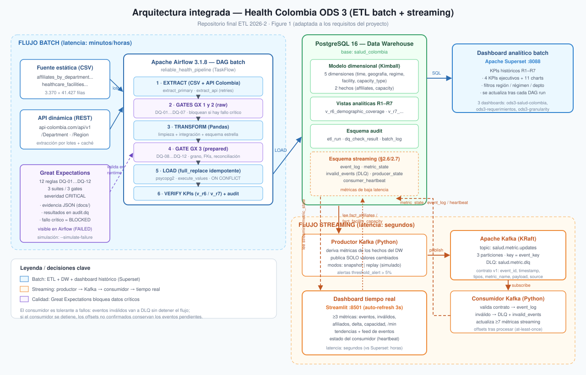
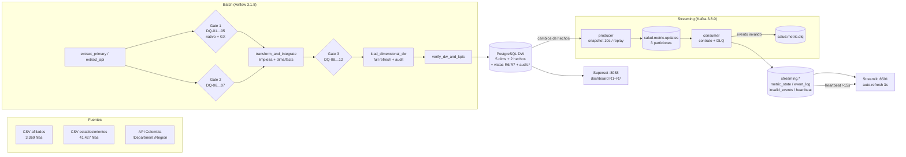
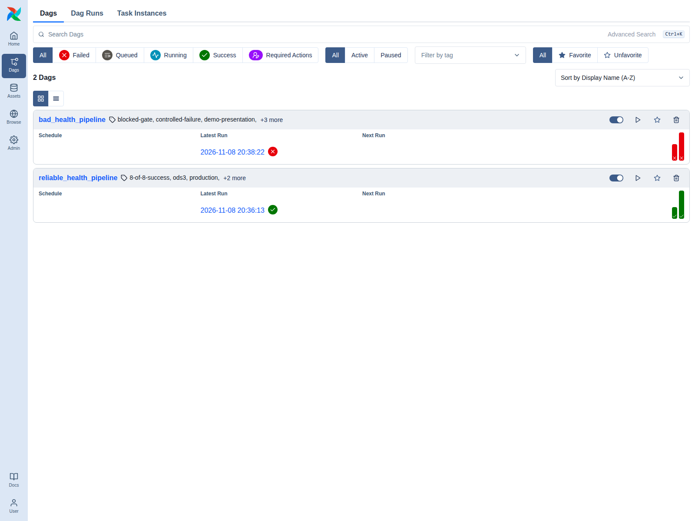
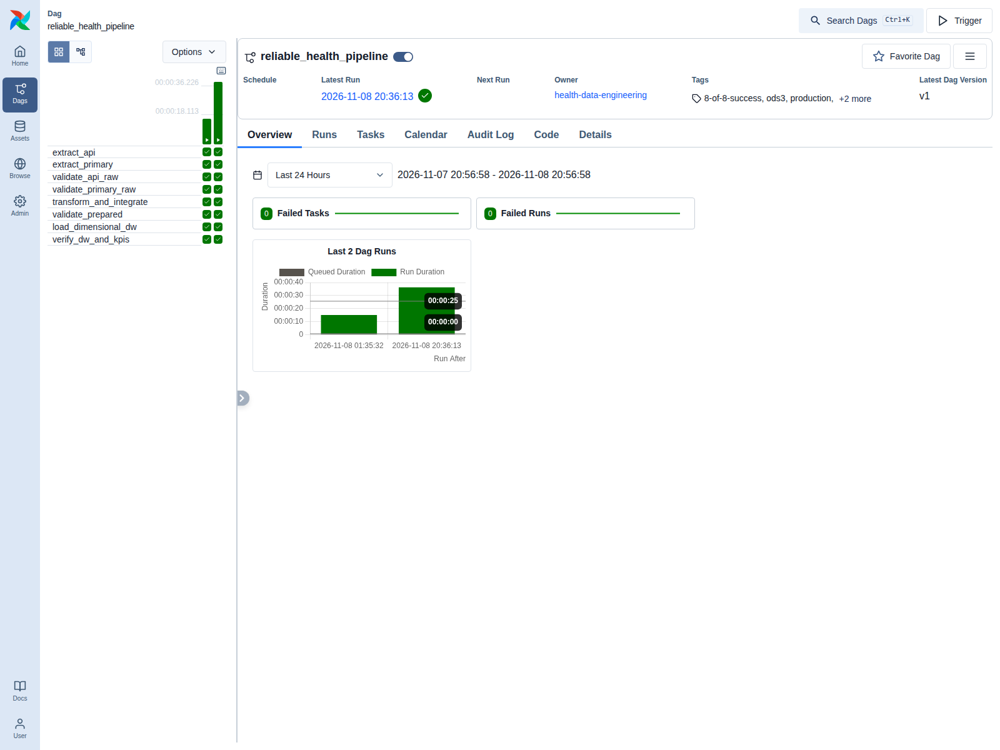
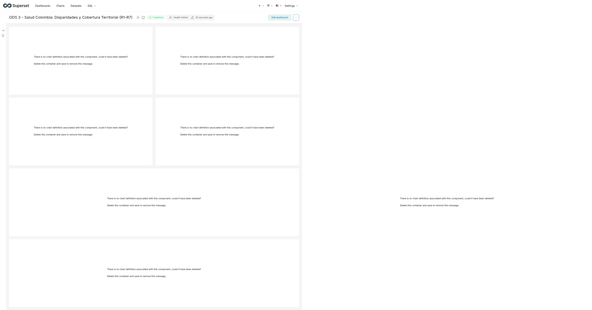
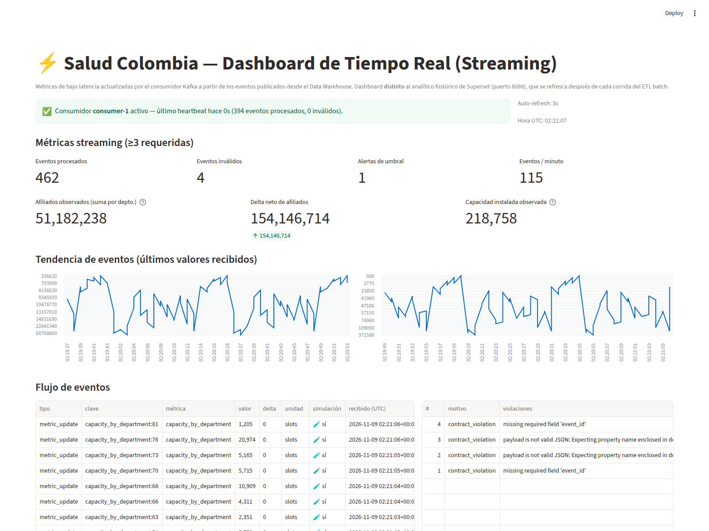
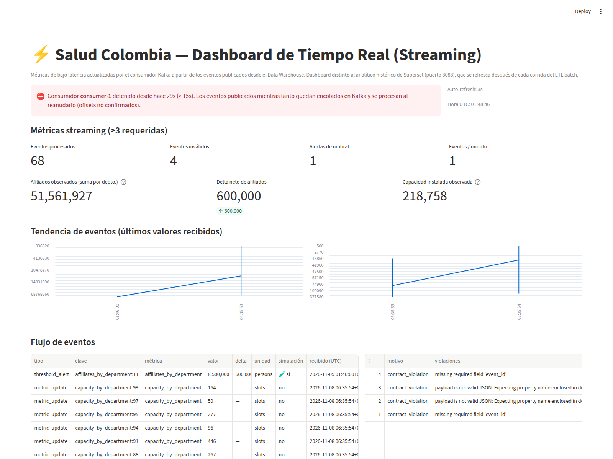
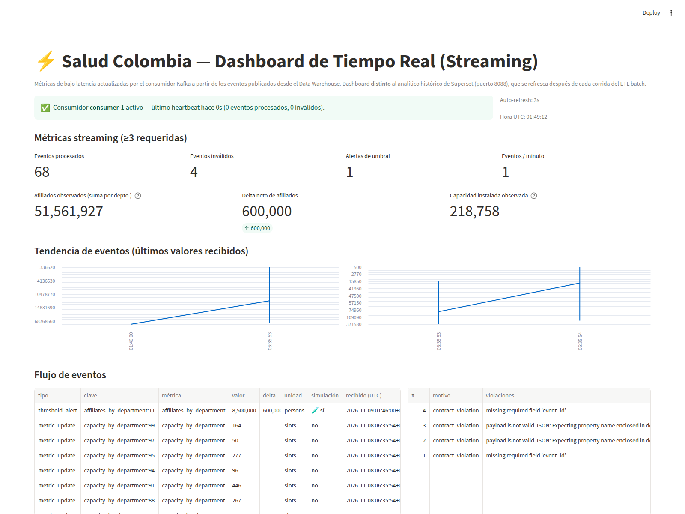

# etl-2026-2-ods3-salud-api-gx-airflow-streaming-kafka-

> 📄 **Versión en inglés:** [README.md](README.md) · Esta documentación en español: `README_ES.md`

**Health Colombia — ODS 3 (Salud y bienestar):** proyecto ETL batch + streaming integrado.
Ingesta de datasets estáticos y de una API dinámica, ETL orquestado con **Apache Airflow**,
validación de calidad con **Great Expectations**, **Data Warehouse dimensional** en PostgreSQL,
analítica histórica en **Apache Superset**, y un pipeline de **Kafka** con productor/consumidor,
contrato de eventos y dashboard de **tiempo real en Streamlit**.

| Componente | Tecnología | URL / puerto |
|---|---|---|
| Data Warehouse | PostgreSQL 16.15 | `localhost:5432` (`salud_colombia`) |
| Orquestación batch | Apache Airflow 3.1.8 (custom + GX) | <http://localhost:8080> |
| Data Quality | Great Expectations 1.24.1 (dentro de los gates del DAG) | — |
| Dashboard histórico | Apache Superset 6.1.0 | <http://localhost:8088> |
| Streaming | Apache Kafka 3.8.0 (1 broker) | `localhost:19092` (host) / `kafka:9092` (interno) |
| Dashboard tiempo real | Streamlit | <http://localhost:8501> |
| API REST sobre el DW | PostgREST | <http://localhost:3000> |
| Tests | pytest (123 tests) | `pytest -q` |

**Índice**

1. [Project Overview and Objectives](#1-project-overview-and-objectives--descripción-general-y-objetivos)
2. [Data Sources and EDA](#2-data-sources-and-eda--fuentes-de-datos-y-eda)
3. [System Architecture](#3-system-architecture--arquitectura-del-sistema)
4. [Batch ETL Pipeline](#4-batch-etl-pipeline--pipeline-etl-batch)
5. [Data Quality](#5-data-quality--calidad-de-datos-great-expectations)
6. [Data Warehouse](#6-data-warehouse--almacén-de-datos-dimensional)
7. [Batch Analytical Dashboard](#7-batch-analytical-dashboard--dashboard-analítico-batch-superset)
8. [Streaming Pipeline](#8-streaming-pipeline--pipeline-de-streaming-kafka)
9. [Real-Time Dashboard](#9-real-time-dashboard--dashboard-de-tiempo-real-streamlit)
10. [Execution and Reproducibility](#10-execution-and-reproducibility--ejecución-y-reproducibilidad)
11. [Functional Evidence](#11-functional-evidence--evidencia-funcional)
12. [Engineering Decisions and Limitations](#12-engineering-decisions-and-limitations--decisiones-de-ingeniería-y-limitaciones)

---

## 1. Project Overview and Objectives — Descripción general y objetivos

**Problema.** Colombia publica información del Sistema General de Seguridad Social en Salud
(afiliados por departamento/municipio/régimen) y de la infraestructura habilitada
(establecimientos, camas, salas) en cortes estáticos, mientras que la información demográfica
oficial (población, superficie por departamento) vive en una API. Los tomadores de decisión del
ODS 3 necesitan (a) una base histórica confiable y auditada para analítica, y (b) indicadores
**en vivo** de afiliación y capacidad instalada con latencia de segundos para detectar cambios
relevantes.

**Objetivos refinados**

1. Construir un ETL batch reproducible orquestado con Airflow que extraiga las dos fuentes
   estáticas y la API, limpie/integre los datos y cargue un **Data Warehouse dimensional**.
2. Aplicar **12 reglas de calidad CRÍTICAS** implementadas con Great Expectations (y verificadas
   con validación nativa) de modo que un dato inválido **nunca** llegue al DW y la falla sea
   visible en Airflow.
3. Proveer un **dashboard analítico histórico** (Superset) con KPIs y requisitos R1–R7.
4. Implementar un pipeline de **streaming en Kafka** (productor + consumidor + contrato de
   eventos) que publique **solo cambios reales** de métricas derivadas del DW y mantenga al
   menos 3 métricas de streaming actualizadas.
5. Construir un **dashboard de tiempo real** (Streamlit) distinto del histórico, con detección
   de caída del consumidor.
6. Dejar **evidencia real de ejecución** (corridas, logs, screenshots, experimentos de evento
   inválido e interrupción del consumidor) dentro de este repositorio.

**Batch vs. streaming (requisitos diferenciados)**

| | Batch (secciones 2.4–2.5) | Streaming (secciones 2.6–2.7) |
|---|---|---|
| Disparador | Corrida manual del DAG (o `src.etl_main`) | Productor continuo cada 10 s + replay de histórico |
| Latencia | Minutos (duración de la corrida ≈ 26 s) | Segundos (publicación → consumidor → dashboard ≈ 1–3 s) |
| Almacenamiento | Dimensiones/hechos + vistas en PostgreSQL | `streaming.*` (event_log, metric_state, invalid_events, heartbeat) |
| Consumidor humano | Superset (`:8088`), consultas históricas | Streamlit (`:8501`), auto-refresh cada 3 s |
| Valor de baja latencia | — | Alertas de umbral (`threshold_alert`) y monitoreo de afiliación/capacidad sin esperar la próxima corrida batch |

---

## 2. Data Sources and EDA — Fuentes de datos y EDA

### 2.1 Fuentes

| Fuente | Tipo | Contenido | Ruta / endpoint |
|---|---|---|---|
| Afiliados al SGSSS | CSV estático (corte 2026-09-06) | 3,369 filas × 8 columnas: departamento, municipio, régimen, año, mes, num_personas | `data/raw/affiliates_by_department_municipality_regime_20260906.csv` |
| Establecimientos (REPS) | CSV estático (corte 2026-09-06) | 41,427 filas × ~24 columnas: prestador, naturaleza, nivel de atención, capacidad instalada (camas/salas/consultorios…) | `data/raw/healthcare_facilities_by_level_capacity_20260906.csv` |
| API Colombia | API REST dinámica | Departamentos y regiones con población oficial, superficie y códigos DANE → enriquece `dim_geografia` y alimenta R6/R7 | `https://api-colombia.com/api/v1` (`/Department`, `/Region`) |

El productor de la API (`src/api_extract.py`) hace la llamada con timeout de 15 s y **guarda un
caché JSON** en `data/raw/`; si la API no responde, cae al caché (`source=fallback_cache`) y la
corrida batch sigue siendo reproducible. Los snapshots crudos quedan versionados en el repo.

**¿Por qué los eventos de streaming se generan aparte?** El CSV/API solo cambian cuando se
publica un nuevo corte (batch, baja frecuencia), pero el negocio necesita observar **cambios de
métricas** (afiliados por departamento, capacidad instalada) con latencia de segundos. Por eso el
productor Kafka deriva eventos de las **tablas de hechos del DW** (no de los CSV crudos) y solo
publica cuando un valor **cambia** respecto a su último estado publicado (modo `snapshot`,
chequeo cada 10 s), o replaya el histórico claramente identificado como simulación (modo
`replay`). El detalle está en la [sección 8](#8-streaming-pipeline--pipeline-de-streaming-kafka).

### 2.2 EDA (notebook)

Notebook: [`notebooks/01_data_validation_cleanup.ipynb`](notebooks/01_data_validation_cleanup.ipynb)
(perfilado, visualización de distribuciones, duplicados, nulos, limpieza y validación final).

**Hallazgos principales (outputs reales del notebook):**

| Hallazgo | Observación | Decisión que motivó |
|---|---|---|
| `NumPersonas` es `object` con separador de miles español (`'2.194'`) | no es numérico en crudo | limpieza `str.replace('.','')` → `to_numeric` → `int`; descarte de filas `<= 0` → regla **DQ-03** |
| Afiliados: **0 nulos, 0 duplicados**, 3,369 filas | fuente limpia en completitud | reglas de esquema/grano (**DQ-01, DQ-09**) en lugar de limpieza agresiva |
| Regímenes: conjunto cerrado `S` 1,124 / `C` 1,122 / `E` 1,115 / `I` 8 | pocos valores posibles | mapeo a `SUBSIDIZED/CONTRIBUTORY/SPECIAL/INDIVIDUAL` y **DQ-02** (`expect_column_values_to_be_in_set`) |
| Establecimientos: **3,145 duplicados (7.59%)** y **26,958 nulos** | los nulos están SOLO en columnas opcionales: `num nivel atencion` 60.99%, `Teléfono` 3.16%, `Gerente` 0.54%, `Email` 0.16%; identidad/capacidad = 0 nulos | `drop_duplicates()` + **DQ-04** con umbral ≥ 99.5% sobre atributos esenciales (no 100% global) |
| `nit IPS` con separadores (`890,980,643`) | basura en clave | limpieza de comas antes de construir `dim_facility` |
| Nombres de departamento heterogéneos: `VALLE` (126 filas), `SAN ANDRES`, `NO APLICA`; distritos especiales como departamento (`CARTAGENA` ×3, `SANTA MARTA` ×3) | cruce CSV ↔ API fallaría sin normalizar | `DEPT_NORMALIZE`, `DISTRICT_TO_DEPT`, `REGION_MAP` (`src/config.py`) → `dim_geografia` única (conforme) → **DQ-08** (≥ 95% de cruce) |

La sección **§9 del notebook** documenta el mapeo completo *hallazgo EDA → limpieza → regla
DQ-01…DQ-12 → expectativa GX*. Todos los outputs del notebook están ejecutados en el repo.

---

## 3. System Architecture — Arquitectura del sistema





**Flujo batch:** CSV/API → extracción cruda → *gates* de validación (nativo **y** Great
Expectations) → transformación e integración → segundo gate → carga al DW (full refresh
idempotente + auditoría) → verificación de KPIs. Un gate fallido detiene el DAG antes de tocar el
DW.

**Flujo streaming:** el productor observa los hechos del DW y publica eventos al tópico
`salud.metric.updates`; el consumidor valida el contrato, actualiza las métricas en
`streaming.*` y escribe el heartbeat; Streamlit lee esas tablas cada 3 s. Los eventos inválidos
van a la tabla `streaming.invalid_events` **y** al tópico DLQ `salud.metric.dlq`.

**Servicios (`docker-compose.yml`)**

| Servicio | Imagen / build | Puerto host |
|---|---|---|
| `postgres` (DW + metadatos streaming) | `postgres:16` | 5432 |
| `postgrest` | `postgrest/postgrest` | 3000 |
| `kafka` | `apache/kafka:3.8.0` | 19092 → 9092 |
| `airflow-webserver` / `scheduler` / `dag-processor` / `airflow-init` | `Dockerfile.airflow` → `localhost/health-airflow:3.1.8` | 8080 |
| `superset` / `superset-init` / `superset-bootstrap` | `Dockerfile.superset` → `apache/superset:6.1.0` | 8088 |
| `etl` (ETL manual) | `Dockerfile` → `python:3.11-slim` | — |
| `streaming-producer` / `streaming-consumer` | `Dockerfile` | — |
| `realtime-dashboard` | `Dockerfile` + Streamlit | 8501 |

---

## 4. Batch ETL Pipeline — Pipeline ETL batch

### 4.1 DAGs

| DAG | Propósito | Schedule |
|---|---|---|
| `reliable_health_pipeline` | **Test A** — pipeline productivo completo (8/8 tareas) | manual (`schedule=None`, `catchup=False`) |
| `bad_health_pipeline` | **Test B** — demostración controlada de falla: inyecta `regime_id='INVALID_Z'` para probar el bloqueo en Gate 1 | manual |

Ambos comparten la estructura de `create_health_pipeline()` en
[`dags/reliable_health_pipeline.py`](dags/reliable_health_pipeline.py) /
[`dags/bad_health_pipeline.py`](dags/bad_health_pipeline.py).

### 4.2 Secuencia de ejecución (8 tareas)

```text
extract_primary ─────────────► validate_primary_raw (Gate 1: DQ-01…05) ─┐
      │                                                                  │
extract_api ─────────────────► validate_api_raw   (Gate 2: DQ-06…07) ──┤
                                                                       ▼
                                    transform_and_integrate (limpieza, dims, hechos,
                                                             integración CSV↔API)
                                                                       │
                                    validate_prepared (Gate 3: DQ-08…12)
                                                                       │
                                    load_dimensional_dw (full refresh + inserts + audit)
                                                                       │
                                    verify_dw_and_kpis (conteos, totales, cierre audit)
```

1. **extract_primary** — lee los 2 CSV crudos, registra conteos en `audit.etl_run_step`.
2. **extract_api** — llama a `api-colombia.com` (o caché) y deja departamentos/regiones en JSON.
3. **validate_primary_raw** — **Gate 1**: DQ-01…DQ-05 con validación nativa *y* GX
   (suites `primary_raw_affiliates_schema`, `primary_raw_affiliates_measures`,
   `primary_raw_facilities` → 11 expectativas).
4. **validate_api_raw** — **Gate 2**: DQ-06…DQ-07 (suite `api_raw_departments` → 4 expectativas).
5. **transform_and_integrate** — limpieza (§2.2), construcción de `dim_time`, `dim_geografia`,
   `dim_regime`, `dim_facility`, `dim_capacity_type`, `fact_affiliates`,
   `fact_facility_capacity` y cruce CSV↔API (prepara la tasa de resolución de departamentos).
6. **validate_prepared** — **Gate 3**: DQ-08…DQ-12 — tasa de cruce CSV↔API ≥ 95% (DQ-08),
   grano único (DQ-09/DQ-10), integridad referencial (DQ-11) y conciliación de sumas
   (DQ-12); suites GX `prepared_fact_affiliates` + `prepared_fact_capacity` → 10 expectativas.
7. **load_dimensional_dw** — `sql/init.sql` (reset idempotente del esquema dimensional,
   **sin tocar `audit.*`**) + `INSERT … ON CONFLICT DO NOTHING` con `batch_id` por corrida.
8. **verify_dw_and_kpis** — recount de dimensiones/hechos, totales de afiliados/camas y
   cierre del run en `audit.etl_run` (`SUCCESS` / `BLOCKED_QUALITY` / `FAILED`).

También existe el ETL batch **manual** (mismo código fuera de Airflow):

```bash
podman-compose run --rm etl python -m src.etl_main
```

### 4.3 Evidencia de ejecución (Test A / Test B)

- **Test A** `reliable_health_pipeline` → run_id
  `manual__2026-11-09T01:36:13.429328+00:00`: **8/8 tareas en `success`**,
  auditoría `SUCCESS` con **12/12 reglas DQ**, GX **11/11 + 4/4 + 10/10 expectativas**,
  duración ≈ 26 s. Logs de los gates:
  `"[...] Validation Gate passed successfully (GX 11/11 expectations)"` (ver §11).
- **Test B** `bad_health_pipeline` → run_id
  `manual__2026-11-09T01:38:22.905052+00:00`: **`failed`** — `validate_primary_raw` falla
  (DQ-02 detecta `INVALID_Z` en nativo *y* en GX: 10/11), 3 tareas `success`,
  4 `upstream_failed`, auditoría **`BLOCKED_QUALITY` 4/5**. El DW **no** se modifica.





---

## 5. Data Quality — Calidad de datos (Great Expectations)

### 5.1 Catálogo de reglas (12, todas CRÍTICAS)

Fuente: [`src/quality/rules.py`](src/quality/rules.py); ejecutadas por
[`src/quality/gx_validator.py`](src/quality/gx_validator.py) en los 3 gates.

| Regla | Capa | Regla de negocio | Umbral | Expectativa GX |
|---|---|---|---|---|
| DQ-01 | raw_affiliates | 8 columnas obligatorias presentes | 100% | `expect_table_columns_to_match_set` |
| DQ-02 | raw_affiliates | `regime_id ∈ {S,C,E,I}` | 100% | `expect_column_values_to_be_in_set` |
| DQ-03 | raw_affiliates | `num_persons` numérico y ≥ 0 | 100% | `expect_column_values_to_be_between` |
| DQ-04 | raw_facilities | atributos esenciales de identidad/capacidad no nulos | ≥ 99.5% | `expect_column_values_to_not_be_null` |
| DQ-05 | raw_facilities | capacidad instalada ≥ 0 | 100% | `expect_column_values_to_be_between` |
| DQ-06 | raw_api_departments | nombre + id obligatorios | 100% | `expect_column_values_to_not_be_null` |
| DQ-07 | raw_api_departments | población y superficie > 0 | 100% | `expect_column_values_to_be_between` |
| DQ-08 | integration_gate | ≥ 95% de departamentos CSV resueltos en la API | ≥ 95% | `expect_integration_key_match_rate` |
| DQ-09 | prepared_fact_affiliates | grano `(sk_time, sk_geografia, sk_regime)` único | 100% | `expect_compound_columns_to_be_unique` |
| DQ-10 | prepared_fact_capacity | grano `(sk_time, sk_facility, sk_capacity_type)` único | 100% | `expect_compound_columns_to_be_unique` |
| DQ-11 | prepared_facts | cero huérfanos en las FK de los hechos | 100% | `expect_foreign_keys_to_exist_in_dimensions` |
| DQ-12 | prepared_facts | suma de afiliados concilia con el crudo | error < 0.01% | `expect_sum_reconciliation` |

### 5.2 Integración real de Great Expectations 1.24.1

[`src/quality/gx_backend.py`](src/quality/gx_backend.py) construye, para cada gate:

1. **Suites por DataFrame** (para no contaminar `column_set` con columnas derivadas):
   `primary_raw_affiliates_schema`, `primary_raw_affiliates_measures`, `primary_raw_facilities`,
   `api_raw_departments`, `prepared_fact_affiliates`, `prepared_fact_capacity`.
2. Un `DataContext` **efímero** (sin escritura de artefactos en disco), un `ExpectationSuite` y
   una `ValidationDefinition` por suite, ejecutados con `gx.data_asset.validate(...)`.
3. Serialización del resultado dentro del reporte de calidad:
   `report["gx"] = {available, version, suites[], expectations_passed/total, failed_rules}` y
   `evaluations[].details.gx` → persistido en `audit.dq_check_result.observed_value`.

**Combinación conservadora (AND):** cada regla se evalúa con su implementación nativa (pandas)
**y**, cuando existe la expectativa GX equivalente, también con Great Expectations; el gate solo
pasa si **ambas** aprueban. 11 de las 12 reglas tienen expectativa GX (DQ-08, una tasa de
cruce ≥ 95%, se calcula nativamente). Si GX no está instalado, `gx_backend` degrada
documentadamente a validación nativa (`available=false`) sin romper el DAG.

### 5.3 Comportamiento ante falla crítica

`CriticalQualityError` → la tarea de validación **falla** en Airflow (roja), las tareas
dependientes quedan `upstream_failed`, el DAG termina `failed`, `audit.etl_run` queda en
**`BLOCKED_QUALITY`** y **el DW no se carga**. Los detalles (regla, valores observados, fallos GX)
quedan en `audit.dq_check_result` y en los JSONs de evidencia.

### 5.4 Evidencia GX

| Archivo | Gate | Resultado |
|---|---|---|
| [`docs/evidence/gx/primary_raw_results.json`](docs/evidence/gx/primary_raw_results.json) | Gate 1 | 5/5 reglas · GX **11/11** expectativas (3 suites) · `available=true v=1.24.1` |
| [`docs/evidence/gx/api_raw_results.json`](docs/evidence/gx/api_raw_results.json) | Gate 2 | 2/2 reglas · GX **4/4** expectativas |
| [`docs/evidence/gx/prepared_results.json`](docs/evidence/gx/prepared_results.json) | Gate 3 | 5/5 reglas · GX **10/10** expectativas (incluye DQ-12) |

En el **Test B** el mismo JSON muestra `DQ-02 → FAIL` con
`gx: {failed: 1, failed_expectations: ['expect_column_values_to_be_in_set(regime_id)']}` —
es decir, el detector GX y el nativo coinciden en la falla (10/11 expectativas).

---

## 6. Data Warehouse — Almacén de datos dimensional

Metodología **Kimball** (grano declarado, dimensiones conformadas, hechos por separado).
Definición completa en [`sql/init.sql`](sql/init.sql); datos en
[`docs/evidence/dw/dimensional_dw_state.log`](docs/evidence/dw/dimensional_dw_state.log).

### 6.1 Dimensiones (`public`)

| Tabla | Filas | Contenido / grano |
|---|---|---|
| `dim_time` | 2 | periodos de los hechos: **2022-Q2** (afiliados) y **2022-Q4** (capacidad); año, mes, trimestre, semestre |
| `dim_geografia` | 2,240 | **dimensión conforme única**: municipio + departamento + región DANE **y** enriquecimiento de la API (capital, superficie, población) |
| `dim_regime` | 4 | `SUBSIDIZED / CONTRIBUTORY / SPECIAL / INDIVIDUAL` |
| `dim_facility` | 10,921 | prestadores/establecimientos (código, nombre, NIT, naturaleza, nivel) |
| `dim_capacity_type` | 63 | tipos de capacidad (camas, salas, consultorios, ambulancias…) |

### 6.2 Hechos (`public`)

| Hecho | Grano | Filas | Total |
|---|---|---|---|
| `fact_affiliates` | periodo × geografía × régimen (snapshot 2022-Q2) | 3,369 | **51,182,238** afiliados |
| `fact_facility_capacity` | periodo × establecimiento × tipo de capacidad × geografía (snapshot 2022-Q4) | 31,496 | **218,758** unidades de capacidad |

Todas las FK tienen restricción `REFERENCES` verificable (integridad referencial real; DQ-11
además la valida en cada corrida).

### 6.3 Vistas analíticas (alimentan Superset)

| Vista | Filas | Uso |
|---|---|---|
| `v_affiliates_summary` | — | R1, R2, R5 |
| `v_facility_summary` | 31,496 | R3 |
| `v_r6_demographic_coverage` | 33 | R6 — cobertura de afiliación vs. población oficial, categoría |
| `v_r7_territorial_capacity` | 33 | R7 — camas/1000 hab, capacidad/km², nivel de alerta |

### 6.4 Esquema `audit.*` (trazabilidad)

| Tabla | Filas | Contenido |
|---|---|---|
| `audit.etl_run` | 4 | una fila por corrida: `run_key`, `dag_id`, `status` (`SUCCESS`/`BLOCKED_QUALITY`/`FAILED`), duración, `dq_rules_passed/total` |
| `audit.etl_run_step` | 14 | pasos (extract/validate/transform/load/verify) con `rows_in/out` y estado |
| `audit.dq_check_result` | 34 | **resultado por regla DQ** con severidad, estado, valor observado y el subobjeto `gx` |
| `audit.etl_batch_log` | 2 | lotes de carga con conteos antes/después (`batch_id` referenciado por los hechos) |

### 6.5 Estrategia de carga

1. **Full refresh idempotente:** `sql/init.sql` hace `DROP … IF EXISTS` + `CREATE` de
   dimensiones, hechos y vistas; las tablas `audit.*` usan `CREATE TABLE IF NOT EXISTS` y **nunca
   se eliminan** (el historial de corridas sobrevive a cualquier reset).
2. **Bulk insert** con `psycopg2.extras.execute_values` y `ON CONFLICT DO NOTHING`
   (re-ejecución sin duplicados).
3. **Auditoría por corrida:** `batch_id` con conteos antes/después; cualquier excepción hace
   `rollback` y deja `FAILED` en `audit.etl_batch_log`.

---

## 7. Batch Analytical Dashboard — Dashboard analítico batch (Superset)

**Herramienta:** Apache Superset 6.1.0 → <http://localhost:8088> (login `admin/admin` en
desarrollo local). **Conexión:** URI SQLAlchemy al DW PostgreSQL registrada por
[`scripts/superset_bootstrap.py`](scripts/superset_bootstrap.py); **7 datasets**
(`v_affiliates_summary`, `v_facility_summary`, `v_r6_demographic_coverage`,
`v_r7_territorial_capacity`, `fact_affiliates`, `fact_facility_capacity`, `dim_geografia`).
Dashboard: **`ods3-salud-colombia`**
(<http://localhost:8088/superset/dashboard/ods3-salud-colombia/>), gráficas creadas por
[`scripts/superset_charts_bootstrap.py`](scripts/superset_charts_bootstrap.py).

| Chart | Dataset | Pregunta de negocio |
|---|---|---|
| **R1** – Afiliados por Régimen | `v_affiliates_summary` | ¿cuánto pesa cada régimen? (contributivo domina) |
| **R2** – Top 10 Departamentos por Afiliados | `v_affiliates_summary` | ¿dónde se concentra la afiliación? (Bogotá ≈ 6.4 M) |
| **R3** – Establecimientos por Naturaleza | `v_facility_summary` | privada (25,067) vs pública (16,174) vs mixta |
| **R4** – Camas por 1000 Habitantes | `v_r7_territorial_capacity` | dotación relativa (líderes: Cesar 2.83, Amazonas 2.74, Atlántico 2.70) |
| **R5** – Afiliados por Región y Régimen | `v_affiliates_summary` | distribución regional (Andina/Caribe/Pacífico…) |
| **R6** – Cobertura Demográfica por Departamento | `v_r6_demographic_coverage` | afiliados vs población oficial: categorías *Meta Universal Adecuada*, *Alta Concentración/Movilidad* (cov. >100% = movilidad), *Déficit* |
| **R7** – Capacidad Territorial por Departamento | `v_r7_territorial_capacity` | IPS, camas, camas/1000 hab y **nivel de alerta hospitalaria** |

**Insights principales:** la afiliación supera el 100% de la población en departamentos con
movilidad (Risaralda 107.1%, Cundinamarca 105.5%), la región Andina concentra el grueso de
afiliados, y la capacidad hospitalaria es desigual (Cesar/Amazonas/Atlántico en alta, otros en
alerta moderada/crítica) — insights históricos que exigen el DW batch (corte 2022 completo).



---

## 8. Streaming Pipeline — Pipeline de streaming (Kafka)

### 8.1 Productor ([`src/streaming/producer.py`](src/streaming/producer.py))

| Modo | Comportamiento |
|---|---|
| `snapshot` (default, producción) | Cada **10 s** (`STREAMING_PRODUCER_INTERVAL`) consulta los hechos del DW, compara con su último valor publicado (`streaming.producer_state`) y **solo publica lo que cambió** — nunca re-publica un KPI sin cambio (justificación analítica). Si `\|delta\| ≥ 5%` emite además un evento `threshold_alert` (`--alert-threshold 0.05`). |
| `replay` (simulación) | Replaya el histórico del DW a 0.5 s por evento. **Identificado explícitamente** en cada evento: `"source": {"mode": "replay", "simulation": true}`. |

```bash
podman exec streaming_producer_salud python -m src.streaming.producer --mode replay --loop   # simulación
podman exec streaming_producer_salud python -m src.streaming.producer --mode snapshot        # producción
```

**Generación y frecuencia:** eventos derivados de `fact_affiliates` / `fact_facility_capacity`
(agregados por departamento), en promedio 134 eventos por pasada completa, chequeo cada 10 s.
**Valor de baja latencia:** un cambio de afiliación o de capacidad llega al dashboard en
segundos (vs. esperar la próxima corrida batch), habilitando `threshold_alert` casi en tiempo
real para monitoreo del ODS 3.

### 8.2 Tópicos

| Tópico | Particiones | Clave (key) | Uso |
|---|---|---|---|
| `salud.metric.updates` | 3 | `event_key` (ej. `affiliates_by_department:19`) | orden por clave = orden por departamento |
| `salud.metric.dlq` | 1 | `message_key` original | dead-letter de eventos rechazados (creado/asegurado por el consumidor al arrancar) |

Grupo de consumidores: `health-metrics-consumers` (consumer id `consumer-1`).

### 8.3 Contrato de eventos ([`src/streaming/contract.py`](src/streaming/contract.py), `schema_version=1`)

| Campo | Regla |
|---|---|
| `event_id` | **requerido**, UUID v4 string, único por evento (idempotencia: `ON CONFLICT (event_id) DO NOTHING`) |
| `event_type` | **requerido**, `metric_update` \| `threshold_alert` |
| `schema_version` | **requerido**, entero `== 1` |
| `event_key` | **requerido**, string no vacío — es también la **key de Kafka** |
| `timestamp` | **requerido**, ISO-8601 UTC con timezone |
| `metric_name` | **requerido**, string no vacío |
| `payload` | **requerido**, objeto con `metric_name`, `value`, `unit` |
| `source` | opcional, `{"mode": …, "simulation": bool, "batch_id": …}` |

**Validación y comportamiento ante evento inválido:** el consumidor valida tipo, presencia,
rango de `schema_version`, formato de timestamp y esquema de `payload`. Si falla: (1) **rechaza**
el evento (`WARNING INVALID EVENT rejected … errors=[...]`), (2) lo registra en
`streaming.invalid_events` (motivo + errores + payload crudo), (3) incrementa
`invalid_events_total`, (4) lo **re-publica a la DLQ** `salud.metric.dlq`, y (5) **sigue
procesando** (el loop no se cae).

### 8.4 Consumidor y métricas ([`src/streaming/consumer.py`](src/streaming/consumer.py))

Actualiza **7 métricas** en `streaming.metric_state` (mínimo requerido: 3):

| Métrica | Significado |
|---|---|
| `events_processed_total` | eventos válidos procesados |
| `invalid_events_total` | eventos rechazados por contrato |
| `threshold_alerts_total` | alertas de umbral recibidas |
| `events_per_minute` | throughput actual |
| `affiliates_latest_total` | suma de afiliados observados (último valor por depto) |
| `affiliates_net_delta` | delta neto acumulado de afiliados |
| `capacity_latest_total` | capacidad instalada observada |

Además: `streaming.event_log` (histórico de eventos), `streaming.consumer_heartbeat`
(`status`, contadores, `last_heartbeat` ≈ cada 1 s) y `streaming.producer_state` (evita
re-publicar sin cambios).

### 8.5 Evidencia

- [`docs/evidence/streaming/01_contract_violation_and_alert.log`](docs/evidence/streaming/01_contract_violation_and_alert.log)
  — rechazos + enrutado a DLQ + `threshold_alert` procesado.
- [`docs/evidence/streaming/02_dlq_topic_messages.log`](docs/evidence/streaming/02_dlq_topic_messages.log)
  — mensajes reales del tópico DLQ (payload crudo + errores).
- [`docs/evidence/streaming/05_replay_and_topic_listen.log`](docs/evidence/streaming/05_replay_and_topic_listen.log)
  — replay (simulación), escucha raw del tópico (`--listen 5`) y descripción de particiones.

---

## 9. Real-Time Dashboard — Dashboard de tiempo real (Streamlit)

**Herramienta:** Streamlit → <http://localhost:8501> ([`src/streaming/dashboard.py`](src/streaming/dashboard.py),
servicio `realtime-dashboard`).

**Integración consumidor → dashboard:** el consumidor Kafka escribe en PostgreSQL
(`streaming.*`); Streamlit **lee esas tablas directamente con psycopg2 y se auto-refresca cada
3 s** (`st_autorefresh`). No hay websockets: el mecanismo es polling sobre la misma base
transaccional — simple, compatible con la herramienta y suficiente para latencia de segundos.

**Métricas mostradas (≥3 requeridas; se muestran 7):** eventos procesados, eventos inválidos,
alertas de umbral, eventos/minuto, afiliados observados, delta neto de afiliados y capacidad
instalada observada — más series de tendencia, flujo de eventos recientes y la tabla de
violaciones de contrato (DLQ).

**Estado del consumidor (heartbeat):** el consumidor escribe `status='running'` + timestamp
(`clock_timestamp()`) ≈ cada 1 s. El dashboard calcula la edad del heartbeat con el **reloj del
servidor** y muestra:

- `✅ ONLINE` si `status='running'` y edad ≤ **15 s** (`STREAMING_HEARTBEAT_TIMEOUT`);
- `⛔ OFFLINE` si la edad supera 15 s o `status='stopped'` (caída detectada);
- `⚠️ Sin heartbeat` si el consumidor nunca arrancó.

**Distinción con el dashboard histórico**

| | Superset (§7) | Streamlit (§9) |
|---|---|---|
| Datos | DW dimensional (hechos históricos 2022) | tablas `streaming.*` (eventos de segundos) |
| Actualización | al consultar / tras cada corrida ETL | polling cada **3 s** |
| Pregunta | “¿cómo fue el histórico del ODS 3?” | “¿qué está pasando **ahora** y está vivo el consumidor?” |
| Alcance | analítica R1–R7 | KPIs de streaming + salud del pipeline |



---

## 10. Execution and Reproducibility — Ejecución y reproducibilidad

### 10.1 Requisitos

- **Git**; **Python 3.12** (opcional: [Nix](flake.nix) con `nix develop` para el entorno local
  con `uv`, podman, psql y chromium);
- **Podman ≥ 4 + `podman-compose`** (o Docker + `docker compose`, los archivos son estándar);
- ~4 GB de RAM libres para los 11 contenedores;
- Sin dependencias externas de pago: las dos únicas fuentes son CSVs incluidos en el repo y la
  API pública `api-colombia.com` (con caché de respaldo incluido).

### 10.2 Puesta en marcha (paso a paso)

```bash
# 1) Clonar
git clone https://github.com/driosoft-pro/etl-2026-2-ods3-salud-api-gx-airflow-streaming-kafka-.git
cd etl-2026-2-ods3-salud-api-gx-airflow-streaming-kafka-

# 2) Configuración local (NUNCA se commitea .env)
cp .env.example .env

# 3) Login de desarrollo de Airflow (SimpleAuthManager exige el archivo;
#    sin él Airflow genera una contraseña aleatoria)
printf '{"airflow": "airflow"}' > config/simple_auth_manager_passwords.json

# 4) Levantar todo (PostgreSQL, Kafka, Airflow, Superset, streaming, Streamlit)
podman-compose up -d
podman ps   # espera a que todos estén "Up" (postgres/kafka "healthy")

# 5) Bootstrap de Superset: conexión DW + 7 datasets + dashboard
podman-compose --profile bootstrap run --rm superset-bootstrap
#    (nota: si podman-compose "run" recrea algún contenedor, repite: podman-compose up -d)

# 6) Gráficas R1–R7 del dashboard (desde el host)
SUPERSET_URL=http://localhost:8088 python3 scripts/superset_charts_bootstrap.py
```

### 10.3 Ejecutar y verificar el sistema completo

```bash
# --- ETL batch en Airflow (Test A: debe quedar 8/8 success) ---
podman exec airflow_scheduler_salud airflow dags trigger reliable_health_pipeline

# --- Test B: falla controlada (debe quedar failed / BLOCKED_QUALITY) ---
podman exec airflow_scheduler_salud airflow dags trigger bad_health_pipeline

# --- Ver resultados de tareas ---
podman exec airflow_scheduler_salud airflow dags list-runs reliable_health_pipeline -o plain
podman exec airflow_scheduler_salud airflow tasks states-for-dag-run reliable_health_pipeline \
  manual__2026-11-09T01:36:13.429328+00:00 -o plain

# --- ETL batch manual (fuera de Airflow) ---
podman-compose run --rm etl python -m src.etl_main

# --- Tests (123; los de integración hacen skip si la BD no está accesible) ---
pytest -q

# --- Streaming: demos ---
podman exec streaming_producer_salud python -m scripts.streaming_demo --listen 5            # ver eventos raw
podman exec streaming_producer_salud python -m scripts.streaming_demo --inject-invalid      # evento inválido
podman exec streaming_producer_salud python -m scripts.streaming_demo --inject-json-invalid # payload no-JSON
podman exec streaming_producer_salud python -m scripts.streaming_demo --inject-alert        # threshold_alert
podman exec streaming_producer_salud python -m src.streaming.producer --mode replay --loop  # simulación

# --- Experimento: interrupción del consumidor ---
podman stop streaming_consumer_salud   # a los 15 s el dashboard marca OFFLINE
podman start streaming_consumer_salud  # vuelve a ONLINE en segundos

# --- Verificar estado del DW / streaming ---
podman exec -i warehouse_salud psql -U etl_user -d salud_colombia
```

**Checklist de verificación**

1. <http://localhost:8080> → `reliable_health_pipeline` última corrida **verde (success)**;
   logs de los gates con `GX 11/11`, `4/4`, `10/10 expectations`.
2. `audit.etl_run` → última corrida `SUCCESS` `dq_rules=12/12`; Test B → `BLOCKED_QUALITY`.
3. <http://localhost:8088> → dashboard `ods3-salud-colombia` con R1–R7 renderizando.
4. <http://localhost:8501> → banner `✅ Consumidor activo` y métricas cambiando cada 3 s.
5. `pytest -q` → **123 passed**.
6. Evidencia ya capturada disponible en [`docs/evidence/`](docs/evidence/) (§11).

### 10.4 Credenciales

Todo el material sensible vive en `.env` (**gitignorado**); `.env.example` trae placeholders y
valores por defecto **solo de desarrollo local** (servicios escuchando en `localhost`):

| Servicio | Usuario / contraseña por defecto (`.env.example`) |
|---|---|
| PostgreSQL | `etl_user` / `change_me_2026` |
| Airflow | `airflow` / `airflow` (archivo `config/simple_auth_manager_passwords.json`, creado en el paso 3) |
| Superset | `admin` / `admin` |

El repositorio **no contiene** API keys, tokens ni credenciales reales (ver §12).

---

## 11. Functional Evidence — Evidencia funcional

Todo el material está en [`docs/evidence/`](docs/evidence/) y corresponde a ejecuciones reales
del sistema (no capturas de código).

### 11.1 Índice de evidencia

| Requisito | Evidencia |
|---|---|
| Corrida exitosa de Airflow (8/8 + GX) | [`docs/evidence/gx/`](docs/evidence/gx/) · logs de gates en los run logs de Airflow · screenshot `airflow_dag_detail.png` |
| Validación de calidad (nativa + GX) | `primary_raw_results.json` (11/11), `api_raw_results.json` (4/4), `prepared_results.json` (10/10) |
| Falla crítica bloquea el DW | Test B `BLOCKED_QUALITY 4/5` en `audit.etl_run` + screenshot `airflow_dags.png` (corrida roja) |
| Carga del DW (dimensiones/hechos) | [`docs/evidence/dw/dimensional_dw_state.log`](docs/evidence/dw/dimensional_dw_state.log) (conteos, FK, vistas, auditoría) |
| Dashboard batch | [`docs/evidence/screenshots/superset_dashboard.png`](docs/evidence/screenshots/superset_dashboard.png) |
| Productor/consumidor Kafka | [`01_contract_violation_and_alert.log`](docs/evidence/streaming/01_contract_violation_and_alert.log), [`05_replay_and_topic_listen.log`](docs/evidence/streaming/05_replay_and_topic_listen.log) |
| Métricas de streaming actualizadas | [`03_database_state.log`](docs/evidence/streaming/03_database_state.log) (`metric_state`: 7 métricas) + screenshot `streamlit_realtime.png` |
| Dashboard tiempo real | `streamlit_realtime.png` (ONLINE) |
| **Experimento: evento inválido** | §11.2 + `01_…log`, `02_dlq_topic_messages.log`, `03_…log` |
| **Experimento: interrupción del consumidor** | §11.3 + `04_consumer_interruption.log` + screenshots offline/recuperado |

### 11.2 Experimento 1 — evento inválido (violación de contrato)

```bash
podman exec streaming_producer_salud python -m scripts.streaming_demo --inject-invalid
podman exec streaming_producer_salud python -m scripts.streaming_demo --inject-json-invalid
```

**Comportamiento observado** (logs reales):

```text
WARNING streaming.consumer: INVALID EVENT rejected (1 errors): {"event_type": "metric_update",
  "schema_version": 999, "event_key": "", "timestamp": "not-a-date", ...}
  | errors=["missing required field 'event_id'"]
INFO    streaming.consumer: event routed to DLQ topic=salud.metric.dlq key=demo:invalid
WARNING streaming.consumer: INVALID EVENT rejected (1 errors): {{{not-json!!
  | errors=['payload is not valid JSON: ...']
INFO    streaming.consumer: event routed to DLQ topic=salud.metric.dlq key=demo:garbage
```

Resultado en base de datos: **4** filas en `streaming.invalid_events` (2 `contract_violation`,
2 `payload is not valid JSON`), `invalid_events_total = 4`, `threshold_alerts_total = 1`, el
consumidor **sigue vivo** (`status=running`) y los mensajes quedan en la DLQ (2 payloads crudos
verificables en [`02_dlq_topic_messages.log`](docs/evidence/streaming/02_dlq_topic_messages.log)).

### 11.3 Experimento 2 — interrupción del consumidor

```bash
podman stop streaming_consumer_salud    # SIGTERM → status='stopped'
sleep 20                                # > 15 s sin heartbeat
podman start streaming_consumer_salud   # recuperación
```

**Comportamiento observado** ([`04_consumer_interruption.log`](docs/evidence/streaming/04_consumer_interruption.log)):

| Momento | Heartbeat | Dashboard |
|---|---|---|
| Normal | `status=running … hace=0s` | `✅ Consumidor consumer-1 activo` |
| Caído (20 s) | `status=stopped … hace=20s (>15s = OFFLINE)` | `⛔ Consumidor detenido desde hace 29s (>15s)` (banner rojo) |
| Recuperado | `status=running … hace=1s` | `✅` de nuevo en ~1 s |





**Limitaciones observadas:** durante la caída los eventos siguen en el tópico (Kafka retiene
mensajes), pero **no se procesan ni llegan al dashboard** hasta que el consumidor vuelve
(latencia de recuperación = tiempo de `start` + rejoin del grupo ≈ 1 s); el heartbeat es
best-effort (si la máquina muere sin SIGTERM, la detección ocurre por antigüedad > 15 s).

---

## 12. Engineering Decisions and Limitations — Decisiones de ingeniería y limitaciones

### 12.1 Decisiones importantes

1. **Imagen Airflow personalizada (`Dockerfile.airflow`).** La imagen oficial de Airflow no
   trae `great_expectations`; se construye `localhost/health-airflow:3.1.8` instalando
   `requirements.txt` **como usuario `airflow`** (la imagen incluye un guard que aborta si pip
   corre como root; el destino `/home/airflow/.local` es el user-site visible en runtime).
2. **`protobuf>=5.26.1,<7` en `requirements.txt`.** Streamlit acepta protobuf 7.x pero los
   providers de Google/opentelemetry embebidos en Airflow requieren `<7`; el pin evita romper
   el webserver/scheduler.
3. **Great Expectations efímero, sin artefactos en disco.** `DataContext` temporal +
   `ExpectationSuite` + `ValidationDefinition` por suite; los resultados se serializan en
   `audit.dq_check_result` y en los JSONs de evidencia (traceabilidad sin suciedad en el repo).
4. **Suites separadas por DataFrame** (crudo sin columnas derivadas) para que
   `expect_table_columns_to_match_set` (DQ-01) no se contamine con columnas de transformación.
5. **Combinación conservadora AND (nativo ∧ GX).** Los dos motores deben coincidir en el
   veredicto; GX ausente degrada a nativo con `available=false` documentado (el DAG nunca se
   rompe por falta del paquete, pero la calidad sigue garantizada).
6. **`kafka-python>=2.2.2,<3.0`.** La 3.x renombra/elimina `kafka.errors.NoBrokersAvailable`
   usada por el manejo de reintentos.
7. **DLQ asegurada al arrancar el consumidor** (`_ensure_dlq_topic`): el auto-creado tardío de
   Kafka hizo perder el primer publish (bug encontrado en la demostración y corregido — ver
   logs `Topic salud.metric.dlq not found` en la primera iteración). Hoy el consumidor crea el
   tópico si falta y hace `key_serializer` explícito en el productor DLQ.
8. **Heartbeat con `clock_timestamp()`** (no `now()`, que se congela en la transacción): la
   primera versión del dashboard mostraba un heartbeat que nunca envejecía.
9. **Replay identificado como simulación** en el propio evento (`source.simulation=true`), como
   exige el enunciado, y modo `snapshot` que **solo publica cambios reales** (sin spam de KPIs
   idénticos).
10. **DAGs con `schedule=None` + `catchup=False`** para evidencia determinista (corridas
    manuales con `run_id` verificable); el orquestador no depende de relojes de sistema.
11. **Superset como BI** (open source, SQL nativo sobre el DW) y **Streamlit** para tiempo
    real (mismo lenguaje Python del pipeline, polling simple sobre PostgreSQL).
12. **Credenciales solo por variables de entorno.** `src/config.py` y los scripts de bootstrap
    leen `DB_PASSWORD`/`POSTGRES_PASSWORD` del entorno; los literales de contraseña fueron
    eliminados del código (el fallback es el placeholder `change_me_2026` de `.env.example`).

### 12.2 Supuestos

- Los CSVs incluidos son el corte oficial (2026-09-06) y la API de Colombia responde o hay
  caché (fallback incluido).
- Los hechos son snapshots (2022-Q2 afiliados, 2022-Q4 capacidad): `dim_time` tiene 2 periodos
  porque las fuentes solo contienen esos cortes.
- Credenciales y puertos son de **desarrollo local**; para cualquier otro entorno se cambian
  por `.env` (no por editar código).

### 12.3 Limitaciones conocidas

- **Kafka single-broker** (`replication_factor=1`), sin TLS/auth: aceptable para la demo, no
  para producción. El DLQ y el tópico principal no tienen retención extendida configurada.
- **Semántica at-least-once** en el consumidor (sin transacciones Kafka): el `event_log` es
  idempotente por `event_id` (`ON CONFLICT DO NOTHING`), pero un reentrego puede recontar
  `events_processed_total`.
- **Polling de 3 s** en el dashboard tiempo real (sin websockets/SSE): la latencia real
  dashboard≈ 0–3 s además de la latencia de proceso.
- **El heartbeat es best-effort:** una caída abrupta (kill -9, red) se detecta por antigüedad
  (>15 s), no por un estado `stopped` explícito.
- **`ON CONFLICT DO NOTHING` en la carga** significa que una re-ejecución no actualiza filas
  existentes: el modelo se recarga con *full refresh* (`sql/init.sql`) para garantizar
  consistencia; el historial de auditoría sí es preservado.
- **API de terceros:** si `api-colombia.com` está caído y no hay caché, el DAG falla en
  `extract_api` (visible y reintentable; los JSONs cacheados en `data/raw/` minimizan el impacto).
- **Cobertura temporal limitada** por las fuentes (2 periodos) — los KPIs históricos son
  correctos para esos cortes, no para series de largo plazo.

---

## Apéndice — Estructura del repositorio

```text
├── README.md                      # technical documentation (English)
├── README_ES.md                   # esta documentación (español)
├── requirements.txt               # dependencias Python (batch, streaming, GX, tests)
├── docker-compose.yml             # orquestación de los 11 servicios
├── Dockerfile                     # etl / streaming / dashboard tiempo real (python:3.11-slim)
├── Dockerfile.airflow             # Airflow 3.1.8 + Great Expectations (build propio)
├── Dockerfile.superset            # Superset 6.1.0 con scripts de bootstrap
├── flake.nix / flake.lock         # entorno Nix opcional (uv, podman, psql, chromium)
├── .env.example                   # plantilla de configuración (el .env real está gitignorado)
├── .gitignore
├── config/                        # superset_config.py + login de Airflow (gitignorado)
├── dags/                          # reliable_health_pipeline.py (Test A) y bad_health_pipeline.py (Test B)
├── data/
│   ├── raw/                       # CSVs fuente + snapshots JSON de la API
│   └── processed/                 # salidas limpias del notebook
├── diagrams/architecture.svg      # diagrama de arquitectura (§3)
├── doc/                           # enunciado PDF del proyecto final
├── docs/evidence/                 # EVIDENCIA REAL de ejecución (§11)
│   ├── gx/*.json                  # reportes de Great Expectations por gate
│   ├── dw/dimensional_dw_state.log
│   ├── streaming/*.log            # contratos inválidos, DLQ, replay, interrupción
│   └── screenshots/*.png          # Airflow, Superset, Streamlit (online/offline)
├── gx/great_expectations.yml      # configuración GX usada por gx_backend
├── notebooks/01_data_validation_cleanup.ipynb   # EDA + limpieza + §9 EDA→DQ
├── scripts/                       # bootstrap Superset, charts R1–R7, demos de streaming
├── sql/                           # init.sql (modelo dimensional), initdb/ (esquemas), queries
├── src/
│   ├── extract.py / api_extract.py / transform.py / load.py / etl_main.py / audit.py
│   ├── quality/                   # rules.py (12 DQ), gx_validator.py (3 gates), gx_backend.py
│   └── streaming/                 # producer, consumer, contract, store, dashboard
├── tests/                         # 123 tests (unit/integration/data/quality/streaming)
└── visualizations/                # salidas visuales adicionales
```

---

*Proyecto ETL 2026-2 — ODS 3 Salud. Toda la documentación técnica y evidencia de ejecución
reside en este README y en `docs/evidence/`.*
